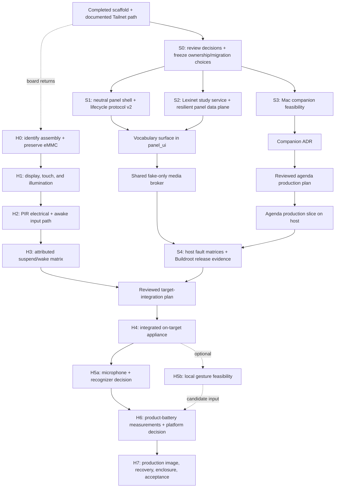

# Plan: Deliver the House Panel End to End

<!-- @canonical end-to-end-development-roadmap -->

**Goal:** turn the current host-tested scaffold into a secure, recoverable,
motion-aware household appliance with a safe display lifecycle, a
Tailnet-backed Lexinet experience, a privacy-bounded personal agenda and
birthday-wish flow, measured power behavior, and a printable enclosure.

**Current execution horizon:** finish all credible board-independent software
and integration evidence, then stop before physical claims until the
development board, display, PIR, microphone, and power hardware are available.

**Amended 2026-09-24:** the BeagleBone Black was lost.
[ADR 0008](../../docs/decisions/0008-adopt-frdm-imx8mplus-and-waveshare-7-inch-dsi-development-platform.md)
replaces it with the FRDM i.MX 8M Plus board and Waveshare 7inch DSI LCD (C).
Wherever this roadmap says the board "returns", read "the FRDM hardware
arrives"; the H-steps need an FRDM baseline plan.

**Amended 2026-09-25:** the FRDM hardware baseline plan
(`2026-09-25-frdm-hardware-baseline.md`) replaces the blocked BeagleBone plan
as Step 10's hardware plan; Step 10's gates and Verify clause are unchanged and
now apply to that plan.

**Role of this plan:** this is the program-ordering authority. It records the
joins, gates, and milestone evidence across the existing detailed plans. It
does not replace their implementation instructions. When a step below invokes
a linked plan, that plan remains authoritative for files, tests, safety rules,
and completion criteria.

**Out of scope:** assuming that the BeagleBone Black is the final product
platform; selecting GPIO pins, display nodes, brightness values, suspend
states, microphone hardware, recognition engines, batteries, or enclosure
dimensions without measurements; treating a Tailnet as application
authorization; enabling real-recipient messaging during a software build.

## Starting point

- The [initial appliance scaffold](2026-08-05-initial-appliance-scaffold.md) is
  complete. It provides host-tested supervisor policy, presence experiments, a
  provisional vocabulary slice, Buildroot integration, and safe build/deploy
  tooling.
- The [Debian Tailnet runbook](2026-08-05-document-debian-tailnet-bringup.md) is
  documented, but it has not been executed on the target.
- The [Lexinet integration plan](2026-08-05-lexinet-study-integration.md) owns
  study semantics, the first shared `panel_ui`, the first shared media broker,
  the resilient vocabulary data plane, and their Buildroot packaging.
- The
  [personal-agenda feasibility plan](2026-08-05-personal-agenda-feasibility.md)
  owns the Mac/provider/Messages/Tailnet experiments and stops at an ADR before
  production implementation.
- ~~The
  [BeagleBone hardware baseline plan](2026-08-05-beaglebone-hardware-baseline.md)
  owns physical identity, eMMC preservation, display, touch, PIR, suspend/wake,
  and power evidence.~~ The
  [FRDM hardware baseline plan](2026-09-25-frdm-hardware-baseline.md) owns
  physical identity, storage preservation, display, touch, backlight, PIR,
  suspend/wake, network recovery, microphone, and board-input power evidence;
  its ordered procedure is `docs/operations/frdm-bringup.md`.
- `BHP_LEXINET_SOURCE_DIR` is the sole host-side input for the populated Lexinet
  checkout. The audit found a clean source checkout at revision `3e15ef6`; the
  originally supplied directory was empty. Cross-repository tooling must not
  infer either workstation path.
- The current macOS host can run compiler-direct panel tests and Swift, but it
  has only Command Line Tools. The signed Mac companion experiment requires a
  full Xcode installation. A complete Buildroot release image requires the
  supported Linux x86_64 build environment; neither limitation requires the
  BeagleBone itself.

## Non-negotiable architecture

- `panel_supervisor` alone owns presence, solar policy, backlight, and suspend.
- ~~One neutral, unprivileged `panel_ui` process owns LVGL, display, and touch.~~
  One neutral, unprivileged `panel_ui` process owns LVGL, display, application
  hit testing, and touch routing. Vocabulary and agenda are sibling feature
  reducers/surfaces, never competing display processes.
- Under proposed ADR 0005, `panel_supervisor` is the sole raw touch-device
  observer and provenance issuer. The broker and personal-context client
  validate one operation-bound observation under distinct exact service
  principals; `panel_ui` cannot author or redeem it.
- One purpose-scoped media broker alone owns the microphone. Command audio
  stays broker-local. Birthday-wish recording is a separate, visible,
  explicitly confirmed purpose.
- One versioned, language-tagged spoken-command catalog owns phrases,
  pronunciation provenance, contexts, effect classes, confusability analysis,
  canonical active command sets, and content-addressed backend projections
  across every application.
- Lexinet remains authoritative for vocabulary content, selection, and durable
  study state. Panel caches and outboxes are bounded and visibly degraded.
- A narrow `personal_context_client` owns the panel's companion credential and
  typed transport. Provider credentials, recipient handles, and Messages
  automation stay on the Mac.
- Tailnet reachability and node identity reduce exposure; application-layer
  authorization, signed single-use requests, replay protection, and
  least-privilege capabilities remain mandatory.
- Hardware observations are evidence for one named assembly and software cell.
  They are never silently promoted into defaults for another board, cape,
  kernel, sensor, microphone, or power chain.

## Dependency map

After S0, the platform/Lexinet lane and the Mac feasibility lane may proceed in
parallel. ~~The neutral shell foundation may start while Lexinet server work is
underway, but the Lexinet plan's Step 7 is not complete until the Step 6 data
plane and vocabulary surface are integrated.~~ Lexinet Step 7a and Steps 1b–6
may proceed in parallel after S0; Step 7b requires both Step 7a and Step 6.
Hardware work never blocks pure domain work, fixtures, protocol tests, fault
injection, packaging, or build automation.

## Work partition

| Work | Start now without the board? | Other prerequisite | Physical evidence still required |
|---|---|---|---|
| Shared contracts and protocol v2 | Yes | Product-decision review | Page-flip/scanout acknowledgement |
| Neutral `panel_ui` and reducers | Yes | Stable lifecycle and intent contracts | DRM/fbdev choice, touch calibration, fonts/colors |
| Lexinet study service and client | Yes | PostgreSQL, explicit Lexinet path, test Tailnet identity for live auth | Target recovery and resource behavior |
| Offline cache/outbox and fault tests | Yes | Contract fixtures | Abrupt-power-loss behavior on final storage |
| Calendar/contact domain and Mac probe | Mostly | Full Xcode, signing identity, local permissions | None for provider feasibility; target UX later |
| Messages feasibility | Mostly | Explicit approval immediately before bounded self/test sends | Real delivery remains manually reconciled |
| Voice intent lifecycle | Yes, with fakes/corpus harness | Stable intent and media-lease contracts | Actual microphone, room, engine, latency, power |
| Optional gesture intent/harness | Yes, after gesture and privacy scope is defined | Consented fixtures and a camera-neutral intent contract | Actual camera, room, model, false actions, latency, power |
| Buildroot packages and image build | Yes | Supported Linux x86_64 host for full image | Boot, drivers, cape compatibility, runtime budget |
| Target network transport and image provisioning (`system_image/` owner) | Generic, credential-free image hooks and dry-run provisioning only | Step 11 binds the exact measured prototype path; Step 14 selects the final transport and radio | Link/radio, driver/firmware, antenna where applicable, DHCP/DNS/time, Tailnet recovery, suspend/resume, power, and recovery evidence for every enabled path |
| Deployment and recovery automation | Yes, dry-run/fake target | Explicit configuration | Actual boot/install/rollback rehearsal |
| PIR, suspend/wake, display, battery | No | Named physical assembly and instruments | Entire work item |
| Enclosure CAD | Preparation only | Measured stack, connectors, airflow, controls | Fit, thermal, radio, assembly, and print trials |

In practical terms, almost all application/domain code, server work, local
protocols, security boundaries, fake hardware adapters, integration harnesses,
service packaging, and release automation can be completed before the board
returns. The unavoidable gaps are device backends and claims about physical
behavior.

## Steps

- [x] **Step 0: Establish the recoverable scaffold**
  - Use the completed scaffold and Tailnet-documentation plans as the baseline;
    do not reconstruct the legacy repositories inside this project.
  - Preserve the current rule that production services and unmeasured hardware
    configuration remain disabled.
  - Verify: both linked completed plans have every checklist item checked and
    `make verify` was recorded as passing at their completion boundary.

- [x] **Step 1: Freeze product decisions and shared contract ownership**
  - ~~Review the five Lexinet semantics in its architecture document.~~
    ~~Review the seven Lexinet semantics, the shared spoken-command-catalog
    decision, and the ten personal-agenda/safety decisions in their architecture
    documents.~~ Execute Lexinet Step 1a at this gate for the seven Lexinet
    semantics and shared spoken-command-catalog decision. At the same gate,
    ~~review the ten personal-agenda/safety decisions in their architecture
    document.~~ Review the eleven personal-agenda/safety decisions in their
    architecture document. Keep `AGENDA-011` pending and deliberately deferred
    to Step 6 after feasibility evidence and ADR review; counting it here does
    not approve either household civil-time contract. Record each other
    decision as accepted, changed, or deliberately deferred,
    including the proposed `finish recording` replacement for the confusable
    requested stop phrase.
    The decision-review portion of personal-agenda feasibility Step 1 joins
    this gate; roadmap Step 5 still owns that step's experiment README, probe
    matrix, bounded limits, redaction evidence, and experiment-specific safety
    review before the feasibility probes begin.
  - Resolve the Lexinet checkout path in configuration; never hard-code an
    incidental sibling layout into cross-repository tests.
  - Record that the Lexinet plan supplies the first neutral shell, shared HTTP
    runtime, shared media broker, and Buildroot migration. The later agenda
    production plan must extend those capabilities instead of creating peers.
  - Allocate an ADR number by scanning `docs/decisions/` on the current target
    branch when the record is created. Immediately before merge, re-scan the
    destination branch and renumber the file and references if a concurrent ADR
    now collides. Pending plans do not reserve numeric filenames.
  - Decide whether lifecycle protocol v2 replaces v1 atomically or has a
    bounded compatibility window. Mixed-version brightness behavior is not
    allowed.
  - Output: reviewed product-decision sections, reconciled plan dependencies,
    an explicit Lexinet source-path input, and a recorded protocol migration
    choice.
  - Verify: Lexinet Step 1a's human-review verification passes, and human review
    confirms the remaining product decisions and safety stop points;
    `make verify-docs` and `make verify` pass with no credentials or personal
    identifiers in the repository.

- [x] **Step 2: Establish the neutral host platform spine**
  - ~~Execute the platform-spine portion of Lexinet Step 7.~~ Execute Lexinet
    Step 7a: introduce
    ~~`panel_ui` as sole display/touch owner~~ `panel_ui` as sole display,
    application-hit-testing, and touch-routing owner; add the ADR 0005
    supervisor observation/provenance ports with host fakes; and add a headless
    renderer, a pure shell controller, namespaced interaction intents, and
    sibling surface contracts. ~~Vocabulary-specific data binding may remain
    pending until Step 3 below.~~ Vocabulary-specific data binding remains owned
    by Step 4 after Step 3 delivers the data plane.
  - Upgrade the local lifecycle protocol to v2. Every request and presentation
    acknowledgement binds the appliance release, unpredictable supervisor
    session, per-connection challenge, monotonic event sequence, complete
    snapshot identity, requested display mode, and render generation. Only the
    exact latest `committed` tuple from the configured Unix peer may precede a
    requested nonzero brightness.
  - Treat stale, duplicate, mismatched, failed, disconnected, or timed-out
    acknowledgements as failure: brightness stays zero. UI failure may prevent
    illumination but must never prevent blanking or suspend.
  - Keep lifecycle modes feature-neutral: `day_active`, `night_red`,
    `suspended`, and `diagnostic`. Feature routing remains in `panel_ui`, not
    `PanelPolicy`.
  - Reuse one canonical set of supervisor clock, presence, solar, backlight,
    suspend, channel, and renderer fakes. Exercise the production codec over a
    real temporary Unix socket or `socketpair`; do not fake serialization.
  - Output: ~~protocol v2 contract, duplex supervisor channel, neutral shell,
    headless renderer, reusable test support, and deterministic lifecycle
    scenarios.~~ Use every Lexinet Step 7a output: protocol v2 contract and
    duplex supervisor channel, intent envelope/registry, neutral shell and
    headless renderer, touch-provenance seams, neutral executable and Buildroot
    entry point, reusable test support, and deterministic lifecycle scenarios.
  - Verify: every exact verification clause in Lexinet Step 7a passes. Host
    tests additionally prove zero-before-render and exact-ack-before-nonzero
    ordering across startup, day/night changes, suspend/resume, supervisor
    restart, stale acknowledgements, UI crash, and timeout;
    `scripts/verification/verify_host_cpp.sh all` and `make verify` pass. This
    is software evidence and does not claim a physically dark display.

- [ ] **Step 3: Build the Lexinet study service and resilient panel data plane**
  - ~~Execute a rating-inert `shuffle_bag_v1` selector as the production
    scheduler.~~ ~~Execute Lexinet plan Steps 1–6 in their recorded order.~~
    Execute Lexinet Step 1b, then Steps 2–6 in their recorded order:
    `study.v1` contract, append-only learning evidence and rebuildable
    projections, active `variety_first_v1` behind the scheduler seam, a
    production-isolated shadow runner for a later pinned FSRS experiment,
    server-authoritative cycle terminalization and idempotent successor linking,
    API/CLI, least-privilege HTTPS Tailnet access, and the cancellable panel
    client with a bounded correction-capable outbox. Inside Step 6, explicitly
    execute its named **Shared HTTP runtime** sub-step before constructing any
    HTTP handle or cancellable network worker.
  - ~~Move process-wide HTTP initialization into one shared runtime before adding
    another network client.~~ Use the Shared HTTP runtime sub-step to create the
    sole process-wide HTTP lifetime owner, inject it into the vocabulary client,
    and share cancellation and validated transport budgets. Keep vocabulary
    contract, authorization, cache/outbox, retry, and delivery semantics
    domain-specific; do not make a generic store that erases delivery rules.
  - Use deterministic seed/clock inputs, a disposable database, Lexinet-owned
    golden examples, a local fake HTTP server, fault-injected filesystem
    commits, and explicit cancellation barriers.
  - Render cached data before network recovery, expose honest degraded states,
    and never evict an unacknowledged study event.
  - Output: ~~use the outputs in Lexinet Steps 1–6.~~ ~~Use the outputs in
    Lexinet Step 1b and Steps 2–6.~~ Use every
    output in Lexinet Step 1b and Steps 2–6, including the Shared HTTP runtime
    sub-step's tracked `shared/http_runtime/` implementation, lifecycle/
    cancellation tests, validated-budget contract, and injected vocabulary
    adapter.
  - Verify: ~~every exact verification clause in Lexinet Steps 1–6 passes.~~
    ~~Every exact verification clause in Lexinet Step 1b and Steps 2–6 passes.~~
    Every exact verification clause in Lexinet Step 1b and Steps 2–6
    passes, including the Shared HTTP runtime sub-step's intended host command,
    lifecycle/adapter tests, and tracked-source `curl_global_*` ownership
    assertion. The join gate additionally requires the live
    cross-repository contract test to accept an explicit Lexinet source path
    and `make verify` to pass in this repository.

- [ ] **Step 4: Complete the vocabulary surface and fake-only media broker**
  - ~~Finish Lexinet Step 7.~~ Execute Lexinet Step 7b by adapting the
    vocabulary reducer and LVGL renderer beneath `panel_ui`; preserve two-sided
    cards, bounded face-preserving history, one local intent order, and
    ~~equivalent touch/semantic-command navigation and rating paths with touch
    Undo.~~ equivalent touch/semantic-command navigation and rating meanings
    with touch Undo, while voice-only first presentation/dependent reveal remains
    provisional until exact-bound touch or rating promotion.
  - Execute Lexinet Step 8 after the panel intent contract is stable. Introduce
    one purpose-scoped media broker and enable only `command_recognition` with
    deterministic fake capture/recognizer paths. Add the canonical command
    catalog/schema, pronunciation provenance, confusability/candidate-analysis
    tool, hard effect-admission matrix including
    `bounded_learning_observation`,
    canonical active command sets, content-addressed backend projections, and
    a schema-validated, content-addressed recognition-policy artifact bound to
    its backend and recognizer identity. Reserve, but do not yet enable,
    `wish_recording`.
  - Add the deterministic two-phase effect gate from ADR 0005. Phase A derives
    every registered intent's endpoint-to-effect pairs and deduplicated effect
    set independent of input source, including touch-only IDs; unresolved edges
    fail conservatively. Phase B derives voice-emittable IDs from each active
    spoken-form projection and applies the unchanged matrix to every effect in
    their Phase-A sets; any one forbidden effect fails, and no touch-only ID may
    enter a voice projection.
  - Ensure absence, night mode, surface change, mute, consumer disconnect,
    suspend preparation, or fault closes capture and wipes volatile buffers.
    ~~The broker acknowledges quiescence by a deadline.~~ Its reply is telemetry.
    ~~The supervisor independently verifies kernel-visible capture-owner/device
    closure and available microphone-rail-off evidence before blank/suspend.~~
    The supervisor blanks immediately, then independently verifies that evidence
    before the suspend-state write. A timeout takes the bounded
    broker-termination/media-off path. Voice failure never blocks touch,
    immediate blanking, or power policy.
  - Output: use the outputs in ~~Lexinet Steps 7–8~~ Lexinet Step 7b and Step 8.
  - Verify: every exact verification clause in ~~Lexinet Steps 7–8~~ Lexinet
    Step 7b and Step 8 passes. The combined host matrix covers touch/voice
    conflicts, replay, mode changes, UI/broker crashes, network stalls, and
    resume with pending events; `make verify` passes. Do not select a real
    recognizer or claim microphone rail-off.

- [ ] **Step 5: Run personal-agenda and birthday-wish feasibility in parallel**
  - Execute the personal-agenda feasibility plan. Step 1 joins the program
    contract review; Step 2 requires full Xcode and a stable signing identity;
    Steps 3–6 may proceed independently after the fixture harness.
  - Keep `DraftOnlyTransport` as the default. Stop for explicit user approval
    immediately before the first bounded live Messages submission, and use
    only an approved self/test route.
  - Treat an automation handoff as `delivery_unknown`, not delivery. Persist a
    single-use dispatch boundary before invocation and never automatically
    retry an ambiguous result.
  - Require complete local playback before audio submission can be offered. A
    panel without measured playback remains text-only even if recording and
    transcription work.
  - Complete the plan's ADR using the collision-safe allocation and pre-merge
    recheck from Step 1, then stop production agenda work until a follow-up plan
    is reviewed.
  - Output: use every output in the feasibility plan.
  - Verify: every verification clause in the feasibility plan passes; no friend
    is contacted and no personal payload, recipient, credential, audio, or
    transcript enters Git, logs, diagnostics, arguments, or URLs.

- [ ] **Step 6: Write and review the post-ADR agenda production plan**
  - Create the follow-up plan required by the agenda feasibility ADR. Do not
    preselect provider, transcription, Messages, or background assumptions in
    this master roadmap.
  - Translate the measured ADR outcome into atomic implementation steps,
    explicit fixture and live-adapter boundaries, failure semantics, file
    ownership, verification commands, and stop points before external effects.
  - Require the plan to extend the existing neutral shell, HTTP runtime, media
    broker, intent namespace, and Buildroot ownership instead of creating
    competing capabilities.
  - Resolve the still-pending `AGENDA-011` in this separately reviewed plan,
    after the feasibility evidence and ADR review: choose exactly one household
    civil-time contract, either bounded panel-local IANA zone data or
    companion-resolved local dates and offsets. Keep the household timezone
    explicit and never infer it from coordinates. Step 7 implements only the
    reviewed choice. If panel-local evaluation is selected, specify its exact
    bounded data/version contract here, but leave target-image packaging to the
    reviewed Step 11 plan and Step 12 execution after physical/image evidence.
  - Output: ~~a separate production plan, or an explicit read-only/draft-only
    direction if the ADR rejects a transport.~~ A separate production plan that
    records exactly one `AGENDA-011` choice, or an explicit read-only/draft-only
    direction if the ADR rejects a transport; a panel-local choice names its
    bounded zone-data contract without prematurely packaging it.
  - Verify: ~~human review confirms that the plan follows the ADR, retains the
    touch-confirmation/no-retry/privacy boundaries, and has a `Verify:` line for
    every atomic step.~~ Human review confirms that the plan follows the ADR,
    resolves `AGENDA-011` to exactly one reviewed civil-time contract, retains
    the touch-confirmation/no-retry/privacy boundaries, and has a `Verify:` line
    for every atomic step. Stop here; do not combine approval with
    implementation.

- [ ] **Step 7: Implement the reviewed agenda production slice on the host**
  - Execute only the reviewed follow-up plan from Step 6.
  - Extend the existing neutral `panel_ui`, HTTP runtime, media broker, intent
    namespace, and Buildroot ownership. Add a provider-neutral agenda reducer,
    minimized expiring snapshot/cache, a narrow signed
    `personal_context_client`, birthday composer, visible recording state,
    touch confirmation, meeting list, and fixture companion.
  - Keep provider adapters, recipient resolution, local STT, and Messages
    transport on the Mac. The panel receives opaque, minimized data and cannot
    select arbitrary recipients or invoke arbitrary automation.
  - Enable `wish_recording` only under the reviewed purpose-specific lease and
    consent flow. Command recognition may open the composer; it cannot begin or
    submit an exportable recording. During capture, no general command grammar
    is active; the same stream may feed only a purpose-internal stop set
    containing `agenda.stop_wish_recording`, which may halt capture but cannot
    route another intent or submit. Its detector returns only a boolean and
    monotonic observation time. Keep recording, tail, detector features, and
    scratch in one purpose arena with swap/core dumps disabled. On a valid stop,
    trim and copy only finalized bounded bytes into a separate purpose-bound
    draft buffer before wiping the arena; failure, cancellation, lifecycle
    closure, expiry, or quiesce wipes both and promotes nothing.
  - Implement the one-shot broker lease contract: successful touch-observation
    claim consumes the observation and creates an immutable uniquely identified
    `armed` lease. The UI receives only its opaque `lease_id`; `capture_start`
    carries only that ID over the same authenticated connection. The broker
    validates its stored binding against current peer, purpose, lifecycle, and
    deadlines before the first valid start separately consumes authorization
    and transitions `armed -> active`; stop transitions `active -> closed`; and
    expiry, lifecycle closure, UI disconnect, mute, or broker restart transitions
    `armed|active -> closed`. Every invalid/repeated transition returns a
    structured outcome.
  - Do not add a lifecycle subscription to `personal_context_client`. Once it
    has claimed touch and created a confirmation token, lifecycle or supervisor
    changes do not revoke that token. Exact prepared-revision/provenance binding,
    monotonic expiry, client restart, and atomic dispatch consumption govern it.
  - Output: the host-tested panel/Mac implementation permitted by the reviewed
    plan, or the selected read-only/draft-only endpoint.
  - Verify: use the follow-up plan's tests; additionally prove expiry,
    permission revocation, offline behavior, route revision changes, replay,
    concurrent confirmation, the complete broker lease state machine,
    post-issuance confirmation lifetime across lifecycle/supervisor changes,
    cancellation/deletion, and UI/media-broker isolation. `make verify` passes
    before packaging.

- [ ] **Step 8: Produce the host-integrated release candidate**
  - Execute Lexinet Step 9 and the approved agenda packaging work. Migrate the
    vocabulary-specific service toward neutral `bhp-panel-ui`; assign distinct
    service users, groups, sockets, state paths, restart limits, and device
    permissions.
  - Keep only the supervisor able to write backlight/suspend and open the
    classified touch device, only `panel_ui` able to open the classified display,
    and only the broker able to open the classified microphone. Revoke the
    vocabulary/UI service's raw `bhp-touch` group membership at the atomic touch
    forwarding cutover. Assign the supervisor, UI, broker, and personal-context
    client distinct exact service principals; require reciprocal peer-credential
    and root-owned-socket checks on provenance channels. Until hardware
    discovery, target device values remain unset and services remain disabled.
  - Run full host system simulations using fake presence, clock, display,
    capture, Lexinet, companion, storage, and Tailnet boundaries. Cover cold
    boot, untrusted clock, sunrise/sunset rollover, absence during work,
    suspend preparation, crash/restart, offline queues, stale data, corrupted
    state, disk full, TLS failure, and credential/capability denial.
  - Before the supported-host image build, resolve and record the deferred
    Buildroot stable-versus-LTS choice, the Tailscale external-tree override,
    and the kernel point-release pin. Record the selected versions, support
    windows, rollback inputs, and why any newer available version was not
    selected; version drift is a failed gate, never an implicit upgrade.
  - Build the fresh pinned Buildroot candidate on supported Linux x86_64 and
    record artifact hashes and size/resource budgets. A successful image build
    is build evidence, not boot or hardware evidence.
  - Verify: `make verify` passes on the development host;
    `make verify-release-candidate` passes on the supported Linux build host;
    all cross-repository contract and fault matrices pass; deployment remains
    dry-run by default; no unmeasured hardware value or secret is embedded.

- [ ] **Step 9: Publish the host-readiness checkpoint**
  - Record versions, contract hashes, completed plans, release artifact hashes,
    unresolved decisions, and the exact physical observations still required.
  - Prepare, but do not fabricate results for, rescue media, inventory forms,
    electrical test sheets, suspend/wake correlation tooling, optical markers,
    power schemas, and deployment rollback procedures.
  - Keep all production target services disabled. No host result may be labeled
    as cape, GPIO, touch, suspend, wake, microphone, battery, or thermal proof.
  - Verify: a clean checkout can reproduce host tests and release artifacts;
    the hardware evidence ledger has no inferred pass; another agent can begin
    hardware Step 1 without reconstructing context.

- [ ] **Step 10: Preserve and characterize the owned BeagleBone assembly independently**
  - This is an independent lane. It may begin as soon as the board returns and
    does not wait for Steps 1–9. Target mutation waits for the preservation and
    experiment gates in the hardware plan; integrated qualification waits for
    the host-readiness join.
  - ~~Execute the BeagleBone hardware baseline plan in order. On first access,
    inventory the unpowered hardware, prepare verified non-flasher rescue media,
    boot from microSD with eMMC unmounted/read-only, and image/hash eMMC before
    inspecting or installing anything.~~
  - Execute the FRDM hardware baseline plan in order. On first access,
    inventory the unpowered hardware, boot the NXP vendor image, and back up and
    hash the factory eMMC before flashing anything.
  - Establish display/touch/backlight facts, then PIR electrical safety and the
    normal awake `libgpiod` path. Run stock `gpio-keys` before the custom module
    for the same pin, sensor, kernel, state, starting level, and edge.
  - Count only trials with correlated physical stimulus, confirmed state entry,
    wake-source/IRQ attribution, Linux input event, and negative control.
    Aborted, wrong-source, timed-out, and unobserved attempts never count as
    successes.
  - Before suspend/wake execution, reconcile the previously divergent trial
    populations into one reviewed matrix and amend the hardware plan to that
    single count. Confirm the target is running the Step 8 kernel pin; any
    proposed refresh returns to Step 8 for a reproducible image and then earns
    new target evidence rather than inheriting results from another kernel.
  - Execute the Debian Tailnet runbook only after the preservation and
    pre-install baseline gates allow package installation.
  - Output: use every artifact in the hardware plan and publish its ADR using
    the collision-safe allocation and pre-merge recheck from Step 1.
  - Verify: every repeat count, soak requirement, evidence rule, and
    verification clause in the hardware plan passes.

- [ ] **Step 11: Write and review the target-integration plan**
  - After both the host-readiness checkpoint and hardware-baseline ADR exist,
    create a target-integration plan rather than guessing node names in advance.
  - ~~Translate the measured display, touch, backlight, PIR, suspend, network,
    storage, and power facts into explicit configuration, rollback steps,
    observation points, reliability populations, and verification commands.~~
    Translate the measured display, touch, backlight, PIR, suspend, storage, and
    power facts into explicit configuration, rollback steps, observation
    points, reliability populations, and verification commands. Bind each
    prototype network transport the plan enables to its exact measured
    interface/radio, driver/firmware, provisioning, base-network recovery, and
    Tailnet path. Assign its credential-free image support and per-device
    provisioning boundary to `system_image/`. This amendment selects neither
    wired nor wireless: the reviewed target plan may select only its
    evidence-backed prototype path and must not promote that path to the final
    product choice; Step 14 owns final transport/radio selection.
  - If the reviewed Step 6 plan selects panel-local IANA evaluation under
    `AGENDA-011`, include the exact bounded zone set, version, image location,
    update/rollback rule, and civil-time tests in this target plan. If it selects
    companion-resolved dates and offsets, add no panel tzdata by implication.
  - Preserve the host artifact hashes and hardware evidence cell in every target
    result so software and physical observations cannot be mixed across builds.
  - Output: ~~a separate target-integration plan with atomic deploy, rollback,
    functional, fault, optical, network, and soak steps.~~ A separate
    target-integration plan with atomic deploy, rollback, functional, fault,
    optical, exact-network-path, conditional zone-data, and soak steps.
  - Verify: ~~human review confirms that every hardware value is evidence-backed,
    the recovery path is usable, and each step has a `Verify:` line.~~ Human
    review confirms that every hardware value is evidence-backed, every enabled
    prototype network path has named physical evidence and a credential-safe
    `system_image/` provisioning path, the recovery path is usable, the
    `AGENDA-011` packaging branch matches Step 6, and each step has a `Verify:`
    line. Stop here; do not combine approval with target mutation or execution.

- [ ] **Step 12: Integrate and qualify the complete appliance on target**
  - Execute only the reviewed target-integration plan from Step 11 and configure
    only its measured display, touch, backlight, PIR, suspend, and ~~network
    paths~~ exact named network-transport and Tailnet paths.
  - Prove the chain from physical PIR stimulus through attributed wake,
    recomputed presence/time/solar truth, correct frame commit, optical output,
    ~~asynchronous Wi-Fi/Tailnet recovery~~ asynchronous recovery of the exact
    Step 11-configured network transport and Tailnet, and Lexinet/companion
    availability.
  - Execute the Step 11 zone-data branch exactly: when `AGENDA-011` selected
    panel-local evaluation, package and test only the reviewed bounded IANA data;
    when it selected companion-resolved dates and offsets, prove the panel image
    does not acquire an undeclared tzdata dependency.
  - Verify no stale or bright frame appears on boot, mode change, crash,
    suspend, or resume. Local cached/night output must not wait for the network.
  - Exercise the full day/night/presence state table, clock correction,
    Tailnet loss/recovery, server/Mac unavailability, corrupt local state,
    abrupt restart, and safe service degradation.
  - Verify: ~~the on-target plan passes its optical, input, lifecycle, network,
    and reliability matrix on the exact named assembly and software image;~~ the
    on-target plan passes its optical, input, lifecycle, civil-time, network, and
    reliability matrix on the exact named assembly and software image, with
    physical/recovery evidence for every enabled network path;
    every observation shares a correlation ID from stimulus through visible
    frame and power trace.

- [ ] **Step 13: Qualify local speech and optional gesture recognition**
  - Execute Lexinet Step 10 only after target UI and lifecycle behavior are
    stable. Classify the exact microphone/interface and keep access exclusive
    to the broker.
  - Compare the constrained recognizer candidates against the same complete
    active command catalog, canonical active sets, appropriate backend
    projections/policies, nearest-neighbor phrase pairs, frozen development,
    single-use selection, and untouched confirmation splits, speakers,
    distances, orientations, room noise,
    negative-audio duration, separately labeled loudspeaker replay, crafted
    audible, ultrasonic/near-ultrasonic carrier, and structure-borne injection
    classes, lifecycle transitions, independently observed quiescence, and
    resource/power measurements. Preserve touch as the always-available
    fallback.
  - Select an engine only through an ADR backed by per-command accuracy,
    a directional command-confusion matrix, wrong-command substitutions, false
    accepts and applied false actions as separate metrics with denominators and
    intervals, visible-action latency, quiesce, suspend/resume, image-size,
    memory, CPU, thermal, and power data. Requalify after any phrase,
    pronunciation, engine/model, microphone, active-set, projection, or
    recognition-policy change, using a fresh unseen manifest after any
    result-informed adaptation. “Touch only on this board” is an acceptable outcome.
  - If gesture control remains desirable, create a separate, bounded
    feasibility plan: define a small semantic gesture vocabulary, consented
    corpus, camera-active indication, retention rules, and false-action budget;
    use local-only inference and route accepted gestures through the same
    namespaced intent path. Camera input does not wake Linux and is disabled if
    privacy, accuracy, thermal, or power evidence is unacceptable.
  - Verify: use the exact speech corpus counts and acceptance gates in Lexinet
    Step 10; no real speech engine enters the production image before its ADR.
    Any gesture engine separately passes its reviewed per-gesture accuracy,
    negative-room false-action, latency, lifecycle, privacy, resource, thermal,
    and power gates on the named camera/platform before enablement.

- [ ] **Step 14: Select the product compute and power architecture**
  - Use the measured BeagleBone baseline as a comparison point, not a sunk-cost
    mandate. Define required occupied duty cycle, charge interval, wake latency,
    always-listening policy, display behavior, STT/vision workload, and battery
    safety before scoring platforms.
  - Compare staying on Black, adding an always-on controller/PMIC power domain,
    or changing the application board. Repeat the common hardware matrix on any
    candidate; vendor specifications do not substitute for the selected image,
    peripherals, and battery-chain measurements.
  - Measure both `board_input` and `product_battery` boundaries, including
    converter/charger loss, low-state-of-charge sag, simultaneous
    ~~display/Wi-Fi/media load~~ display and media load over the exact candidate
    network transport (including Wi-Fi only for a candidate that selects it),
    shutdown reserve, boot lockout, handover, and recovery. Never compare
    unnamed boundaries.
  - ~~Freeze the final board, always-on controller if any, radios, storage,
    microphone, speaker/playback path, power source, charger, and update/recovery
    design in an ADR.~~ Freeze the final board, always-on controller if any,
    selected network transport and radio/antenna path or paths, storage,
    microphone, speaker/playback path, power source, charger, and update/recovery
    design in an ADR. Require physical driver/firmware, link/radio/antenna,
    reconnect, suspend/resume, power, and recovery evidence for every network
    path the final image enables; prototype evidence does not transfer to a
    different transport, radio, antenna, board, or image.
  - Verify: the selected product configuration passes the common bake-off and
    reliability gates in the compute-platform assessment; runtime calculations
    reproduce from content-hashed traces and include transition energy.

- [ ] **Step 15: Productize, enclose, and accept the household appliance**
  - Harden the image for abrupt power loss, bounded writes, rollback/recovery,
    signed and reproducible releases, secret provisioning/rotation, clock
    recovery, service health, and redacted diagnostics.
  - Measure the final stacked assembly, cable bends, connectors, sensor field
    of view, microphone opening, speaker if selected, antenna keep-outs,
    controls, service access, airflow, and surface temperatures before CAD.
  - Build a serviceable printed enclosure, verify fit and radio/thermal/sensor
    behavior, document the bill of materials and assembly, and retain source
    CAD plus printable exports.
  - Run the final acceptance matrix across cold boot, long idle, repeated
    motion, sunrise/sunset, network/server/Mac outages, suspend/wake soak,
    charging/discharging, low battery, update/rollback, Lexinet study, agenda,
    birthday wish, mute/privacy, and recovery from faults.
  - Verify: a clean source checkout produces signed, content-identified
    artifacts; the assembled device passes the final reliability, power,
    privacy, recovery, usability, and enclosure criteria; operations documents
    allow safe reprovisioning without exposing secrets or personal content.

## Evidence gates

| Gate | Opens | Smallest honest pass |
|---|---|---|
| S0 — contracts | Independent host lanes | Reviewed vocabulary/agenda semantics, unique ADR allocation, explicit shared owners |
| S1 — shell | Feature UI integration | Headless lifecycle and exact v2 acknowledgement tests; no physical-display claim |
| S2 — Lexinet | Complete host vocabulary flow | Server-owned contract, deterministic selection, resilient bounded panel data plane, least-privilege tests |
| S3 — companion decision | Agenda production planning | Signed fixture probe, provider/transport/STT/Tailnet evidence, reviewed ADR |
| S3a — agenda plan | Agenda implementation | Follow-up production plan reviewed separately from its execution |
| S4 — host release | Hardware characterization inputs | Host fault matrices plus fresh pinned image artifacts, with services disabled |
| H0 — identity/preservation | Target mutation | Exact assembly identity and restorable eMMC evidence |
| H1 — display/touch | Lit UI experiments | Named scanout/touch path and synchronized no-bright-flash evidence |
| H2 — PIR | Suspend experiments | Safe voltage/pin plus repeatable awake-state events |
| H3 — suspend/wake | Suspend enablement | Passing attributed implementation × BSP × state × level × edge cells and soak |
| H4 — target system | Product-like demo | Correlated motion-to-correct-frame flow and network-independent local output |
| H5 — local perception | Voice default and optional gesture decision | Named microphone/engine, and camera/model if pursued, pass separate privacy, accuracy, false-action, latency, lifecycle, and resource gates |
| H6 — product power | Platform freeze | Reproducible battery-boundary traces and platform bake-off |
| H7 — acceptance | Household deployment | Recoverable release, final soak, safe power, complete enclosure and runbooks |

### Gate-to-step mapping

This table names the roadmap work that earns each dependency/evidence gate.
Intermediate unlabeled graph nodes remain ordinary dependencies, not hidden
completion gates.

| Gate | Roadmap work that earns or publishes it | Exact subordinate boundary | Next roadmap work |
|---|---|---|---|
| S0 | Step 1 | Lexinet Step 1a plus the agenda/product review and migration/ownership choices | Steps 2, 3, and 5 may start |
| S1 | Step 2 | Lexinet Step 7a | Step 4 after S2 also passes |
| S2 | Step 3 | Lexinet Step 1b, then Steps 2–6 | Step 4 after S1 also passes |
| S3 | Step 5 | Remaining Personal-agenda feasibility Step 1 contract/probe-matrix work plus Steps 2–7; its decision review joined S0 | Step 6 |
| S3a | Step 6 | Separately reviewed agenda production plan | Step 7 |
| S4 | Step 8 earns the evidence; Step 9 publishes the checkpoint | Lexinet Step 9, approved agenda packaging, host matrices, and pinned image artifacts | Host side of the Step 11 join; Step 10 remains independent |
| H0 | Inside Step 10 | Hardware Steps 1–2; Hardware Step 3 remains an intermediate pre-H1 baseline | Remaining non-destructive Step 10 work and permitted target mutation |
| H1 | Inside Step 10 | Hardware Step 4 | Hardware Step 5 |
| H2 | Inside Step 10 | Hardware Step 5 | Hardware Step 6 |
| H3 | Inside Step 10 | Hardware Step 6 earns H3; Hardware Steps 7–8 still complete the baseline and ADR | Step 11 only after complete Step 10 and S4 |
| H4 | Step 12 | Reviewed target-integration plan from Step 11 | Step 13 |
| H5 | Step 13 | Dependency-map H5a speech plus optional H5b gesture are branches of this one evidence gate | Step 14 |
| H6 | Step 14 | Product power/platform comparison and ADR | Step 15 |
| H7 | Step 15 | Final release, recovery, enclosure, and acceptance matrix | End-to-end completion |

Protocol success, compilation, a release image, one resume, an ALSA device, or
a photograph alone cannot satisfy a physical gate. Missing observation points
produce `unobserved`, never inferred success.

## Host-readiness definition

The software head start is complete when:

- product semantics and every cross-process contract are versioned and tested;
- one headless `panel_ui` can render every lifecycle and fixture feature state;
- supervisor tests enforce blank-before-transition and exact
  render-ack-before-illumination ordering;
- Lexinet supplies deterministic rating-aware coverage cycles, replayable
  learning evidence, scheduler provenance, and idempotent reconciliation;
- panel data remains useful, bounded, and honest through network failure;
- the agenda feasibility ADR exists and its permitted production slice is
  host-tested against a fake companion;
- ~~touch paths work independently of voice; the shared catalog produces reviewed
  pronunciation/confusability reports, canonical active command sets, and
  deterministic backend projections; and the fake broker proves lifecycle
  shutdown, replay rejection, and buffer erasure;~~ touch paths work
  independently of voice; the shared catalog produces reviewed
  pronunciation/confusability reports, canonical active command sets, and
  deterministic backend projections; and the fake broker proves lifecycle
  shutdown, replay rejection, buffer erasure, and supervisor-observed
  quiescence without trusting broker self-report;
- system simulations cover time, storage, process, Tailnet, server, and
  companion faults;
- cross-build and deployment tooling can produce content-identified artifacts
  without secrets or implicit target paths; and
- every device-specific setting remains unset and every target service remains
  disabled pending hardware evidence.

## End-to-end done criteria

- Motion reliably wakes the exact selected platform from its deepest accepted
  state and absence returns it to the measured low-power policy.
- The screen stays physically off while absent, presents measured dim red after
  hours, and presents the correct daytime surface without exposing stale or
  bright frames.
- ~~Lexinet works through the Tailnet with varied, resumable study sessions,
  bounded offline behavior, equivalent touch/voice navigation and ratings, a
  touch correction path, and replaceable schedulers over replayable evidence.~~
  Lexinet works through the Tailnet with varied, resumable study sessions,
  bounded offline behavior, equivalent touch/voice navigation and rating
  meanings with source-qualified evidence durability, a touch correction path,
  and replaceable schedulers over replayable evidence.
- Birthdays and today's meetings use minimized provider-neutral data. Birthday
  wishes require visible recording and touch confirmation, use only provisioned
  recipients, and never retry an ambiguous Messages handoff.
- ~~Microphone capture is purpose-scoped, visibly active, promptly quiesced, and
  optional; loss of voice never breaks touch or power behavior.~~ Microphone
  capture is purpose-scoped, visibly active, promptly and independently
  observed as quiesced, and optional; broker self-report is not
  proof, and loss of voice never breaks touch or power behavior.
- Power, wake latency, network recovery, thermals, battery behavior, and
  reliability are measured at named boundaries on the final assembly.
- Releases are reproducible, recoverable, safely provisioned, and diagnosable
  without leaking secrets or personal content.
- The final electronics fit a serviceable printed enclosure with verified
  sensor, radio, audio, connector, and thermal behavior.

## Immediate next action

~~Begin Step 1. It is the only join required before the neutral platform,
Lexinet, and Mac feasibility lanes can proceed independently.~~ Begin the
board-independent Step 2, Step 3, and Step 5 lanes under the gate table. Prefer
the platform/Lexinet lane first because it removes the current
single-client/synchronous/UI-owner limitations and gives the agenda feature a
stable shell to extend; personal-agenda feasibility Step 1 remains incomplete
until Step 5 produces and reviews its experiment contract and safety matrix.

**Amended 2026-08-06:** the user expanded the Step 1 Lexinet review to include
touch and voice ratings, modular rating-aware next-card selection, replayable
scheduler evidence, and a shared way to keep future voice commands phonetically
distinct. Steps 1, 3, 4, and 13 now carry the additional decision, scheduler,
catalog/tooling, active-set/backend-projection, correction, and
measured-confusion gates;
no previously unchecked step was marked complete. Independent review sharpened
the join with canonical server event order, bounded Undo ownership, hard
voice-effect admission, artifact-bound recognizer output, and held-out acoustic
qualification rather than changing the selected architecture.

**Amended 2026-08-07:** reconciled the future touch owner and packaging steps
with proposed ADR 0005. The supervisor becomes the raw observer, `panel_ui`
retains application routing, capability holders validate provenance under
distinct principals, and the packaging cutover revokes raw UI touch access. The
effect gate is two-phase, broker lease start is one-shot, and an issued
personal-context confirmation token expires independently of lifecycle. No step
or product-decision status changed, and no hardware behavior is claimed.

**Amended 2026-08-07:** replaced partial Lexinet-step invocations with exact
Steps 1a, 1b, 7a, and 7b and added the gate-to-roadmap-step correspondence.
No roadmap checkbox changed; Step 1 remains pending.

**Amended 2026-08-07:** assigned target network transport and credential-free
image provisioning to `system_image/`, made Step 11 bind exact measured
prototype paths, replaced Step 12's Wi-Fi-specific recovery claim with the
configured transport plus Tailnet, and left final transport/radio selection to
Step 14 with physical evidence required per enabled path. Step 1 now counts the
still-pending `AGENDA-011`; Step 6 resolves it after feasibility review, while
conditional panel-local zone-data packaging remains a Step 11 plan/Step 12
execution concern. Roadmap Step 3 now explicitly consumes and verifies Lexinet
Step 6's Shared HTTP runtime sub-step. No checkbox, product-decision status, or
hardware claim changed.

**Amended 2026-08-08:** propagated review-amendments Step 14 into the executable
roadmap. Semantic touch/voice equivalence no longer implies identical evidence
durability; broker self-report no longer proves quiescence; and target speech
qualification includes crafted audible and out-of-band injection classes.
Immediate blanking now precedes bounded supervisor verification before the
suspend-state write, and `wish_recording` now has an explicit arena-to-draft
handoff. No roadmap checkbox, pending product-decision status, production
default, or hardware claim changed.

**Amended 2026-08-16:** the user accepted `LEXI-001`–`LEXI-007`, `VOICE-001`,
and `AGENDA-001`–`AGENDA-010`, deliberately deferred `AGENDA-011` to roadmap
Step 6, and selected an atomic protocol-v2 cutover. ADR 0006 records those
dispositions and the shared capability ownership. The Lexinet checkout is
selected only through `BHP_LEXINET_SOURCE_DIR`; its workstation value lives in
ignored `config/device.env`, not tracked documentation or automation. Lexinet
Step 1a and this roadmap gate were completed after their mapped human proof,
`make verify-docs`, and `make verify` passed. The personal-agenda feasibility
Step 1 decision-review subpart is complete, but its experiment README, matrix,
limits, redaction proof, and safety review remain unchecked work owned by
roadmap Step 5.

**Amended 2026-08-16:** completed Step 2 and delegated Lexinet Step 7a as a
host-software milestone. The repository now has one strict protocol-v2 codec,
complete immutable presentation commitments under superseding ADR 0007, exact
Unix-peer validation, a persistent neutral `panel_ui` shell/controller with a
headless renderer and fail-dark backend, supervisor-owned touch-provenance seams
with authority-measured contact duration, and one installed `bhp-panel-ui`
Buildroot entry point. Focused supervisor/UI and packaging proofs, the all-slice
host suite, and `make verify` are recorded in the verification map. A fresh
hash-verified Buildroot 2026.05.1 Kconfig evaluation also passed on this Darwin
host, while Linux-x86_64 ARM toolchain resolution, a physical display-commit
backend, raw-touch transport, on-target correlation, and every hardware claim
remain unperformed; target services stay disabled.

**Amended 2026-08-16:** assigned the review plan's previously ownerless release
and hardware decisions to existing gates. Roadmap Step 8 now owns the
Buildroot support-track, Tailscale external-tree override, and kernel
point-release pin before the supported-host build. Step 10 owns reconciliation
of the suspend-trial populations and target confirmation of that kernel; kernel
drift returns to Step 8 instead of inheriting evidence. No version was selected,
no checkbox changed, and no hardware result is claimed.

**Amended 2026-09-25 (virtual-panel software proof):** the
[virtual-panel plan](2026-09-25-virtual-panel.md) records the bounded simulation
tranche. Roadmap Step 3 now has a canonical study reducer, shared HTTP lifetime,
typed verified-TLS fixture client, cancellable worker, bounded atomic cache and
outbox, durable initial-create/sync identities, and successor/late-correction
recovery. The isolated study commit `b5ca0b3` passed repository and documentation
verification; `.build/study-commit-verify.log` and
`.build/study-commit-docs.log` retain those results. The live Lexinet/Tailnet and
full per-clause join gates remain open, so Step 3 is not checked.

Step 4 now has one shell-owned LVGL display, subordinate vocabulary renderer,
source-qualified reducer integration and a separate deterministic fake broker.
The command catalog, artifact/policy chain, effect-admission checks and lease
closure tests exist, but pronunciation/acoustic qualification, production
broker provenance IPC and independently observed capture closure remain open.
Lexinet Step 7b's host clause is complete; the broader Step 8 obligations keep
this roadmap step open.

Step 7 has synthetic agenda presentation only: today, stale/expired/unavailable,
composer, recording, preview, confirmation and delivery-unknown screens. They
provide no personal provider, recording, transcription, recipient or submission
capability. Steps 5–7, their human decision gates and AGENDA-011 are unchanged.
Step 8 has Debian AArch64 simulation services and all 29 guest/native scenarios
passing, including both evdev touch protocols and PIR-driven zero brightness.
This does not satisfy production Buildroot packaging, supported release builds,
real cross-repository/provider fault matrices or any FRDM hardware measurement.
The final combined working-tree `make verify` passed at
`2026-09-26T05:58:55Z` in `.build/virtual-panel-final-verify.log`; its mapped
host-verification clauses are recorded without closing the release milestone.
