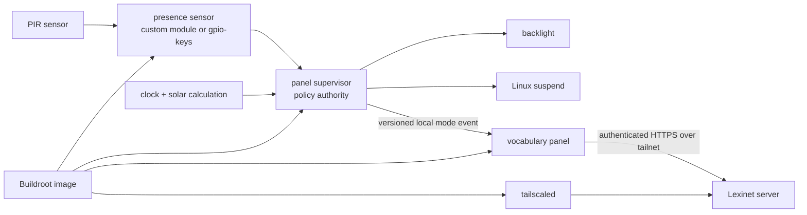

# BeagleBone House Panel

A clean-room embedded appliance project for a motion-aware BeagleBone display:

- wake from a PIR sensor through a Linux kernel proof of concept;
- enter the deepest **measured and reliable** low-power state when the room appears unoccupied;
- show a dim red surface after local sunset and before sunrise;
- show an interactive Lexinet-backed vocabulary experience during daytime;
- build a small, reproducible Buildroot image suitable for 4 GB eMMC;
- eventually package the board, cape, sensor, and power hardware in a printable enclosure.

This repository is the new canonical implementation. The legacy repositories and their audit remain one directory above and are not imported as source dependencies.

The durable recovery findings are preserved in the self-contained [legacy recovery summary](docs/legacy/recovery-summary.md). The longer forensic audit and restart proposal remain adjacent in the recovery workspace; the summary explains what was salvageable, what was missing, and why this clean repository exists.

## Current status

This is an executable scaffold, not a hardware-complete product.

| Work stream | First implementation | What remains hardware-dependent |
|---|---|---|
| Presence/wake | Custom input-driver experiment plus stock `gpio-keys` comparison | PIR electrical behavior, cape pin conflicts, DeepSleep0 wake proof |
| Panel supervisor | Host-tested daemon, policy, offline solar math, evdev discovery, backlight/suspend, clock-readiness, and local IPC adapters | Actual nodes, brightness, clock recovery, and suspend behavior on the target |
| Vocabulary panel | Host-tested flash-card flow, provisional HTTPS Lexinet client, and strict-compiled LVGL DRM/fbdev renderer | Integrated graphical controller executable, actual Lexinet contract, cape nodes, and calibrated touch |
| System image | Pinned Buildroot external tree, SSH-free production profile, root-key-only bring-up profile, Chrony/DHCP, exact touch isolation, packages, init scripts, and overlay | Full release image build, cape driver/device tree, and measured package/resource budget |
| Operations | Environment checks, isolated SDK cross-build, exact content-addressed uploads, board bring-up provisioning, diagnostics, and fresh-source release verification | Production provisioning/update/rollback, final board identity, and credentials |
| Enclosure | Requirements and measurement checklist | Physical dimensions, thermals, connectors, and CAD |

No document or test result in this repository claims the saved legacy pin map is electrically safe or that suspend wake works on the actual assembly.

## Platform direction

The owned BeagleBone Black is the immediate characterization target, not an
implicit final product-board selection. It will establish the real cape, PIR,
kernel wake, display, network-recovery, and battery-boundary facts before money
is spent on a replacement.

Current research rejects BeagleBone AI-64 as the default cordless upgrade,
uses i.MX 8M Plus as the practical comparison baseline, BeagleY-AI as the
open-hardware AI challenger, BeaglePlay as the lower-compute open option, and
QCS6490 only after its sleep claim is made reproducible. See the
[compute platform assessment](docs/research/compute-platform-assessment.md),
[proposed two-domain power architecture](docs/architecture/power-domain-architecture.md),
and [current investigation decision](docs/decisions/0003-characterize-beaglebone-before-selecting-product-platform.md).

Two software gates intentionally remain before a product-like lit-screen test:
the LVGL renderer/flash-card/session/HTTP pieces still need one graphical
controller process, and protocol v1 still needs a sequence-bound
rendered/page-flipped acknowledgement before the supervisor may raise a
nonzero backlight. Until those exist, services stay disabled by default and the
no-white-flash requirement is not claimed as proven.

## Architecture

The system deliberately keeps hardware authority out of the UI:



See [system architecture](docs/architecture/system-architecture.md),
[proposed power-domain architecture](docs/architecture/power-domain-architecture.md),
[process interconnectivity](docs/architecture/process-interconnectivity.md),
[panel policy](docs/behavior/panel-policy.md), and
[flash-card UX](docs/behavior/flash-card-ux.md).

## Repository map

| Directory | Ownership |
|---|---|
| `presence_sensor/` | Kernel-side PIR state/events and wake experiments |
| `panel_supervisor/` | Presence, solar, display, and sleep policy |
| `vocabulary_panel/` | Lexinet client boundary and flash-card presentation |
| `system_image/` | Buildroot external tree and target lifecycle |
| `hardware_tests/` | Non-destructive discovery and on-device evidence capture |
| `enclosure/` | Future source CAD, print exports, and assembly documentation |
| `scripts/` | Host setup, builds, uploads, and repository verification |
| `docs/` | Architecture, behavior, interfaces, research, security, and hardware decisions |

## Quick start

```sh
scripts/environment/check_host_dependencies.sh
make verify
```

`make verify` uses the compilers already available on the host and does not contact or mutate a BeagleBone. CMake remains the application/build-image integration path:

```sh
cmake --preset host-debug
cmake --build --preset host-debug
ctest --preset host-debug --output-on-failure
```

For Buildroot and deployment, follow [development environment setup](docs/operations/development-environment.md) and [build/deploy operations](docs/operations/build-and-deploy.md). For the official-Debian compatibility baseline, follow the [Debian Tailnet bring-up runbook](docs/operations/debian-tailnet-bringup.md). Upload scripts default to a dry run and require an explicit execution flag.

On a supported Linux x86_64 build host, `make verify-release-candidate` performs
the separate full-image build/artifact gate. It is deliberately excluded from
the fast host suite and remains build evidence, not hardware evidence.

## First on-device action

Do not flash or boot the installed eMMC OS. Inventory the unpowered hardware, prepare a verified non-flasher microSD, boot explicitly from it with eMMC unmounted/read-only, and image/hash eMMC first. Then run the read-only inventory collection described in [hardware testing](hardware_tests/README.md).

The complete executable sequence is the
[BeagleBone hardware baseline plan](.claude/plans/2026-08-05-beaglebone-hardware-baseline.md).

## Decisions intentionally still open

- Exact BeagleBone/cape/PIR revisions and wiring.
- Final product compute platform; the Black is the current measurement target,
  not a permanent constraint.
- Custom input driver versus stock `gpio-keys` for the final wake path.
- LVGL direct DRM versus its fbdev fallback; Qt 6 Widgets remains the measured fallback if LVGL fails a target gate.
- DeepSleep0 versus a shallower always-networked mode on Black; a future product
  may add an always-on MCU and full application-domain power-off.
- Lexinet API/authentication/review contract.
- Local STT/gesture scope, microphone/camera hardware privacy controls,
  production update/rollback, and enclosure geometry.

The current preferred directions are recorded as experiments, not irreversible architecture.
