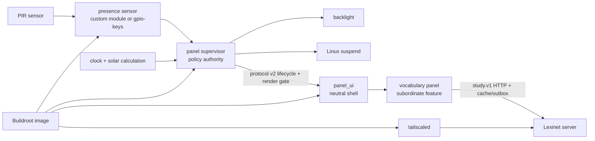
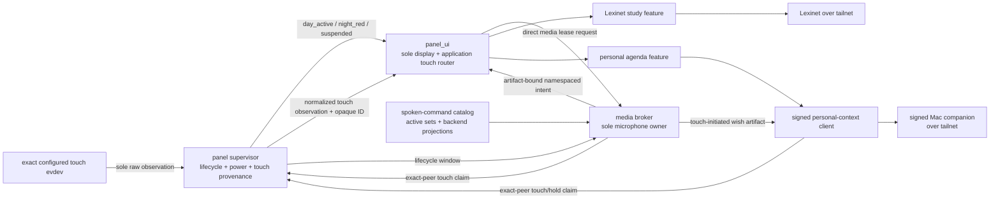

# BeagleBone House Panel

A clean-room embedded appliance project for a motion-aware BeagleBone display:

- wake from a PIR sensor through a Linux kernel proof of concept;
- enter the deepest **measured and reliable** low-power state when the room appears unoccupied;
- show a dim red surface after local sunset and before sunrise;
- show an interactive Lexinet-backed vocabulary experience during daytime;
- show a privacy-bounded personal agenda and prepare birthday wishes through a
  companion on the user's Mac;
- build a small, reproducible Buildroot image suitable for 4 GB eMMC;
- eventually package the board, cape, sensor, and power hardware in a printable enclosure.

This repository is the new canonical implementation. The legacy repositories and their audit remain one directory above and are not imported as source dependencies.

The durable recovery findings are preserved in the self-contained [legacy recovery summary](docs/legacy/recovery-summary.md). The longer forensic audit and restart proposal remain adjacent in the recovery workspace; the summary explains what was salvageable, what was missing, and why this clean repository exists.

## Current status

The display applications run in a native Mac window and a Linux virtual panel.
This is not a hardware-complete product; production enablement still depends on
real-provider and hardware evidence.

| Work stream | Implemented software | Remaining gates |
|---|---|---|
| Presence/wake | Stock `gpio-keys` PIR node in the FRDM project overlay (pin is a build-failing placeholder) plus the custom input-driver experiment | PIR pin and J18 voltage, pad ownership, suspend-to-RAM wake proof |
| Panel supervisor | Policy/daemon, protocol-v2 presentation gate, sole evdev touch observation, and authenticated normalized-touch stream; Linux guest tests exercise tablet/Type-B input and backlight | Actual FRDM nodes, brightness, clock recovery, suspend behavior, touch calibration, and on-target display-commit correlation |
| Panel UI | Neutral shell, canonical study reducer, shared LVGL renderer, headless/SDL/guest DRM backends, intent routing, Unicode policy, lifecycle and normalized-touch clients | Physical display-commit evidence, calibrated display/touch, production service enablement; production backend remains fail-dark |
| Vocabulary panel | Study surface beneath `panel_ui`, cancellable HTTPS worker, durable create/retry identities, atomic cache/outbox recovery, and synthetic verified-TLS integration for `study.v1` | Real Lexinet/Tailnet identity, policy, revocation and certificate evidence; panel Tailscale packaging and credentials; target validation |
| Spoken commands | Fake-only broker, content-addressed catalog/active sets/backend/policy, effect admission, replay/cooldown and lifecycle closure tests | Real recognizer/acoustic qualification, microphone ownership and independent closure, production holder-claim/media IPC; wish recording remains disabled |
| Personal agenda | Synthetic agenda/birthday/wish-flow surfaces; `AGENDA-001` through `AGENDA-010` accepted and companion boundary documented | `AGENDA-011`, feasibility Step 1, real providers/companion, EventKit/Contacts, Google, Tailnet, local STT and Messages measurements |
| Virtual panel | 29 headless and SDL scenarios, Debian arm64 QEMU/HVF guest with DRM completion, authenticated touch, synthetic PIR/backlight, and Cocoa interaction | Simulation only; no FRDM electrical, physical display, power, suspend or wake evidence |
| System image | Pinned Buildroot external tree with FRDM i.MX 8M Plus production and bring-up defconfigs (NXP `linux-imx`/`uboot-imx` `lf-6.12.49-2.2.0`), board profiles, SSH-free production profile, root-key-only bring-up profile, Chrony/DHCP, exact touch isolation, packages, init scripts, and overlay | NXP firmware license decision, full image build, measured PIR/backlight/display values, and measured package/resource budget |
| Board bring-up | `config/boards/` profiles, AArch64 cross build, `hardware_tests/frdm/` gate evidence scripts, and the board-arrival checklist | Every `FRDM-GATE-*` measurement |
| Operations | Environment checks, isolated SDK cross-build, exact content-addressed uploads, board bring-up provisioning, diagnostics, and fresh-source release verification | Production provisioning/update/rollback, final board identity, and credentials |
| Enclosure | Requirements and measurement checklist | Physical dimensions, thermals, connectors, and CAD |

## Development roadmap

The
[end-to-end development roadmap](.claude/plans/2026-08-05-end-to-end-development-roadmap.md)
is the program-ordering authority. It shows which work can proceed immediately
on host machines, where the Lexinet and Mac-companion lanes can run in parallel,
and the evidence gates that begin when the development hardware arrives. The detailed
[Lexinet integration](.claude/plans/2026-08-05-lexinet-study-integration.md),
[personal-agenda feasibility](.claude/plans/2026-08-05-personal-agenda-feasibility.md),
and
[BeagleBone hardware baseline](.claude/plans/2026-08-05-beaglebone-hardware-baseline.md)
plans remain authoritative inside their work streams; the
[FRDM hardware baseline](.claude/plans/2026-09-25-frdm-hardware-baseline.md)
plan replaces the BeagleBone one for hardware work.

The software lane now exercises study and offline behavior beneath the neutral
shell, with deterministic visual tests and a running Linux guest. Next gates
include real Lexinet deployment, Mac-companion feasibility, production capability
boundaries, and the disabled-by-default Buildroot release candidate. GPIO,
physical display, suspend/wake, microphone, battery, and final platform claims
still require measured hardware evidence.

No document or test result in this repository claims the saved legacy pin map is electrically safe or that suspend wake works on the actual assembly.

## Platform direction

The BeagleBone Black was lost. Per
[ADR 0008](docs/decisions/0008-adopt-frdm-imx8mplus-and-waveshare-7-inch-dsi-development-platform.md),
the development platform is now the NXP FRDM i.MX 8M Plus board with a
Waveshare 7inch DSI LCD (C) touchscreen, both ordered and not yet received. It
is the characterization target, not the final product-board selection; a
successful prototype is expected to move to an i.MX 8M Plus system-on-module on
a custom carrier.

Current research rejects BeagleBone AI-64 as the default cordless upgrade,
uses i.MX 8M Plus as the practical comparison baseline, BeagleY-AI as the
open-hardware AI challenger, BeaglePlay as the lower-compute open option, and
QCS6490 only after its sleep claim is made reproducible. See the
[compute platform assessment](docs/research/compute-platform-assessment.md),
[proposed two-domain power architecture](docs/architecture/power-domain-architecture.md),
and [current investigation decision](docs/decisions/0003-characterize-beaglebone-before-selecting-product-platform.md).

The vocabulary session/HTTP/LVGL surface is integrated beneath `panel_ui`, and
the virtual guest correlates protocol-v2 acknowledgements with DRM completion.
Physical display-commit evidence and on-target correlation remain gates before
production services can be enabled. The production backend stays fail-dark,
services stay disabled by default, and physical no-white-flash behavior is unproven.

## Architecture

The implemented host spine keeps hardware authority in the supervisor and
feature routing in the neutral UI:



The accepted application boundary includes implemented touch provenance and
fake spoken commands, plus the gated media and personal-context targets shown
below. Agenda and vocabulary decisions stay outside the supervisor:



~~The earlier convergence sketch assigned the raw touch device to `panel_ui`
and left touch provenance inside the process asking capability holders to
act.~~ Accepted [ADR 0005](docs/decisions/0005-validate-touch-provenance-at-capability-holders.md)
makes the supervisor the sole raw-touch observer while leaving application hit
testing in the UI. The normalized stream is implemented and Linux-tested, and
packaging revokes the UI service's raw input access. Production broker and
personal-context holder-claim IPC remain gated; the fake broker owns no physical
microphone and synthetic agenda surfaces invoke no real provider. These tests
produce no hardware evidence.

See [system architecture](docs/architecture/system-architecture.md),
[application capability ownership](docs/architecture/application-capability-ownership.md),
[proposed power-domain architecture](docs/architecture/power-domain-architecture.md),
[process interconnectivity](docs/architecture/process-interconnectivity.md),
[Lexinet study integration](docs/architecture/lexinet-study-integration.md),
[spoken-command distinctiveness](docs/architecture/spoken-command-distinctiveness.md),
[personal agenda and birthday wishes](docs/architecture/personal-agenda-and-birthday-wishes.md),
[panel policy](docs/behavior/panel-policy.md), and
[flash-card UX](docs/behavior/flash-card-ux.md).

## Repository map

| Directory | Ownership |
|---|---|
| `presence_sensor/` | Kernel-side PIR state/events and wake experiments |
| `panel_supervisor/` | Presence, solar, display, and sleep policy |
| `panel_ui/` | Neutral display shell, application hit testing, intent routing, and lifecycle client |
| `vocabulary_panel/` | Lexinet client boundary and flash-card presentation |
| `media_broker/` | Fake-only command-recognition leases and artifact-bound intent admission |
| `simulator/` | Native window and deterministic display scenarios |
| `shared/` | Canonical application identity, lifecycle codec, normalized-touch stream, spoken-command artifacts, and structured logging capabilities |
| `config/` | Example build, deployment, and service configuration templates; secrets excluded |
| `system_image/` | Buildroot external tree and target lifecycle |
| `hardware_tests/` | Non-destructive discovery and on-device evidence capture |
| `enclosure/` | Future source CAD, print exports, and assembly documentation |
| `scripts/` | Host setup, builds, uploads, and repository verification |
| `docs/` | Architecture, behavior, interfaces, research, security, and hardware decisions |

## Quick start

```sh
scripts/environment/check_host_dependencies.sh
make verify
```

`make verify` uses the compilers already available on the host and does not contact or mutate a BeagleBone. CMake remains the application/build-image integration path:

```sh
cmake --preset host-debug
cmake --build --preset host-debug
ctest --preset host-debug --output-on-failure
```

On the Mac, verify the headless images and open the native panel:

```sh
make verify-panel-goldens
make sim-panel
```

For the Linux virtual panel, prepare the local QEMU dependency as described in
[virtual-panel operations](scripts/sim/README.md), then run:

```sh
scripts/sim/run_virtual_panel.sh --execute
# In another terminal, while the VM is running:
python3 scripts/sim/provision_virtual_panel.py --execute
```

Omit `--execute` to preview either VM command. See
[virtual-panel validation](docs/testing/virtual-panel-validation.md) for the
headless, native-window and guest evidence, and their remaining gates.

The Linux-only daemon paths and optional HTTP/LVGL adapters have a separate
containerized host gate. It builds an explicit Linux x86_64 environment and
runs the same repository suite inside it:

```sh
make verify-linux-x86_64
```

For Buildroot and deployment, follow [development environment setup](docs/operations/development-environment.md) and [build/deploy operations](docs/operations/build-and-deploy.md). For the official-Debian compatibility baseline, follow the [Debian Tailnet bring-up runbook](docs/operations/debian-tailnet-bringup.md). Upload scripts default to a dry run and require an explicit execution flag.

On a supported Linux x86_64 build host, `make verify-release-candidate` performs
the separate full-image build/artifact gate. It is deliberately excluded from
the fast host suite and remains build evidence, not hardware evidence.

## First on-device action

~~Do not flash or boot the installed eMMC OS. Inventory the unpowered hardware, prepare a verified non-flasher microSD, boot explicitly from it with eMMC unmounted/read-only, and image/hash eMMC first. Then run the read-only inventory collection described in [hardware testing](hardware_tests/README.md).~~

When the FRDM board arrives, follow the ordered board-arrival checklist
(`ARRIVAL-01` through `ARRIVAL-25`) in
[FRDM bring-up](docs/operations/frdm-bringup.md): boot NXP's vendor image
first, back up the factory eMMC, then run the `hardware_tests/frdm/` gate
scripts. Each writes JSON evidence to ignored `hardware_tests/results/frdm/`.
The project image waits for the measured PIR pin and the NXP firmware license
decision.

The complete executable sequence is the
~~[BeagleBone hardware baseline plan](.claude/plans/2026-08-05-beaglebone-hardware-baseline.md).~~
[FRDM hardware baseline plan](.claude/plans/2026-09-25-frdm-hardware-baseline.md).

**Amended 2026-08-07:** reconciled the proposed convergence sketch with ADR
0005's supervisor-observed touch provenance and capability-holder validation.
The current scaffold and every hardware-evidence gate remain unchanged.

## Decisions intentionally still open

- Exact FRDM board variant, display cable, PIR part, and wiring.
- Acceptance of the NXP Software License Agreement for `firmware-imx` (LPDDR4
  training) and the IW612 Wi-Fi firmware (`BHP_BOARD_NXP_FIRMWARE_EULA` in
  `config/boards/frdm-imx8mp.env`). This is a human decision recorded as an ADR;
  the project image cannot boot or use Wi-Fi without it.
- Every `UNMEASURED:FRDM-GATE-*` value in the board profile
  (`scripts/boards/show_board_profile.sh` lists them).
- Final product compute platform; the FRDM i.MX 8M Plus board is the current
  measurement target, not a permanent constraint.
- Custom input driver versus stock `gpio-keys` for the final wake path.
- LVGL direct DRM versus its fbdev fallback; Qt 6 Widgets remains the measured fallback if LVGL fails a target gate.
- ~~DeepSleep0 versus a shallower always-networked mode on Black; a future product
  may add an always-on MCU and full application-domain power-off.~~
  `deep` versus `s2idle` suspend-to-RAM on the FRDM (`FRDM-GATE-SUSPEND`); a
  future product may add an always-on MCU and full application-domain power-off.
- Real Lexinet Tailnet deployment evidence, the panel Tailscale packaging
  choice, credentials, and production integration/packaging work in its
  [cross-repository plan](.claude/plans/2026-08-05-lexinet-study-integration.md).
- Personal-agenda feasibility Step 1 review, feasibility measurement, and
  implementation of the accepted personal-agenda/Mac-companion boundary under
  its
  [feasibility plan](.claude/plans/2026-08-05-personal-agenda-feasibility.md);
  especially `AGENDA-011`, Messages automation, local transcription, and real
  recipient confirmation beyond the synthetic shared-shell surfaces.
- Local STT/gesture scope, microphone/camera hardware privacy controls,
  production update/rollback, and enclosure geometry.

Remaining unaccepted directions are recorded as experiments, not irreversible
architecture.

**Amended 2026-08-07:** added the existing `shared/` and `config/` ownership
rows to the repository map; no implementation, decision status, or hardware
claim changed.

**Amended 2026-08-16:** recorded ADR 0006 acceptance of the named Lexinet,
spoken-command, and agenda semantics, shared capability ownership, and atomic
protocol-v2 cutover. `AGENDA-011`, agenda feasibility Step 1, all successor
implementation, and every hardware evidence gate remain pending.

**Amended 2026-08-17:** recorded Lexinet Step 4's canonical study service,
strict routes, operator CLI/client, and post-commit shadow composition at pinned
revision `e8a9d52e35bdd55aa7451f4413c781f8371ebb8f`. The resilient panel data plane,
final scoped Tailnet authorization, packaging, and every hardware evidence gate
remain pending.

**Amended 2026-08-17:** recorded clean Lexinet HEAD
`ce42272df315f357e10998dd48e9ffd1a935c2ff`, where the local native TLS,
fresh-`WhoIs`, scoped node-capability/token authorization, separate
create/resume-and-sync router, and redacted deployment boundary are implemented.
Step 5 Verification Item 1 is recorded; its synthetic `ListenTLS` failure proof
is wrapper cleanup evidence, not real certificate evidence. Real tagged,
untagged, wrong/extra-tag, revocation, native certificate/MagicDNS/hostname/TLS
handshake and invalid-certificate behavior, destructive/cross-profile denial,
and the panel Tailscale packaging choice remain pending. The `study.v1`
contract provenance and roadmap checkboxes are unchanged; Step 5 stays
unchecked.

**Amended 2026-09-24:** recorded ADR 0008. The BeagleBone Black was lost; the
FRDM i.MX 8M Plus board and Waveshare 7inch DSI LCD (C) are being purchased as
the development platform. Black-specific Buildroot defconfigs and AM335x
research remain as history. Every hardware evidence gate remains pending.

**Amended 2026-09-25:** retargeted the status table, first on-device action,
and open decisions to the FRDM i.MX 8M Plus (ADR 0008): board profiles, FRDM
Buildroot defconfigs, gate evidence scripts, and the board-arrival checklist.
No hardware evidence exists yet; the NXP firmware license is an open human
decision.

**Amended 2026-09-25:** refreshed implemented software status for the virtual
panel: shared study/display surfaces, durable HTTP/cache/outbox behavior,
supervisor-owned raw touch, authenticated normalized observations, fake command
admission, synthetic agenda, and three visual validation tiers. Added the Mac
and QEMU quickstart. Real-provider, production capability, firmware-license and
every `FRDM-GATE-*` obligation remain open; production services remain disabled.
