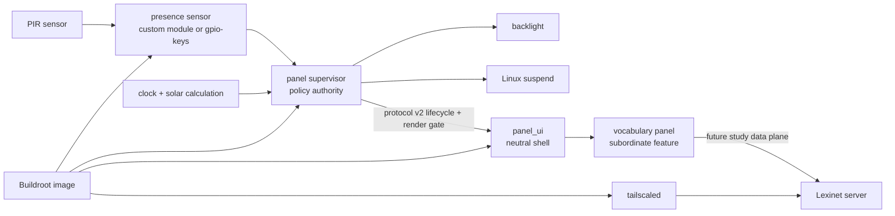

# BeagleBone House Panel

A clean-room embedded appliance project for a motion-aware BeagleBone display:

- wake from a PIR sensor through a Linux kernel proof of concept;
- enter the deepest **measured and reliable** low-power state when the room appears unoccupied;
- show a dim red surface after local sunset and before sunrise;
- show an interactive Lexinet-backed vocabulary experience during daytime;
- show a privacy-bounded personal agenda and prepare birthday wishes through a
  companion on the user's Mac;
- build a small, reproducible Buildroot image suitable for 4 GB eMMC;
- eventually package the board, cape, sensor, and power hardware in a printable enclosure.

This repository is the new canonical implementation. The legacy repositories and their audit remain one directory above and are not imported as source dependencies.

The durable recovery findings are preserved in the self-contained [legacy recovery summary](docs/legacy/recovery-summary.md). The longer forensic audit and restart proposal remain adjacent in the recovery workspace; the summary explains what was salvageable, what was missing, and why this clean repository exists.

## Current status

This is an executable scaffold, not a hardware-complete product.

| Work stream | First implementation | What remains hardware-dependent |
|---|---|---|
| Presence/wake | Custom input-driver experiment plus stock `gpio-keys` comparison | PIR electrical behavior, cape pin conflicts, DeepSleep0 wake proof |
| Panel supervisor | Host-tested daemon, policy, offline solar math, evdev discovery, backlight/suspend, protocol-v2 presentation gate, and touch-provenance seams | Actual nodes, brightness, clock recovery, suspend behavior, raw-touch adapter, and display-commit correlation on the target |
| Panel UI | Host-tested neutral shell/controller, intent registry, Unicode policy, headless renderer, protocol-v2 Unix client, and disabled fail-dark Buildroot entry point | Evidence-backed physical renderer, normalized-touch transport adapter, target service enablement, and calibrated display/touch |
| Vocabulary panel | Host-tested flash-card scaffold and provenance-stamped `study.v1` consumer contract; Lexinet canonical study service/routes/CLI plus its local native-TLS scoped Tailnet boundary are implemented | Resilient panel data plane, real Tailnet identity/policy/revocation/certificate evidence, panel Tailscale packaging choice, integration beneath the neutral shell, target renderer, and calibrated touch |
| Personal agenda | `AGENDA-001` through `AGENDA-010` accepted; provider-neutral birthday/meeting model, safe wish-composer flow, Mac companion boundary, and feasibility plan documented; `AGENDA-011` deferred | Agenda feasibility Step 1 review; EventKit/Contacts, Google, Tailnet, local STT, Messages measurements, and all feature implementation |
| System image | Pinned Buildroot external tree, SSH-free production profile, root-key-only bring-up profile, Chrony/DHCP, exact touch isolation, packages, init scripts, and overlay | Full release image build, cape driver/device tree, and measured package/resource budget |
| Operations | Environment checks, isolated SDK cross-build, exact content-addressed uploads, board bring-up provisioning, diagnostics, and fresh-source release verification | Production provisioning/update/rollback, final board identity, and credentials |
| Enclosure | Requirements and measurement checklist | Physical dimensions, thermals, connectors, and CAD |

## Development roadmap

The
[end-to-end development roadmap](.claude/plans/2026-08-05-end-to-end-development-roadmap.md)
is the program-ordering authority. It shows which work can proceed immediately
on host machines, where the Lexinet and Mac-companion lanes can run in parallel,
and the evidence gates that begin when the BeagleBone returns. The detailed
[Lexinet integration](.claude/plans/2026-08-05-lexinet-study-integration.md),
[personal-agenda feasibility](.claude/plans/2026-08-05-personal-agenda-feasibility.md),
and
[BeagleBone hardware baseline](.claude/plans/2026-08-05-beaglebone-hardware-baseline.md)
plans remain authoritative inside their work streams.

With the shared product contracts accepted by ADR 0006 and the neutral host
UI/protocol spine now implemented, the immediate sequence is to implement
Lexinet study and offline behavior, run Mac feasibility in parallel, and produce a
disabled-by-default Buildroot release candidate. GPIO, display, suspend/wake,
microphone, battery, and final platform claims remain measured hardware gates
rather than blockers to that software head start.

No document or test result in this repository claims the saved legacy pin map is electrically safe or that suspend wake works on the actual assembly.

## Platform direction

The owned BeagleBone Black is the immediate characterization target, not an
implicit final product-board selection. It will establish the real cape, PIR,
kernel wake, display, network-recovery, and battery-boundary facts before money
is spent on a replacement.

Current research rejects BeagleBone AI-64 as the default cordless upgrade,
uses i.MX 8M Plus as the practical comparison baseline, BeagleY-AI as the
open-hardware AI challenger, BeaglePlay as the lower-compute open option, and
QCS6490 only after its sleep claim is made reproducible. See the
[compute platform assessment](docs/research/compute-platform-assessment.md),
[proposed two-domain power architecture](docs/architecture/power-domain-architecture.md),
and [current investigation decision](docs/decisions/0003-characterize-beaglebone-before-selecting-product-platform.md).

Two gates intentionally remain before a product-like lit-screen test: the
vocabulary session/HTTP/LVGL surface must be integrated beneath `panel_ui`, and
the host-tested protocol-v2 handshake needs an evidence-backed physical
display-commit backend plus on-target correlation. Until those exist, services
stay disabled by default and the no-white-flash requirement is not claimed as
proven.

## Architecture

The implemented host spine keeps hardware authority in the supervisor and
feature routing in the neutral UI:



The accepted application boundary extends this host spine with touch
provenance, voice, and sibling feature surfaces; it does not add agenda or
vocabulary decisions to the supervisor:


~~The earlier convergence sketch assigned the raw touch device to `panel_ui`
and left touch provenance inside the process asking capability holders to
act.~~ Accepted [ADR 0005](docs/decisions/0005-validate-touch-provenance-at-capability-holders.md)
makes the supervisor the future raw-touch observer while leaving application
hit testing in the UI. The packaging cutover must revoke the current UI service's
raw `bhp-touch` access and use distinct exact service principals for broker and
personal-context provenance claims. This is an accepted target contract, not
current code or hardware evidence.

See [system architecture](docs/architecture/system-architecture.md),
[application capability ownership](docs/architecture/application-capability-ownership.md),
[proposed power-domain architecture](docs/architecture/power-domain-architecture.md),
[process interconnectivity](docs/architecture/process-interconnectivity.md),
[Lexinet study integration](docs/architecture/lexinet-study-integration.md),
[spoken-command distinctiveness](docs/architecture/spoken-command-distinctiveness.md),
[personal agenda and birthday wishes](docs/architecture/personal-agenda-and-birthday-wishes.md),
[panel policy](docs/behavior/panel-policy.md), and
[flash-card UX](docs/behavior/flash-card-ux.md).

## Repository map

| Directory | Ownership |
|---|---|
| `presence_sensor/` | Kernel-side PIR state/events and wake experiments |
| `panel_supervisor/` | Presence, solar, display, and sleep policy |
| `panel_ui/` | Neutral display shell, application hit testing, intent routing, and lifecycle client |
| `vocabulary_panel/` | Lexinet client boundary and flash-card presentation |
| `shared/` | Canonical application identity, lifecycle codec, normalized-touch stream, and structured logging capabilities |
| `config/` | Example build, deployment, and service configuration templates; secrets excluded |
| `system_image/` | Buildroot external tree and target lifecycle |
| `hardware_tests/` | Non-destructive discovery and on-device evidence capture |
| `enclosure/` | Future source CAD, print exports, and assembly documentation |
| `scripts/` | Host setup, builds, uploads, and repository verification |
| `docs/` | Architecture, behavior, interfaces, research, security, and hardware decisions |

## Quick start

```sh
scripts/environment/check_host_dependencies.sh
make verify
```

`make verify` uses the compilers already available on the host and does not contact or mutate a BeagleBone. CMake remains the application/build-image integration path:

```sh
cmake --preset host-debug
cmake --build --preset host-debug
ctest --preset host-debug --output-on-failure
```

The Linux-only daemon paths and optional HTTP/LVGL adapters have a separate
containerized host gate. It builds an explicit Linux x86_64 environment and
runs the same repository suite inside it:

```sh
make verify-linux-x86_64
```

For Buildroot and deployment, follow [development environment setup](docs/operations/development-environment.md) and [build/deploy operations](docs/operations/build-and-deploy.md). For the official-Debian compatibility baseline, follow the [Debian Tailnet bring-up runbook](docs/operations/debian-tailnet-bringup.md). Upload scripts default to a dry run and require an explicit execution flag.

On a supported Linux x86_64 build host, `make verify-release-candidate` performs
the separate full-image build/artifact gate. It is deliberately excluded from
the fast host suite and remains build evidence, not hardware evidence.

## First on-device action

Do not flash or boot the installed eMMC OS. Inventory the unpowered hardware, prepare a verified non-flasher microSD, boot explicitly from it with eMMC unmounted/read-only, and image/hash eMMC first. Then run the read-only inventory collection described in [hardware testing](hardware_tests/README.md).

The complete executable sequence is the
[BeagleBone hardware baseline plan](.claude/plans/2026-08-05-beaglebone-hardware-baseline.md).

**Amended 2026-08-07:** reconciled the proposed convergence sketch with ADR
0005's supervisor-observed touch provenance and capability-holder validation.
The current scaffold and every hardware-evidence gate remain unchanged.

## Decisions intentionally still open

- Exact BeagleBone/cape/PIR revisions and wiring.
- Final product compute platform; the Black is the current measurement target,
  not a permanent constraint.
- Custom input driver versus stock `gpio-keys` for the final wake path.
- LVGL direct DRM versus its fbdev fallback; Qt 6 Widgets remains the measured fallback if LVGL fails a target gate.
- DeepSleep0 versus a shallower always-networked mode on Black; a future product
  may add an always-on MCU and full application-domain power-off.
- Real Lexinet Tailnet deployment evidence, the panel Tailscale packaging
  choice, and the resilient panel study data plane, integration, and packaging
  work in its
  [cross-repository plan](.claude/plans/2026-08-05-lexinet-study-integration.md).
- Personal-agenda feasibility Step 1 review, feasibility measurement, and
  implementation of the accepted personal-agenda/Mac-companion boundary under
  its
  [feasibility plan](.claude/plans/2026-08-05-personal-agenda-feasibility.md);
  especially `AGENDA-011`, Messages automation, local transcription, recipient
  confirmation, and the neutral shared UI shell.
- Local STT/gesture scope, microphone/camera hardware privacy controls,
  production update/rollback, and enclosure geometry.

Remaining unaccepted directions are recorded as experiments, not irreversible
architecture.

**Amended 2026-08-07:** added the existing `shared/` and `config/` ownership
rows to the repository map; no implementation, decision status, or hardware
claim changed.

**Amended 2026-08-16:** recorded ADR 0006 acceptance of the named Lexinet,
spoken-command, and agenda semantics, shared capability ownership, and atomic
protocol-v2 cutover. `AGENDA-011`, agenda feasibility Step 1, all successor
implementation, and every hardware evidence gate remain pending.

**Amended 2026-08-17:** recorded Lexinet Step 4's canonical study service,
strict routes, operator CLI/client, and post-commit shadow composition at pinned
revision `e8a9d52e35bdd55aa7451f4413c781f8371ebb8f`. The resilient panel data plane,
final scoped Tailnet authorization, packaging, and every hardware evidence gate
remain pending.

**Amended 2026-08-17:** recorded clean Lexinet HEAD
`ce42272df315f357e10998dd48e9ffd1a935c2ff`, where the local native TLS,
fresh-`WhoIs`, scoped node-capability/token authorization, separate
create/resume-and-sync router, and redacted deployment boundary are implemented.
Step 5 Verification Item 1 is recorded; its synthetic `ListenTLS` failure proof
is wrapper cleanup evidence, not real certificate evidence. Real tagged,
untagged, wrong/extra-tag, revocation, native certificate/MagicDNS/hostname/TLS
handshake and invalid-certificate behavior, destructive/cross-profile denial,
and the panel Tailscale packaging choice remain pending. The `study.v1`
contract provenance and roadmap checkboxes are unchanged; Step 5 stays
unchecked.
