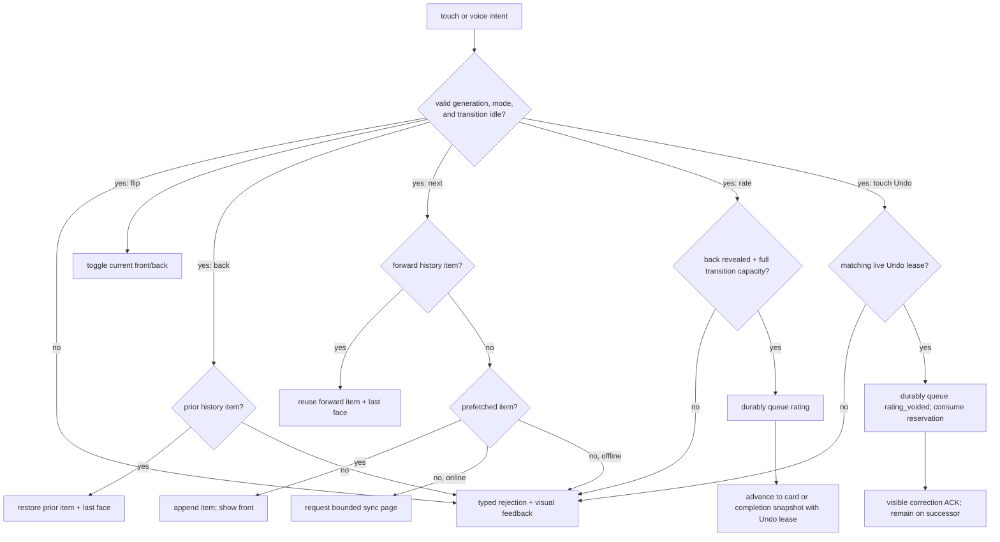
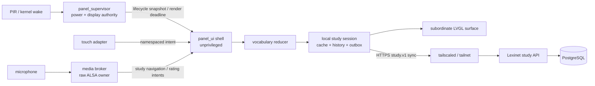
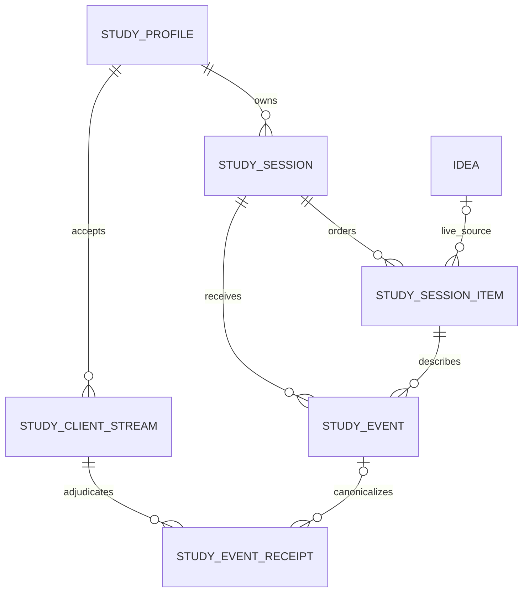

# Lexinet Study Integration

<!-- @canonical lexinet-study-integration -->

**Status:** all seven version 1 Lexinet decisions accepted by
[ADR 0006](../decisions/0006-accept-product-semantics-and-atomic-protocol-v2-cutover.md);
implementation and evidence gates remain pending
**Scope:** Lexinet-backed concept cards, varied selection, offline behavior,
touch navigation, and local constrained-catalog voice commands
**Not selected here:** a final microphone, speech engine, battery-powered board,
or a scientifically optimized personalized scheduler

## Outcome

Lexinet remains the source of truth for vocabulary content, study-session
ordering, and durable learning events. The house panel keeps only enough local
state to render promptly, navigate a bounded history, and survive a temporary
Tailnet outage.

The first experience remains exposure-oriented, but four explicit recall
ratings may influence future ordering. It helps a single learner repeatedly
encounter the language used to discuss complex software systems without
pretending that an unmeasured scheduling algorithm knows what the learner has
mastered. Raw learning events remain canonical so a later scheduler can replay
the same history rather than inherit opaque state from version 1.

The initial semantic command inventory is:

- `Lexi flip`: toggle the current card between its front and back.
- `Lexi next`: move forward. This never means “I knew it.”
- `Lexi back`: move backward through local presentation history. This never
  undoes a previously synchronized learning event.
- `Lexi again`, `Lexi hard`, `Lexi good`, and `Lexi easy`: after the back is
  revealed, record the corresponding recall rating and advance only after the
  event is durably queued.

Touch controls emit the same semantic intents and remain available when the
microphone or recognizer is unavailable. These spoken forms are accepted
semantic candidates, while production activation remains gated by the
panel-wide [spoken-command distinctiveness](spoken-command-distinctiveness.md)
catalog report and measured evidence; semantic intent IDs do not change when a
spoken alias changes. The
touch-only `study.rating.undo` intent has no spoken alias and targets the exact
rating event exposed by the current Undo lease.

## Repository reality

Host-side automation locates the populated Lexinet repository only through
`BHP_LEXINET_SOURCE_DIR` and verifies its history against
`BHP_LEXINET_BASE_REVISION`. The audit found the source checkout clean at full
revision `3e15ef60e1970757e756d74622846edba166757c`; the originally supplied
directory was empty. No script may encode or infer either workstation path. The
validator resolves the physical Git root and requires that audited commit in
the selected checkout's ancestry rather than trusting `go.mod` alone. Runtime
endpoint and credential configuration remain separate from these
development-source inputs.

Lexinet already provides useful foundations:

- a Go service and CLI backed by PostgreSQL;
- ideas with canonical names, definitions, examples, aliases, and acronyms;
- topics and idea-topic membership;
- an embedded `tsnet` listener;
- strict JSON request decoding and a consistent structured error shape.

It does not yet provide study sessions, random or scheduled selection, exposure
history, reviews, or a flash-card API. Its substantive routes are currently
unversioned and successful responses are raw JSON resources. New study routes
must not accidentally redefine the existing API conventions.

The panel repository already has a deterministic `FlashCardSession`, a guarded
but provisional HTTP adapter, fixture-driven host tests, and an LVGL renderer.
Its current state machine is forward-only (`word -> definition -> example ->
rating`); it has no production graphical controller, backward navigation,
prefetch cache, durable outbox, or voice source. The integration replaces the
provisional HTTP shape and refactors that progression into an explicit
two-sided card.

The proposed
[personal-agenda application](personal-agenda-and-birthday-wishes.md) makes the
production UI boundary panel-wide. One neutral `panel_ui` shell owns
LVGL/display/touch and routes namespaced intents to sibling feature reducers.
This document remains authoritative for the Lexinet reducer, study data,
`study.flip`, `study.next`, `study.back`, and `study.rate.*` semantics; it does
not make vocabulary the appliance shell.

## Product semantics

### Card projection

Lexinet ideas are concepts, so “card” need not mean a single dictionary word.
The initial `term_definition` card projection is:

| Surface | Lexinet source |
|---|---|
| Stable identity | Study-session-item UUID; idea UUID and card kind remain explicit |
| Front | Canonical name |
| Back | Primary definition, then first sorted definition, then nonblank summary |
| Supporting content | At most one sorted example; selected aliases/acronyms are optional |
| Freshness | Immutable issued projection plus source content timestamp/hash |
| Corpus membership | Active idea in any configured topic |

An idea is ineligible if it is archived or merged, lacks a canonical name, or
has no usable back text. The response says which fallback supplied the back so
the panel never has to infer content quality.

Existing topics define the initial study corpus; Lexinet should not gain a
second “deck” taxonomy. A profile can initially select one topic such as
`frontier-model-language`, while the contract permits a normalized set of topic
slugs. Multiple topics form a union unless a later product decision introduces
a different named corpus rule.

### Navigation

The panel keeps a bounded browser-style history:

1. A new card opens on its front.
2. `flip` toggles front/back without a request.
3. `next` moves through existing forward history first; at the history tail it
   consumes the next prefetched session item and opens its front.
4. `back` restores the preceding card and its last visible face.
5. Reaching either boundary is a visible no-op, not an error and not a queued
   future action.



~~Rendering a session item for the first time creates its one idempotent
`presented` fact. Revealing its back for the first time creates its one
idempotent `revealed` fact. Re-rendering or revisiting the item creates neither
again. Neither fact claims mastery. `again`, `hard`, `good`, and `easy` are valid
only after `revealed`.~~

Rendering a session item for the first time from non-voice system/session entry
or touch creates its one idempotent `presented` fact before display. A first
render caused by voice records only a bounded, session-local provisional marker;
it does not enter the durable outbox or Lexinet. A later study touch
bound to the same active session, session item, immutable content revision, and
render generation promotes that marker before applying its semantic action. An
accepted touch or voice rating bound to the same tuple promotes the
current item's provisional `presented` and any dependent provisional `revealed`
observation atomically with `rated`. Voice reveal remains provisional while its
`presented` prerequisite is provisional. Unpromoted markers are discarded at
session termination or process restart, cannot satisfy server-authoritative
cycle exhaustion, and never acquire a client-stream sequence. Restart recovery
must also discard the provisional render and open a non-card resume gate; it may
not automatically redisplay an issued item that lacks canonical `presented`
evidence. A touch through that gate durably creates `presented` before display,
while a voice resume creates a new provisional marker. Session termination
abandons that session-item view, so later system entry cannot silently relabel
the discarded voice observation as canonical.

Revealing the back for the first time creates its one idempotent `revealed` fact
when `presented` is already canonical; otherwise the voice-originated reveal is
provisional under the same rule. Re-rendering or revisiting the item creates
neither fact again. Neither fact claims mastery. `again`, `hard`, `good`, and
`easy` are valid only after the local view is revealed and mean:

| Rating | Learner meaning |
|---|---|
| `again` | Recall failed |
| `hard` | Recalled, but only with substantial difficulty |
| `good` | Recalled with ordinary effort |
| `easy` | Recalled immediately and confidently |

A rating is atomically written to the bounded outbox before navigation advances;
`next` can never silently emit one. Touch and voice traverse the same reducer
path. The next card shows the accepted rating and a one-tap **Undo** affordance.
If no prefetched successor exists, an explicit completion/refill-required
snapshot becomes the successor and retains the same Undo affordance; background
refill does not silently replace that snapshot while the lease is live.
Undo appends an idempotent `rating_voided` event that names the exact `rated`
event; it never erases history. Accepting a rating must reserve enough bounded
outbox capacity for that correction.

~~Rating admission preflights the complete local transition. It always requires
one slot for `rated` plus one reserved Undo slot. Advancing to an
already-presented forward item or a non-card completion snapshot needs no other
event. Showing a never-presented prefetched successor additionally requires a
third slot, and the rating plus successor `presented` fact commit atomically
before render. With only the two base slots, the rating may still advance to an
explicit tracking-paused completion snapshot while leaving the cached successor
unshown. With fewer than two, rating is rejected and the current card remains.~~

Rating admission preflights the complete local transition. It always requires
one slot for `rated` plus one reserved Undo slot and enough ordinary slots for
every provisional prerequisite it must promote. Advancing to an
already-presented forward item or a non-card completion snapshot needs no other
event. A touch rating that shows a never-presented prefetched successor
additionally requires one slot, and the rating plus successor `presented` fact
commit atomically before render. A voice rating commits the current item's
promotions and rating but leaves a never-presented successor provisional. If the
rating, Undo reservation, and all current-item prerequisite promotions fit but
a touch-originated successor's additional `presented` slot does not, advance to
an explicit tracking-paused non-card completion snapshot. If any rating, Undo,
or prerequisite-promotion capacity is missing, reject the rating and keep the
current card visible and unrated.

Single-shot voice rating accepts residual false-recognition risk proportionate
to a correctable, single-learner event. Undo is a compensating event, not a
rollback: it cannot change an already materialized successor cycle. A late
correction affects the next unmaterialized cycle and may leave one cycle ordered
from the mistaken rating. Recognition substitutions remain an explicit target
evidence gate.

### Versioned variety-first scheduling

Random selection with replacement performs poorly for a small lexicon because
it can repeat one card while neglecting others. Version 1 uses
`variety_first_v1`, a transparent rating-aware coverage policy:

1. Fold canonical events through an explicit server-assigned per-profile
   ingestion-ordinal high-water mark and ignore any rating with an effective
   `rating_voided` correction.
2. Snapshot every eligible card projection into one finite immutable coverage
   cycle.
3. Rank cards for the next cycle by latest effective outcome: `again`, `hard`,
   unseen/unrated, `good`, then `easy`.
4. Within a rank, order by the latest effective `presented` event's per-profile
   ingestion ordinal, ascending. Never-presented uses an explicit oldest
   sentinel that sorts before every real ordinal; break equal sentinels with a
   persisted deterministic seed. Receipt timestamps remain evidence but are not
   a selection key.
5. Place every eligible identity in the cycle exactly once. If the first item
   would match the preceding cycle's tail, deterministically rotate another
   item from the same rating rank to the front when one exists. Never cross a
   rating-rank boundary merely to avoid repetition; if no same-rank alternative
   exists, retain the priority order and record
   `boundary_repeat_due_to_priority` in its selection reason.
6. Resume an unfinished active cycle instead of silently rematerializing it.
   Ratings and corrections affect only the next unmaterialized cycle.
7. Additions, archives, merges, and topic changes affect that next cycle, not
   immutable projections already issued to an offline client.

This guarantees coverage before repetition while making difficult cards appear
earlier in a successor cycle. It changes priority, not review frequency or due
dates, and makes no optimized-retention claim. That limitation is deliberate:
the initial personal history is sparse and the lexicon is expected to remain
modest.

A pure `StudyScheduler.plan(StudySchedulingSnapshot) -> StudyPlan`
`@extension-point` owns selection. Its input includes the learner, normalized
   corpus/hash, eligible identities, effective event stream or rebuildable
   projection through a named per-profile ingestion ordinal, predecessor tail, server
planning time, deterministic seed, and canonical policy configuration. Its
output includes ordered identities, per-item `selection_reason`, policy
name/version, configuration digest, input per-profile ingestion high-water
ordinal, corpus hash,
seed, and planning time. The composition root injects exactly one active policy;
there is no ambient registry or silent fallback.

A later pinned `fsrs_vN`, Leitner, or other scheduler can consume the same facts.
FSRS is the leading longer-term candidate because its scheduler and optimizer
are explicitly separated and its four response grades align with this UI. It
must first run through a shadow-only runner, with no effect on issued cycles,
after its input mapping is reviewed and enough time-separated events exist to
compare its predictions and workload. Version 1 delivers that runner boundary
and a fake isolation test, not an FSRS implementation. Adding a pinned FSRS
adapter is a later explicit scheduler experiment. Switching the active policy
is an explicit versioned decision and rebuild, never a mutation of raw history.

## Ownership and trust boundaries

| Concern | Canonical owner | Panel copy |
|---|---|---|
| Ideas, names, definitions, examples, topics | Lexinet | Bounded read-only card projection cache |
| Corpus eligibility | Lexinet | Requested topic/profile only |
| Scheduling policy, issued-cycle order, and pagination | Lexinet | Bounded assigned window and local navigation index |
| Durable exposure/review events | Lexinet | Idempotent pending outbox until acknowledged |
| Current face and back/forward history | Vocabulary reducer | Canonical only for the active study surface |
| Voice recognition | Shared panel media broker | Only namespaced semantic intents reach the study reducer |
| Display, presence, and suspend policy | Panel supervisor | No Lexinet authority |
| Power wake source | PIR/kernel path | Voice has no wake authority |



No renderer, recognizer, or Lexinet response may write backlight or suspend
interfaces. For the `command_recognition` purpose described here, no raw audio,
transcript, or recognizer-specific score crosses the media-broker boundary. A
future `wish_recording` purpose is a distinct, visibly initiated and bounded
artifact path governed by the personal-agenda architecture; command-listening
audio can never be reused for it.

## Lexinet study domain

The exact schema belongs to the Lexinet implementation, but the domain needs
the following explicit cardinalities:



- `study_profiles` makes the one-learner assumption explicit with an initial
  profile reference such as `default`; it avoids inventing a full account
  system. This learner identity is independent of the panel's authenticated
  device identity, so re-provisioning hardware does not create a new learner.
- `study_sessions` records an authoritative session identity, normalized active
  cycle scope (learner, corpus selector, and card kind), selected scheduler
  namespace/configuration, per-profile ingestion high-water ordinal, planning
  time, seed, corpus hash, predecessor/successor links, and finite lifecycle.
  The lifecycle distinguishes `active`, `completed`, `waiting_for_corpus`,
  `superseded_empty`, and explicitly audited `abandoned`. A transactional
  uniqueness rule permits one nonterminal `active` or `waiting_for_corpus`
  session per exact scope regardless of a later configured scheduler change.
- `study_session_items` records the ordered, nonrepeating idea reference and an
  immutable snapshot of the issued front, back, example, source revision, and
  `selection_reason`. The snapshot is historical session data, not a second
  editable vocabulary authority. Its source identity survives hard deletion
  even if a nullable live foreign key is cleared.
- `study_events` is append-only and keyed by a client-generated UUID. It records
  schema version, learner/card/session/item identity, durable `client_stream_id`
  plus a gap-free sequence scoped to that stream, a
  server-assigned per-profile ingestion ordinal allocated transactionally,
  immutable content revision, kind (`presented`, `revealed`, `rated`, or
  `rating_voided`), rating when applicable, causal target for a correction,
  authoritative server receipt time, and optional client time plus clock-quality
  classification. It records no raw input source, phrase, transcript, audio, or
  recognizer score.
- `study_client_streams` records the durable stream UUID and its terminally
  adjudicated-through sequence.
- `study_event_receipts` binds every terminally adjudicated stream sequence to
  its event UUID, normalized payload hash, disposition (`accepted`,
  `semantic_duplicate`, or `terminal_rejected`), stable code, and optional
  canonical event UUID/ingestion ordinal. Receipts are replay authority but are
  not scheduler facts.
- `study_card_states` is a disposable acceleration projection keyed by learner,
  stable card kind/identity, scheduler name/version, state-schema version, and
  derived-through per-profile ingestion ordinal. It is always rebuildable from canonical
  events and never becomes HTTP or migration authority.

Deleting every derived scheduler row and replaying the same bounded event prefix
must reproduce the same scheduler input. Changing policy creates a new
namespace and folds history into it; it does not overwrite the prior projection
or rewrite an event.

The eligible-corpus read is a transaction-owned linearization point, not an
advisory preflight. Lexinet locks the deterministically ordered eligible idea
rows, captures their selected canonical name/definition/example projection, and
holds those locks through plan insertion. An active insert is invalid without
that captured set. Storage binds the issued front/back/example and source
revision/hash to the captured projection; a scheduler cannot substitute its own
content bytes. Every mutation that changes eligibility or selected content
takes the same idea-row lock. A mutation ordered after this read affects the
next cycle, which makes concurrent additions, edits, topic changes, and merges
deterministic without pretending that a later commit preceded the snapshot.

Lexinet's idea-merge operation must leave issued item snapshots and historical
events intact. New sessions select only the surviving active idea. Every
named/versioned derived per-card scheduler state must have an explicit
consolidation path onto the survivor without rewriting the historical item
identity. Projection payloads are opaque to generic storage, so merge atomically
invalidates both source and survivor projection rows. The owning projector must
then replay canonical accepted events through the chosen prefix and write the
survivor namespace anew; storage never invents a generic merged payload.
Adding study tables without testing merge behavior is incomplete.

`client_stream_id` is a persisted random UUID owned by one installed study data
plane, not the local interaction source-instance ID. Its sequence survives
process restart and is committed atomically with each local event;
reprovisioning starts a new stream without reusing a prior sequence. The server
enforces unique `(profile, client_stream_id, client_sequence)` and event UUIDs,
adjudicates only the next contiguous new stream sequence while idempotently
replaying old receipts, and assigns the separate per-profile ingestion ordinal
only to a newly accepted canonical event. A stable terminal batch rejection
writes terminal receipts for every new sequence in that batch while committing
no study event; a retryable request failure writes no receipt. Thus semantic
duplicates and rejected events cannot block or later reorder the stream.

## HTTP contract direction

The canonical, machine-readable contract should live in Lexinet. The panel
keeps generated or provenance-stamped fixtures only; it must not become a
second hand-maintained API authority.

Introduce a versioned study surface while leaving existing unversioned
operator routes undisturbed:

```text
POST /api/v1/study/sessions
GET  /api/v1/study/sessions/{session_id}
POST /api/v1/study/sessions/{session_id}/sync
```

Session creation uses a client-generated creation-request UUID and is
idempotent; the returned session identity is authoritative. It accepts a profile
reference, normalized topic set, card kind, optional predecessor identity and
flush receipt, and bounded prefetch request. Under a transaction lock for the
active-cycle scope `(profile, normalized corpus selector, card kind)`, it
returns the one unfinished cycle or materializes exactly one new finite
immutable cycle with the currently selected scheduler. Concurrent distinct
creation UUIDs for the same scope therefore converge on the same session.
Changing scheduler configuration applies only to the successor after the active
cycle terminates; an immediate cutover requires an explicit audited
abandon/terminate migration first. Reusing a creation UUID with different
normalized input is an explicit conflict.

Creating a successor has an event-order barrier and owns the normal terminal
transition. The panel first syncs every locally pending predecessor event and
receives a flush receipt binding its client stream, acknowledged-through
sequence, and resulting profile ingestion high-water ordinal. Under the same
active-scope and event-snapshot transaction lock, Lexinet validates the receipt
and the authoritative exhaustion predicate: a nonempty predecessor is still the
current `active` session and every one of its materialized items has one
accepted canonical `presented` fact. Local page/prefetch exhaustion is not this
predicate. If valid, the transaction records the final input high-water, marks
the predecessor `completed`, links and materializes exactly one successor from
an event snapshot at or after the receipt, and returns it. An unexhausted cycle
fails with a stable `STUDY_CYCLE_NOT_EXHAUSTED` code without changing lifecycle.
Concurrent requests with distinct creation UUIDs and replays naming the same
predecessor return the one linked successor after the first transaction wins.
The panel must not call create while an earlier local predecessor event remains
pending.

Zero eligible cards create or return one nonterminal `waiting_for_corpus`
sentinel for the active scope and corpus hash, never a vacuously exhausted
cycle. Repeated create calls return that same sentinel while the eligibility
snapshot is unchanged. When its corpus hash changes and at least one card
becomes eligible, the same locked create transaction marks it
`superseded_empty` and materializes one `active` cycle; it cannot create an
infinite chain of empty successors.

Terminal lifecycle freezes item order, not late learning evidence. A valid
`rated` or `rating_voided` event for a retained completed predecessor remains
admissible and enters the canonical per-profile order. An Undo accepted after
the successor materialization boundary is therefore the explicitly documented
late-correction case: it cannot rewrite that immutable successor and affects the
following unmaterialized cycle.

Every response that issues a cycle includes scheduler name/version,
configuration digest, input per-profile ingestion high-water ordinal, planning
time, seed, and per-item selection reason. Clients display cards; they do not
reproduce the scheduler.

Sync is the only mutation needed in the steady-state panel loop. It accepts:

- a client-generated sync UUID;
- a durable `client_stream_id` plus ordered, contiguous sequence-numbered events
  with stable event UUIDs;
- a bounded page request after a previously issued position.

For each session item, `presented` may occur once; `revealed` may occur once and
requires `presented`; `rated` requires `revealed`; and `rating_voided` requires
one current effective rating. Every prerequisite may already be stored or may
precede its dependent event in the same ordered atomic sync batch. A second UUID
for the same singular `presented` or `revealed` fact returns the existing fact's
receipt as a semantic duplicate and consumes no new ingestion ordinal. Any
other invalid transition rejects the atomic batch with a stable code.

`rated` carries exactly one of `again`, `hard`, `good`, or `easy`.
`rating_voided` names one effective rating UUID and
can make it absent exactly once; duplicates are idempotent and a conflicting
causal target is rejected. The target rating may already be stored or may appear
earlier in the same ordered atomic sync batch. At most one effective rating
exists per session item. A void makes the item unrated and permits a later
replacement rating, while the append-only evidence retains every attempt and
correction.

It atomically writes canonical events and/or terminal stream receipts, advances
authoritative state once, and returns the stream adjudicated-through sequence,
event dispositions, profile ingestion high-water ordinal, optional successor
flush receipt, and an identical bounded page of already materialized items.
Repeating a page or sync request must not create gaps, duplicates, or a second
event. A valid empty corpus is an explicit session status with an empty item
list; malformed or unavailable data remains an error.

Study API success responses should follow Lexinet's existing raw typed-resource
style and existing structured error envelope unless the entire Lexinet API is
separately migrated. Every response includes a schema/protocol version and a
request correlation header. The server rejects unknown request fields; the
panel tolerates contract-declared optional response additions but rejects an
unknown protocol version, required semantic enum, invalid cardinality,
oversized body, or out-of-order event with a stable machine-readable code.

## Offline, wake, and synchronization flow

The panel must not make a working Tailnet a prerequisite for useful wake
behavior.

~~The prior suspend tail used `S->>M: quiesce` followed by
`M-->>S: capture closed; volatile audio wiped` as its only media-closure
evidence.~~ The sequence below preserves immediate blanking and independent
supervisor observation.

```mermaid
sequenceDiagram
    participant P as PIR / kernel
    participant S as panel_supervisor
    participant C as panel_ui + vocabulary reducer
    participant M as media broker
    participant L as Lexinet

    P->>S: attributed wake / present state
    S->>C: day_active lifecycle snapshot
    C->>C: route to active study surface
    C->>C: load bounded cache atomically
    C-->>S: dark frame or cached card rendered
    S->>S: raise calibrated daytime brightness
    par local interaction
        C->>C: flip / next / back / rate / Undo from cache
    and background recovery
        C->>L: resume + idempotent sync over Tailnet
        L-->>C: acknowledgements + refill
    end
    S->>M: arm purpose-bound command lease
    M-->>C: namespaced study voice intents
    P->>S: absent after grace
    S->>S: write exact-zero brightness
    S->>M: revoke capture; bounded quiesce
    S->>C: suspended mode
    C-->>S: black frame / state saved
    M-->>S: closure report (telemetry)
    S->>S: independently verify capture/device closure
    S->>P: request measured suspend path
```

The local cache and outbox are bounded, crash-consistent, owner-only files.
Cached cards carry the immutable session-item projection and its source
revision. An event's payload, sequence, and idempotency UUID become durable in
one commit before the UI calls it queued; a rating is enqueued before the
controller leaves that item, with correction capacity reserved. Lexinet's
acknowledgement, not a successful socket write, removes an outbox event.

Exactly one durable Undo lease may exist. It names the rating UUID and immediate
successor snapshot, is admitted only when the outbox has room for both the
rating and one reserved correction, and reduces general available capacity by
one even if the rating is acknowledged and removed. The resulting render binds
the affordance to its current render generation; a restored identical snapshot
may reissue it from durable state under a new generation. Appending the void
consumes the reservation. The next accepted non-Undo study intent, replacement
lease, explicit routing to another product surface, or ending the study session
expires it and releases the reserved slot. ~~A terminal server rejection of the
target rating atomically marks that local rating unsaved, removes the now
meaningless affordance, and releases the reservation without emitting a void.~~
A stable terminal server rejection
never emits a void; it uses the complete transition-group disposition below to
remove the now-meaningless affordance and release the reservation. Network loss,
absence, and suspend do not silently expire it. Thus Undo survives immediate
navigation and temporary Tailnet loss without allowing unbounded reservations
or a stale intent to correct another rating.

When a rating promotes provisional prerequisites, its local atomic transaction
records the complete constituent set: current-item promotions, `rated`, and any
touch-originated successor `presented`. Failure before that transaction commits
leaves the provisional markers, current render, and capacity unchanged. A
stable terminal server rejection of the batch atomically marks every
constituent `rejected`, removes the Undo affordance, and releases its reservation
without a void. It preserves the already-rendered successor and face/history
state because exposure cannot be undone, but rejected evidence is neither
canonical nor restored to “confirmation required”: the confirming action did
occur, while persistence failed. It cannot satisfy cycle exhaustion or be
reissued under new identities. A voice-originated successor marker, which was
not a constituent, remains provisional. The UI stays visibly tracking-rejected
until authoritative reconciliation or a new session replaces that state.

~~Pending events are visibly marked `queued locally`, `syncing`, `saved`, or
`rejected`; queued is never presented as saved. Pending events are never evicted
to make room for cards. Admission counts one ordinary slot for a new
`presented` or `revealed` fact and one event plus one reservation for a rating.
At the outbox bound, an action that would create any new study fact is visibly
rejected as “study tracking paused”: `next` may traverse already-presented
forward history but cannot show a never-presented cached item; `flip` may toggle
an already-revealed item but cannot reveal a back for the first time; `back` and
other fact-free local navigation continue. No exposure is silently untracked.~~

Pending events are visibly marked `queued locally`, `syncing`, `saved`, or
`rejected`; queued is never presented as saved. A provisional voice observation
is separately labeled `voice — confirmation required`, never `queued` or
`saved`. Pending events are never evicted to make room for cards. Admission
counts one ordinary slot for each newly canonical `presented` or `revealed` fact
and one event plus one reservation for a rating. At the outbox bound, touch and
rating actions that would create or promote a study fact are visibly rejected as
“study tracking paused.” Voice `next` may still show a never-presented cached
item only with its bounded provisional marker, and voice `flip` may reveal it
only provisionally; neither can satisfy server exhaustion or sync. `back` and
other fact-free local navigation continue. No provisional exposure is silently
presented as canonical evidence.
Once the card queue is exhausted offline, `next` reports that refill is required.
Disk-full, corrupt, and unwritable state are typed failures and never become an
empty corpus.

The existing provisional policy that forbids any offline review queue is
superseded only after event idempotency, bounds, corruption handling, and visible
sync status are implemented together. Until then, the current fail-closed
behavior remains correct.

The server-assigned per-profile ingestion ordinal is the canonical total event
order; server receipt time is the canonical timestamp. A panel may send an
observed wall time plus clock-quality evidence, but an unset or untrusted RTC
must not prevent an event from being stored. Retry is limited to connection
failures, timeouts, `429`, and `5xx`; permanent rejections stay visible for
operator resolution. Lexinet must retain issued session-item identities for at
least the configured maximum offline interval.

## Touch and voice input

Both input paths terminate in one namespaced panel intent envelope:

```text
InteractionIntent {
  protocol_version,
  active_context_nonce,
  source_instance_id,
  source_kind: touch | voice | host_fixture,
  sequence,
  observed_monotonic_time,
  render_generation,
  intent_id:
    study.flip | study.next | study.back |
    study.rate.again | study.rate.hard |
    study.rate.good | study.rate.easy |
    study.rating.undo,
  voice_evidence: null | {
    spoken_form_id,
    catalog_revision,
    active_command_set_digest,
    backend_artifact_digest,
    recognizer_build_model_identity,
    recognition_policy_digest
  }
}
```

The version 1 union has no caller-supplied domain payload. The rating is the
closed semantic suffix of `study.rate.*`; `study.rating.undo` requires
`source_kind: touch`, has no target payload or voice form, and resolves the exact
rating UUID only from the reducer's current durable Undo lease. `voice_evidence`
is required exactly for `source_kind: voice` and forbidden for other sources.
For voice, `spoken_form_id` must belong to the identified active command set and
map there to the exact top-level `intent_id`. Touch adapters emit those same
stable IDs directly. Unknown intent/source/evidence combinations are rejected
before reducer dispatch.

~~Equivalent touch and voice intents traverse the same method and tests. `rate`
additionally requires the current item to be revealed, the rating affordance
active, and correction capacity available. It durably queues the event, visibly
acknowledges the selected rating, and advances through the same navigation
primitive as `next`; failure leaves the card visible and unrated.~~

The neutral shell owns ingress ordering and routes only `study` intents to the
vocabulary reducer. The reducer is the sole study state-transition owner. It
rejects stale render generations, replayed/nonmonotonic sequences, commands
received while a transition is committing, voice evidence that does not match
the configured catalog/active-set/backend/recognizer/policy identity, and commands when
the study surface is inactive. Equivalent touch and voice intents traverse the
same method and tests for intent validation, navigation, and rating meaning;
the authenticated `source_kind` selects only the evidence-durability branch
described above. `rate` additionally requires the current item to be
revealed, the rating affordance active, and correction capacity available. It
atomically promotes any provisional prerequisites, durably queues the event,
visibly acknowledges the selected rating, and advances through the same
navigation primitive as `next`; failure leaves the card visible and unrated. A
voice-originated successor first presentation remains provisional. A qualifying
study touch matching the active session, session item, immutable content
revision, and render generation of a provisional marker promotes it before the
touch's semantic transition. No caller supplies a promotion flag or event UUID.
`study.rating.undo` durably appends the exact correction and consumes its reservation
before acknowledging; it leaves the already displayed successor card or
completion/refill-required snapshot in place.

To avoid one spoken phrase plus one fallback tap becoming two actions, the
controller assigns one local ingress sequence, processes the first valid intent,
and suppresses a second interaction intent inside a short measured conflict
window. A matching second intent is classified as a duplicate; a different one
is a visible conflict rather than a queued future action. Input source does not
grant authority. The controller never queues interaction during load,
sync-commit, suspend, or resume transitions. Every accepted command receives
immediate visual acknowledgement; there is no text-to-speech requirement.

Session availability, connectivity, visible face/navigation, and event-delivery
status are orthogonal state components. They must not be multiplied into one
ever-growing stage enum. One reducer validates their combined invariant and
produces a render snapshot.

### Media broker lifecycle

Neither the neutral shell nor vocabulary reducer may own raw microphone access.
One shared, least-privileged media broker owns ALSA. For its
`command_recognition` purpose it implements:

```text
ALSA -> bounded volatile ring -> VAD/utterance boundary
     -> ActiveCommandSet/backend projection
     -> constrained CommandRecognizer -> semantic intent socket
```

It is armed only when all of these are true:

- the supervisor grants a generic time-bounded media-safety window;
- the broker validates the `command_recognition` purpose inside that window;
- the lifecycle mode is `day_active` and the study surface is active;
- presence is asserted;
- an intent consumer is connected;
- any physical microphone mute is open.

Surface change, night mode, absence, suspend preparation, mute, consumer loss,
or broker fault closes capture and wipes the volatile ring. Voice does not wake
suspended Linux; the PIR remains the wake source. An always-on voice wake path
would require a separate low-power DSP/MCU or a future board capability and is
outside this integration.

The supervisor blanks immediately when lifecycle policy requires it; blanking
never waits for the broker. A broker closure report is telemetry, not proof.
Before writing the suspend state, the supervisor independently verifies
kernel-visible capture-owner/device closure and any available microphone-rail
evidence. Media stays disabled if the selected platform cannot expose that
independent observation. At runtime, failure or deadline expiry takes the
bounded broker-termination/media-off path and cannot delay suspend
indefinitely.

`CommandRecognizer` is an engine extension point, not a general transcription
interface. The canonical
[spoken-command catalog](spoken-command-distinctiveness.md) produces one
content-addressed active command set and a deterministic backend-specific
projection plus a schema-validated, content-addressed recognition-policy
artifact bound to that backend and recognizer identity; recognizer
configuration never duplicates a phrase list or accepts a caller-asserted
policy digest. The admission taxonomy classifies navigation facts as
`bounded_learning_observation` and ratings as `correctable_learning`. It
abstains when confidence or best-versus-runner-up separation is insufficient
and exports only a semantic intent bound to the active-set, backend-artifact,
recognizer-build, and recognition-policy identities. On the BeagleBone Black, compare a constrained
PocketSphinx JSGF/FSG projection with a quantized sherpa-onnx keyword/token and
pronunciation-lexicon projection. Select neither from desktop results: measure
image size, resident memory, CPU, latency, per-command substitutions,
broker-level false accepts, UI-applied false actions, and power with the real
board and microphone. Whisper-class general STT and remote STT are outside the
initial Black implementation.

Relevant primary references:

- [PocketSphinx configuration and grammar parameters](https://pocketsphinx.readthedocs.io/en/stable/config_params.html)
- [sherpa-onnx keyword spotting](https://k2-fsa.github.io/sherpa/onnx/kws/index.html)
- [sherpa-onnx embedded ARM Linux build](https://k2-fsa.github.io/sherpa/onnx/install/arm-embedded-linux.html)

## Tailnet authentication and authorization

~~Tailnet routing is not sufficient application authorization. The existing
Lexinet bearer, when configured, grants broad mutation authority and should not
be copied onto a physically accessible panel.~~ Tailnet routing is not
sufficient application authorization. At the reviewed baseline, current
Lexinet has a live unauthenticated Tailnet path whenever its service bearer is
empty: `requireBearer` returns the protected route group unchanged, the shipped
Docker configuration leaves `auth_token` empty, and the documented TCP-mode
`tailscale serve` bridge supplies neither caller identity nor application
authentication. Every vocabulary mutation route is registered inside that
group. Step 5 must therefore close an existing exposure rather than add a
greenfield scoped path.

The Step 5 negative test that a nontagged node cannot reach or authorize to the
study service does not currently hold. Review-amendments Step 15a defines a
fail-fast empty-token/Tailnet startup guard, completed in sibling Lexinet commit
`178d9ea`. That guard is only a narrow interim mitigation: it does not derive a
Tailnet principal, restrict capabilities, provide certificate-validated HTTPS,
or observe a host-side TCP proxy. Until scoped Tailnet identity and TLS land,
enabling the native listener or an external proxy requires both the completed
guard and a separately provisioned nonempty service bearer. That broad bearer
remains unsuitable for provisioning onto the physically accessible panel.

The preferred production path is:

1. Give the appliance a dedicated Tailscale tag such as
   `tag:embedded-house-panel`.
2. Restrict that tag to the exact Lexinet host and port with Tailnet grants.
3. Serve the tsnet listener over certificate-validated HTTPS.
4. At the tailnet listener boundary, derive a principal with Tailscale `WhoIs`;
   never trust forwarded identity headers.
5. Authorize the panel principal only for study read/sync capabilities. Preserve
   bearer-authenticated loopback/operator access for the existing CLI and
   mutation routes.

The device principal is additionally limited to configured learner-profile
references. It is authorization metadata, not the learner identity itself.
Revoking or re-provisioning a node must remove device access without deleting or
forking the learner profile.

The listener must mark the transport source in request context so a loopback
request cannot masquerade as a tailnet principal. A scoped token file is the
fallback if node identity cannot meet the deployment constraints; it must grant
only study capabilities, be provisioned outside the image, and never appear in
arguments, URLs, logs, or Git.

Current Tailscale APIs document both tsnet TLS listeners and local caller
identity:

- [`tsnet.Server` API](https://tailscale.com/docs/reference/tsnet-server-api)
- [`tsnet` Go package](https://pkg.go.dev/tailscale.com/tsnet)
- [Tailnet grants syntax](https://tailscale.com/docs/reference/syntax/grants)
- [Tailscale identity concepts](https://tailscale.com/docs/concepts/tailscale-identity)

Both repositories currently pin an old 1.78-era Tailscale integration. The
implementation must review, update, and pin a supported compatible version
before relying on current identity or TLS behavior.

## Alternatives considered

| Strategy | Disposition | Reason |
|---|---|---|
| Panel downloads all ideas and shuffles locally | Reject as authority | Fragments state across clients and makes retries/reinstalls change behavior |
| SQL `ORDER BY random()` per request | Reject | Repeats unpredictably and cannot reproduce a failed selection |
| `shuffle_bag_v1` ignores ratings | Retain only as a test baseline | Simple fair coverage, but it would make the four ratings misleading |
| `variety_first_v1` rating-aware coverage | Select for v1 | Transparent successor-cycle priority, full coverage, resumable and deterministic without a mastery claim |
| FSRS immediately controls ordering | Shadow first | Four ratings fit naturally, but sparse history and unmeasured parameters do not yet justify production authority |
| SM-2 or Leitner immediately | Defer behind the same seam | Both are plausible replayable policies, but their interval/box rules are stronger product assumptions than version 1 needs |
| General on-device transcription on Black | Defer | Resource and power cost are unmeasured and unnecessary for a fixed catalog |
| Remote speech recognition | Reject for v1 | Adds latency, network dependency, and an avoidable raw-audio privacy boundary |
| Voice wake from Linux suspend | Reject for Black v1 | A suspended userspace recognizer cannot listen; PIR remains the wake source |
| Shared broad bearer on panel | Reject | Physical compromise would expose destructive Lexinet operations |

## Acceptance gates

The integration is not complete until automated or on-target evidence proves:

- every eligible card appears once before any repeat for corpus sizes 0, 1, 2,
  and representative larger sets;
- a fixed policy version/configuration, planning time, seed, corpus,
  per-profile server-ingestion high-water ordinal, and predecessor tail produce
  a stable order and reasons;
- within each rating rank, latest effective `presented` ingestion ordinal sorts
  ascending, never-presented sorts first, and only equal sentinel values reach
  the seeded tie-breaker;
- successor cycles rank the latest effective outcomes `again`, `hard`,
  unseen/unrated, `good`, then `easy`, while an active issued cycle remains
  immutable;
- deleting and rebuilding every derived card state from canonical events
  produces the same scheduler input and selection plan;
- fake shadow-runner output cannot affect an issued `variety_first_v1` cycle;
- concurrent distinct creation UUIDs for one learner/corpus/card-kind scope
  create or resume exactly one nonterminal cycle, even across a configured
  scheduler change; the new policy begins only at the successor boundary;
- successor creation records an input ingestion high-water at or after a valid
  predecessor flush receipt, and no locally pending predecessor rating that wins
  the barrier is omitted;
- server-authoritative exhaustion requires one canonical `presented` fact for
  every materialized item; local prefetch exhaustion cannot complete a cycle;
- one locked transaction validates exhaustion, terminalizes the predecessor,
  records its final high-water, and links exactly one successor; concurrent
  creation UUIDs and replays return that same successor;
- an unchanged empty corpus returns one `waiting_for_corpus` sentinel rather
  than a vacuous or infinite successor chain; eligible content atomically
  supersedes it with one active cycle;
- completed predecessors continue accepting valid retained rating corrections,
  which affect only a later unmaterialized cycle when a successor already
  exists;
- the predecessor tail is not the successor head when another card exists in
  the same leading rating rank; otherwise the strict rank wins and the repeated
  head carries `boundary_repeat_due_to_priority` provenance;
- archived, merged, topic-excluded, and content-empty ideas never become new
  card items;
- editing, archiving, merging, or deleting an idea does not mutate an already
  issued item snapshot or make its idempotent event unrecordable;
- replaying session creation, sync, or individual event UUIDs changes state at
  most once;
- replaying an idempotency UUID with different normalized input returns a
  conflict rather than the first response or a second mutation;
- an idea merge changes future eligibility without erasing issued snapshots or
  event history;
- `next` never records `good`, `back` never reverses a durable event, and rating
  is rejected before reveal;
- rating acceptance is durable before advance, reserves correction capacity,
  and one idempotent `rating_voided` event—whether its target was previously
  stored or earlier in the same atomic batch—removes the rating from future
  folds without erasing its history; at most one rating remains effective per
  session item and a void permits a replacement;
- one durable Undo lease owns exactly one reservation until correction,
  replacement, the next accepted non-Undo study action, explicit routing to
  another product surface, or study-session termination;
  acknowledgement, network loss, absence, and suspend cannot leak, steal, or
  silently release that reservation;
- `study.rating.undo` is touch-only, targets only the current lease's rating
  UUID without accepting a caller-supplied target, is durable before its visible
  acknowledgement, and does not navigate back;
- one ordered atomic batch may contain `presented`, `revealed`, `rated`, and
  `rating_voided`; each causal prerequisite may be stored already or earlier in
  that batch; singular observations cannot gain a second canonical event through
  another UUID;
- accepted, semantic-duplicate, and terminal-rejected client sequences have
  replayable hash-bound receipts, so each stream advances contiguously without
  putting non-events into the scheduler ledger;
- ~~a permanent rating rejection removes its Undo lease and reservation without
  a void and remains visibly unsaved across restart;~~ a stable terminal
  rejection of a grouped rating transition marks every constituent rejected,
  preserves the already-visible face/history/successor state, releases its Undo
  lease and reservation without a void, and remains visibly unsaved across
  restart;
- rating the final cached item advances to a stable completion/refill-required
  successor snapshot with Undo; a background refill cannot erase the affordance;
- ~~rating with two available slots can commit the rating plus Undo reservation
  and advance only to an already-presented or non-card successor; showing a
  never-presented successor requires a third slot and commits its `presented`
  fact atomically with the rating before render;~~ rating admission reserves the rating, Undo correction, and every provisional
  prerequisite promotion atomically; a touch rating that shows a
  never-presented successor additionally commits that successor's `presented`
  fact before render, while a voice rating leaves that successor provisional;
- ~~at the outbox bound, fact-free history navigation remains usable but first
  presentation, first reveal, and rating are rejected rather than silently
  untracked;~~ at the outbox bound, fact-free history navigation remains usable; touch first
  presentation/reveal and every rating or promotion are rejected rather than
  silently untracked, while voice first presentation/reveal remains explicitly
  provisional and unsynchronized;
- cached interaction works during a Tailnet interruption and reconciles after
  reconnect without duplicate events;
- power loss before, during, or after local enqueue and server acknowledgement
  yields either one pending event or one accepted event, never silent loss;
- ~~touch and voice produce identical navigation/rating transitions, and voice
  failure never disables touch;~~ touch and voice produce identical navigation/rating transitions at the
  semantic reducer layer, while source-qualified evidence durability keeps a
  voice-only first presentation and dependent reveal provisional; voice failure
  never disables touch;
- a provisional voice observation has no client-stream sequence, cannot sync or
  satisfy cycle exhaustion, promotes only from a study touch or accepted rating
  matching its active session, session item, immutable content revision, and
  render generation, and disappears on session termination/restart; restart
  enters a non-card resume gate so the same unpresented item becomes canonical
  only after a new touch-originated action, while voice recreates provisional
  state;
- a grouped rating transition either commits all current-item promotions,
  `rated`, and any touch-successor `presented` locally or leaves the prior state
  unchanged; stable terminal batch rejection marks every constituent rejected,
  preserves already-visible navigation state, releases Undo without a void,
  and excludes those facts from exhaustion or identity-changing reissue;
- every voice `spoken_form_id` belongs to the bound active command set and maps
  losslessly to the envelope's exact stable `intent_id`; touch uses that same ID
  and no parallel namespace/action mapping exists;
- a tagged panel principal can use only study routes and cannot mutate or delete
  ideas;
- no command-recognition audio or transcript appears on the network, disk,
  diagnostics, or logs;
- the canonical command analyzer flags near neighbors; active command sets and
  backend projections contain no disabled or voice-ineligible forms, identify
  their complete artifact/policy chain, and ambiguity abstains;
- every decision-affecting VAD, endpointing, confidence, margin, silence,
  cooldown, and post-processing configuration is bound by
  a validated recognition-policy artifact and its derived
  `recognition_policy_digest`; changing it invalidates prior evidence;
- 100 suspend/resume trials produce no stale post-resume voice action;
- after a single-use comparison manifest, the unchanged selected
  artifact/policy passes an untouched final-confirmation manifest that is
  session-disjoint (and speaker-disjoint where the intended population permits),
  meets a provisional observed per-command success target of 95%, has no
  wrong-command substitutions in the confirmation positive corpus, and has p95
  utterance-end-to-visible-action latency below 750 ms on the actual target;
- a separately frozen minimum 24-hour confirmation negative run observes no more than one
  broker false accept and no more than one applied false action, with exact
  exposure and 95% interval reported. This is a prototype screen, not a claim
  that the underlying false-event rate is at most one per day.

The speech thresholds are starting gates, not claimed measurements. The
hardware comparison must retain raw, redacted evidence and amend them if the
physical environment shows that another threshold better represents a usable,
safe product.

## Version 1 product decisions

These stable IDs were accepted for version 1 by
[ADR 0006](../decisions/0006-accept-product-semantics-and-atomic-protocol-v2-cutover.md).
Acceptance freezes their product meaning; it does not claim implementation,
service availability, recognizer qualification, or hardware evidence.

| ID | Version 1 decision | Status | Consequence |
|---|---|---|---|
| `LEXI-001` | `flip` is a true two-sided front/back toggle | Accepted — ADR 0006 | Supersedes the scaffold's word/definition/example/rating progression for production work |
| `LEXI-002` | `next` advances without a rating and records exposure only | Accepted — ADR 0006 | Navigation never implies mastery |
| `LEXI-003` | `back` restores the previous card's last visible face | Accepted — ADR 0006 | Bounded history is presentation history, not an undo of synchronized events |
| `LEXI-004` | Configured existing topics define the corpus; selecting multiple topics forms their union | Accepted — ADR 0006 | Lexinet gains no competing deck taxonomy |
| `LEXI-005` | Version 1 uses one explicitly configured learner profile; after the back is revealed, `again`, `hard`, `good`, and `easy` are available through equivalent touch and voice intents, durably record then advance, and expose touch Undo as an append-only correction | Accepted — ADR 0006 | Re-provisioning does not fork history; voice accepts bounded false-rating risk but remains correctable and hardware-gated |
| `LEXI-006` | Canonical append-only learning events retain rating, timing/clock quality, item/content identity, idempotency, and corrections; every scheduler state is a named/versioned rebuildable projection | Accepted — ADR 0006 | Algorithms can be replayed, compared, and replaced without rewriting history or coupling input modality to learning data |
| `LEXI-007` | Select deterministic `variety_first_v1` for the first active policy: ratings reprioritize the next unmaterialized coverage cycle but do not change frequency or claim optimized retention; deliver an authority-isolated shadow runner in version 1 and evaluate a separately pinned FSRS adapter there before any later cutover | Accepted — ADR 0006 | Small-corpus variety remains predictable while the project gathers the time-separated data needed for a stronger scheduler |

After acceptance, semantic changes to these decisions require an explicit
product-contract amendment. A change that alters required `study.v1` fields or
meaning requires a new protocol version and coordinated consumer update.

The executable sequence is in
[the Lexinet study integration plan](../../.claude/plans/2026-08-05-lexinet-study-integration.md).

**Amended 2026-08-05:** the personal-agenda proposal changed the production
presentation boundary from a vocabulary-owned executable to one neutral
`panel_ui`, and generalized the planned media broker around explicit capture
purposes. The Lexinet study contract and reducer semantics are unchanged.

**Amended 2026-08-06:** user review expanded four recall ratings to touch and
voice, required scheduler-relevant facts to survive algorithm changes, and
requested panel-wide phonetic command analysis. The proposal now uses a
correctable rating event, a rebuildable scheduler projection,
`variety_first_v1`, an isolated shadow-runner boundary for later pinned FSRS
evaluation, and the canonical shared spoken-command catalog.

**Amended 2026-08-08:** kept touch and voice on one semantic reducer while
making a voice-only first `presented` fact and its dependent reveal provisional
until an active-session/item/revision/render-bound study touch or accepted
rating atomically promotes them. Restart now uses a non-card resume gate, and
grouped terminal rejection has an explicit all-constituent disposition. The
amendment also makes immediate blanking precede bounded supervisor-verified
media quiescence before the suspend-state write. This does not change any
`LEXI-*` status or approve roadmap Step 1.

**Amended 2026-08-16:** documented that Step 5 remediates the reviewed live
empty-bearer Tailnet exposure and that its nontagged-node negative test does not
yet hold. The Step 15a fail-fast guard is a narrow interim mitigation whose
implementation and tests completed in sibling Lexinet commit `178d9ea`; a
separately provisioned nonempty service bearer remains a native-listener or
external-proxy prerequisite until scoped identity and TLS land. No `LEXI-*`
status or roadmap checkbox changed.

**Amended 2026-08-16:** recorded ADR 0006 acceptance of all seven version 1
Lexinet decisions. The accepted semantics supersede the scaffold for future
production work without claiming that `study.v1`, the resilient client, voice
activation, or any hardware-dependent path is implemented.

**Amended 2026-08-16:** froze the Step 2 execution boundaries found by
adversarial persistence review. A locked eligible-source read now linearizes a
cycle and supplies storage-owned immutable item bytes; all relevant vocabulary
mutators share that idea-lock protocol. Idea merge invalidates opaque derived
rows for canonical namespace-owned replay rather than fabricating projection
state. This clarifies persistence behavior without claiming Step 2 completion.

## Additional primary scheduler references

- [Open Spaced Repetition scheduler benchmark](https://github.com/open-spaced-repetition/srs-benchmark)
- [FSRS scheduler/optimizer separation](https://github.com/open-spaced-repetition/fsrs4anki)
- [Official Anki FSRS guidance and rating semantics](https://docs.ankiweb.net/deck-options.html#fsrs)
