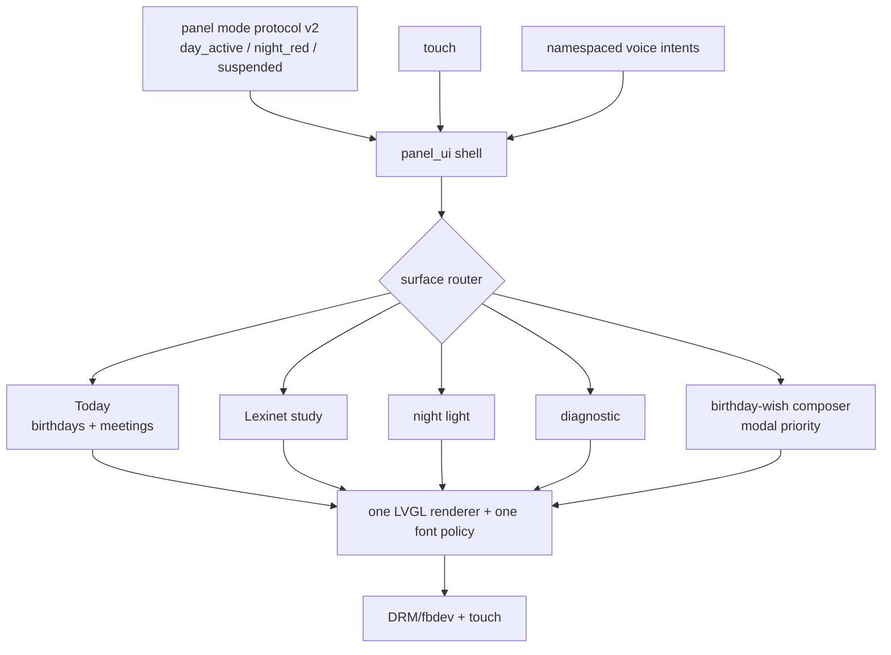
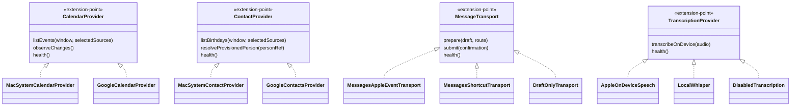
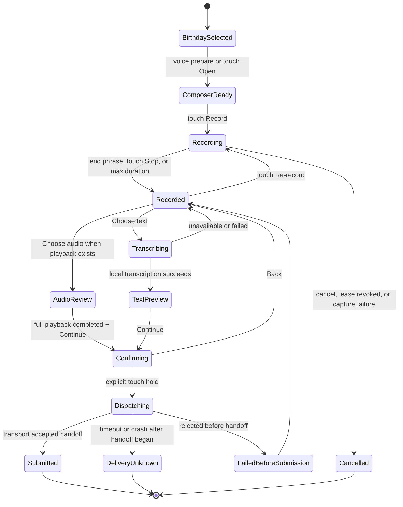
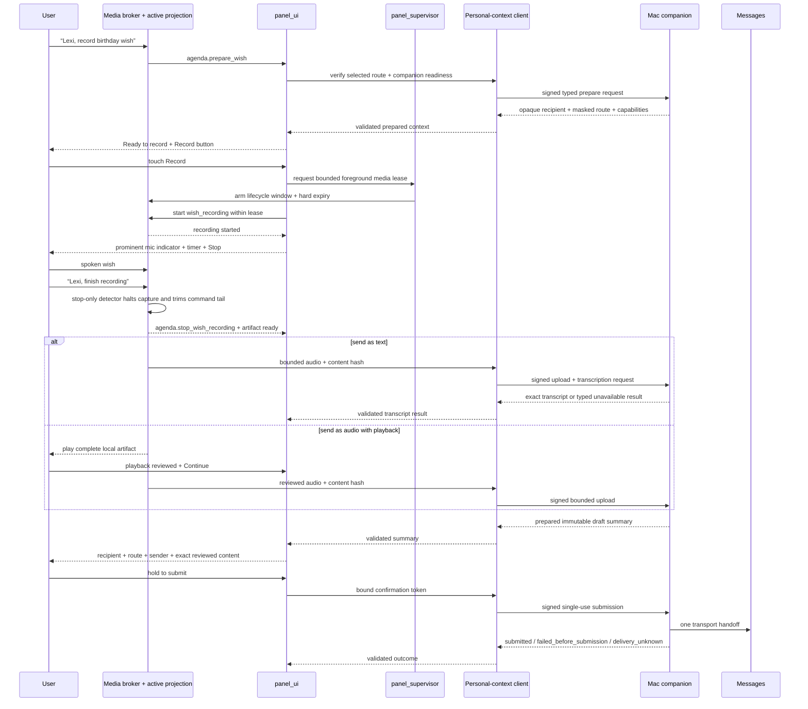

<!-- @canonical personal-agenda-birthday-wishes -->

# Personal Agenda and Birthday Wishes

**Status:** proposed architecture; roadmap Step 1 decision bundle prepared
2026-08-06 and pending human confirmation; no Calendar, Contacts, recording,
transcription, or Messages integration is implemented

**Outcome:** make birthdays and today's meetings a privacy-bounded panel
application, and make a birthday wish a reviewable draft that can be submitted
through a signed companion on the user's Mac. The panel never receives provider
credentials or raw recipient handles, and saying “send birthday wish” never
immediately contacts another person.

## Recommendation

Use the Mac companion as the personal-data and messaging boundary.

The first provider implementation should use EventKit and Contacts.framework
for accounts already configured in macOS. Discovery before consent is
content-free: it checks only adapter availability and authorization state. The
local Mac user must opt into each provider class and grant access before the
companion enumerates sources; it may query events only from calendars selected
after that grant, and it may query contact fields only during explicit local
recipient provisioning. That path can cover iCloud accounts and Google
accounts synchronized through macOS. Keep independent `CalendarProvider` and
`ContactProvider` extension points so a direct Google Calendar/People API
adapter can be added when a Google account should not be configured in System
Settings.

The Mac is already required for Messages, so this design gives one place for
OAuth tokens, Apple privacy grants, recipient provisioning, on-device
transcription, and irreversible message submission. The physically accessible
panel receives only a bounded `TodaySnapshot`, opaque person references, masked
recipient readiness, and draft-specific capabilities.

Treat Messages automation as an experiment until it is proven on the exact Mac
and macOS release. The Messages scripting dictionary installed on the current
development Mac advertises text and file sending, and Shortcuts offers another
automation surface, but neither is a documented unattended delivery API.

## Product scope

### First useful release

- Show birthdays occurring today, with the next seven days available as a
  secondary list.
- Show today's all-day and timed meetings in chronological order.
- Open a birthday-wish composer for the selected birthday.
- Require a deliberate touch to start a bounded recording, then show an
  unmistakable recording indicator and touch stop control.
- Offer locally transcribed text. Offer a generic audio attachment only when a
  measured playback path lets the user review the complete artifact first.
- Show the selected recipient, masked destination, exact transcript or
  completed audio playback, and sender identity before submission.
- Require an explicit touch confirmation for every submission.
- Report `submitted`, `failed_before_submission`, or `delivery_unknown`
  honestly; do not claim delivery or read status.

### Explicitly deferred

- Editing calendars or contacts from the panel.
- Inviting attendees, joining meetings, reminders, or waking the panel for a
  meeting.
- Arbitrary recipient search or group messaging.
- Voice-only message submission.
- Cloud transcription, text-to-speech, or a conversational assistant.
- Persistent offline voice drafts on the panel.
- A promise that an attachment appears as Apple's special expiring audio-note
  bubble rather than an ordinary playable audio file.
- Operation while no user is logged in to the Mac, or an assumption that a
  sleeping Mac can always be reached.

## Product semantics

The spoken phrase is an entry into a reversible workflow, not the external side
effect:

| Input | Meaning | External effect |
|---|---|---|
| `Lexi, send birthday wish` | Open and arm the composer for the currently selected, unambiguous birthday | None |
| `Lexi, record birthday wish` | Recommended alias with more accurate wording | None |
| Record button | Begin visible, bounded `wish_recording` capture | Starts local capture; no network transfer yet |
| `Lexi, finish recording` | Preferred stop phrase; stop the active recording after trimming the command tail | None |
| Stop button | Stop the active recording | None |
| Cancel / re-record | Destroy or replace the draft | None |
| Hold to submit | Submit the exact reviewed draft to the selected route | Irreversible Messages automation |

If more than one birthday is in context, the panel requires a touch selection
before recording. Version 1 does not infer a recipient from a spoken name.
If no provisioned recipient route exists, the birthday remains displayable but
the composer is unavailable.

The UI should label the initial result as **Ready to record a draft**, even when
the recognized phrase contains “send.” Version 1 requires touch to begin
capture and a second touch hold to submit. A false ambient recognition can
therefore open a screen, but cannot capture or transmit room audio and cannot
message a friend. Voice-only recording start is deferred unless later evidence
and an explicit privacy decision accept acoustic replay and false-trigger risk.

The requested `Lexi, end birthday wish` stop phrase remains pending rather than
silently becoming an alias. The shared command-catalog analysis flags `send
birthday wish` and `end birthday wish` as close phone-sequence neighbors. The
version 1 recommendation is therefore `Lexi, finish recording`; retaining the
requested phrase requires a reviewed context-separated exception plus measured
recognizer evidence.

## Current platform reality

### Apple-backed accounts

EventKit is the supported macOS calendar boundary. Reading events requires full
calendar access; Apple does not offer an EventKit read-only permission. The
companion therefore performs only an availability/authorization-state check
until the local user explicitly enables Calendar access. After the broad system
grant, onboarding selects exact calendars before the adapter issues any event
query. Runtime reads remain logically read-only and bounded to those selected
calendars and a short time window.

Contacts.framework provides birthday components, names, and candidate
messaging routes. Native macOS Contacts authorization is effectively all or
nothing. Before the local user explicitly enables Contacts and grants access,
the companion checks only availability/authorization state and reads no source,
person, or route data. Afterward, a local onboarding search requests only the
fields needed to provision an allowlist and pin one route per selected person;
the companion does not bulk-export an address book to the panel.

Both frameworks represent accounts configured on the Mac. This makes the
macOS-system adapter the simplest flexible Apple/Google starting point without
putting either account's credentials on the panel.

### Direct Google accounts

A direct Google adapter remains useful when a calendar or contacts account
should not be synchronized into macOS:

- Google Calendar supports birthday events and exposes a linked People resource
  where one exists. Its birthday type also covers anniversaries and other
  significant dates, so the adapter must inspect the subtype rather than
  treating every birthday event as a human birthday.
- The People API returns contact birthdays as partial dates; a missing year is
  valid.
- Calendar and People incremental sync tokens have provider-specific expiry and
  reset behavior. The adapter must fall back to a bounded full resync instead of
  returning a silently incomplete day.
- Authorization belongs in the Mac companion using a Desktop App OAuth flow,
  the system browser, PKCE, and Keychain-held refresh tokens.
- Prefer the narrow read scopes needed for selected calendar events and direct
  contacts. A service account is not a substitute for a personal Google
  Contacts identity.

The direct Google calendar and contacts adapters are independently selectable.
Google Calendar plus macOS Contacts, or the reverse, remains a supported
configuration.

### Messages

Apple's public macOS documentation exposes no general headless iMessage
transport API. Two candidate automation adapters deserve a measured spike:

1. A fixed, user-provisioned Shortcut per allowlisted recipient.
2. A direct Apple Event using the Messages scripting dictionary from the signed
   companion.

On this development host, macOS 26.5.2 build 25F84 and Messages 26.0 build
1450.600.61.1.5 install a `Messages.sdef` whose `send` command accepts `text` or
`file` and targets a `participant` or `chat`. The observed file SHA-256 is
`a9db9b015709c8c8e92a8bdccf08984635d5c3545f670bcd0e5a3a10bd5f9e4e`.
This is promising local evidence, not a stable cross-version contract.

The companion should be a signed per-user menu-bar application or login item,
not a root daemon. Calendar, Contacts, Messages, Automation grants, Shortcuts,
and sender identity all belong to the logged-in user session. Distribution for
this private appliance should begin with Developer ID signing and notarization,
outside the Mac App Store.

iMessage requires the Mac to be signed in to Messages. SMS/MMS/RCS also depends
on the user's compatible iPhone, carrier/region, and Messages forwarding
configuration. Provision and test each route class separately, show the Mac's
configured sender identity in the confirmation view, and enable only routes
that the feasibility matrix actually proves.

## System boundaries

```mermaid
flowchart LR
    PERSON["Room occupant"] -->|"motion / touch / bounded speech"| PANEL["House panel"]

    subgraph panel["BeagleBone appliance"]
        SUP["panel_supervisor\nlifecycle + power authority"]
        UI["panel_ui\nsole display/touch owner"]
        VOCAB["vocabulary feature"]
        AGENDA["personal agenda feature"]
        MEDIA["media broker\nsole microphone owner"]
        CLIENT["personal-context client\nrequest signer"]
        TSD["tailscaled"]

        SUP -->|"day-active / night / suspended"| UI
        UI --> VOCAB
        UI --> AGENDA
        MEDIA -->|"semantic commands"| UI
        MEDIA -->|"purpose-bound wish artifact"| CLIENT
        AGENDA -->|"typed agenda/draft operations"| CLIENT
        CLIENT -->|"signed canonical requests"| TSD
    end

    subgraph mac["Logged-in Mac user session"]
        SERVE["Tailscale Serve\nHTTPS + app capabilities"]
        RELAY["signed companion\nlocalhost only"]
        CAL["CalendarProvider"]
        CONTACT["ContactProvider"]
        STT["TranscriptionProvider"]
        MSG["MessageTransport"]

        SERVE --> RELAY
        RELAY --> CAL
        RELAY --> CONTACT
        RELAY --> STT
        RELAY --> MSG
    end

    TSD -->|"minimal snapshot / explicit draft"| SERVE
    CAL --> ACCOUNTS["EventKit or Google Calendar"]
    CONTACT --> PEOPLE["Contacts.framework or Google People"]
    MSG --> MESSAGES["Messages via Shortcut or Apple Event"]
```



The supervisor never receives birthdays, calendar events, selected screens,
recipient references, transcripts, or draft state. It continues to own only
presence interpretation, solar state, brightness, suspend, and bounded media
leases.

## One display owner

The current future controller and Buildroot service are vocabulary-specific,
while the LVGL renderer owns process-global state and the exact display and
touch devices. A second agenda renderer cannot safely coexist.

Before either graphical application is promoted, introduce one neutral,
unprivileged `panel_ui` process:



The supervisor's internal `UiMode::Day` is already lifecycle-neutral, but
protocol version 1 serializes it as `display_mode: vocabulary`. Protocol version
2 should send `day_active`; the shell, not the power policy, chooses Today or
Lexinet. The existing sequence-bound render-ready requirement remains.

Recommended daytime presentation policy:

1. On the first daytime presence wake of a local day, show Today.
2. Put today's birthdays first and meetings below.
3. Return to the last selected feature, normally Lexinet, after a measured
   timeout or explicit touch.
4. Keep a birthday badge or Today tab available for the rest of the day.
5. Let an active composer outrank all ordinary surfaces.
6. Never expose agenda content in night-light or suspended mode.

Use namespaced intents such as `study.flip`, `agenda.open`, and
`agenda.prepare_wish`; do not turn one global action enum into an
ever-growing application state machine. Vocabulary and agenda reducers retain
their own domain transitions.

## Provider architecture

<!-- @extension-point CalendarProvider -->
<!-- @extension-point ContactProvider -->
<!-- @extension-point MessageTransport -->
<!-- @extension-point TranscriptionProvider -->



Provider selection is per capability, not a global Apple-versus-Google switch.
CalDAV/CardDAV adapters can be added later, but are not required for version 1.

Do not enable a system-account adapter and direct adapter over the same source
without explicit precedence. macOS may already unify linked contacts, while
cross-provider display-name matching is unsafe. Never merge two people merely
because their names are equal.

## Normalized personal-context model

The companion owns provider identifiers and returns a minimized projection:

```text
TodaySnapshot {
  schema_version
  snapshot_id
  generated_at
  household_time_zone
  household_date
  soft_stale_after
  hard_expires_at
  birthdays[] {
    occurrence_ref
    person_ref
    display_name
    local_date
    birth_year_known
    message_capability: unavailable | provisioned
    masked_destination?
  }
  meetings[] {
    event_ref
    title_or_busy
    local_start
    local_end
    all_day
    location?
  }
  companion_capabilities {
    agenda
    draft_upload
    local_transcription
    message_submission
  }
}
```

The panel does not receive phone numbers, email addresses, Google People
resource names, Apple contact identifiers, attendee lists, organizers, meeting
notes, conferencing URLs, OAuth material, or Messages chat identifiers by
default.

### Birthday rules

- A birthday is month and day with an optional year. Never invent an age.
- Compute occurrences in one explicitly configured IANA household timezone.
  Latitude/longitude used for solar calculation is not a timezone.
- Make the February 29 policy explicit. The proposed default is the last day of
  February in non-leap years, subject to user confirmation.
- Choose one authoritative birthday source for an overlapping account. Calendar
  birthday events may supplement contacts only when a stable provider link
  proves identity.
- Require a locally provisioned person-to-route link before messaging.
- Store provider identity links on the Mac. The panel uses opaque, rotating
  references.

### Meeting rules

- Expand recurring events for the bounded local-day window.
- Put all-day events first, then timed events by start time.
- Exclude cancelled events and events the user declined.
- Render private events as `Busy` unless explicitly configured otherwise.
- Treat title and location as sensitive screen content.
- Make snapshot age visible. A soft-stale same-day snapshot is useful only under
  the documented redaction policy; hard-expired or prior-day data is not
  renderable current truth.
- Do not wake the device or hold it awake merely to refresh the agenda.

Buildroot currently omits timezone data. The feature must add a bounded tzdata
selection or receive fully resolved local dates and offsets from the companion;
it must never infer timezone from coordinates.

## Birthday-wish lifecycle



`Submitted` means that the selected transport accepted the handoff. It does not
mean delivered or read. Once the transport begins the irreversible handoff, the
companion never retries automatically. A timeout or crash at that boundary is
`delivery_unknown` and requires human reconciliation in Messages.

`failed_before_submission` is permitted only before the adapter is invoked.
After invocation begins, every error is `delivery_unknown` unless that exact
measured adapter contract can prove that no handoff occurred or can positively
prove acceptance.

Immediately before invoking Messages, one atomic compare-and-set consumes the
single-use confirmation and durably records the attempt reference, immutable
prepared-dispatch revision, and `dispatch_started` state. Concurrent requests
can produce only one winner. After a restart, any attempt left in that state
becomes `delivery_unknown` and is never replayed. This fail-closed write-ahead
boundary favors a possibly unsent wish over contacting someone twice.

Before handoff, an idempotency key may safely replay draft creation, upload, and
preparation. It must be bound to the panel principal, current birthday
occurrence and household date, fresh snapshot identity, opaque recipient,
immutable route revision and resolved destination, sender identity, transport
kind/version, content hash, media type, and expiry. Preparation revalidates the
current occurrence and route on the Mac. If any bound revision changes before
submission, fail before invoking the adapter and require a new preview. The
confirmation view is built from that prepared summary, then a short-lived
single-use token binds the touch action to the exact revision.

Touch confirmation reduces accidental speech activation; it is not a security
proof against a compromised `panel_ui`. The proposed version 1 boundary accepts
that the UI can exercise the panel's allowlisted message authority and bounds
that exposure on the Mac by current birthday, provisioned route, draft expiry,
rate limits, and one attempted submission per route per household date. This
limitation remains pending with the Step 1 safety review. A stronger requirement
needs a dedicated physical confirmation input owned outside the UI process.

Only one composer and one active draft are allowed per panel. Starting another
requires explicit cancellation of the first, and a draft's person/route cannot
be changed after audio capture begins.

## Voice and media flow



The media broker remains the sole process allowed to open the microphone. It
needs two explicit capture purposes:

- `command_recognition`: bounded volatile audio; emits semantic commands only;
  audio and transcripts never leave the broker.
- `wish_recording`: starts only after the composer is visible, companion
  readiness is verified, and the user touches Record; exports exactly one
  bounded, consented artifact to the draft endpoint. While active, it owns a
  purpose-internal stop-only detector whose `ActiveCommandSet` contains only
  `agenda.stop_wish_recording`.

This purpose split is the explicit exception to the repository's default
no-raw-media network posture. A command-listening buffer must never be promoted
into a wish. Purpose, maximum duration, maximum bytes, destination capability,
and lease expiry are fixed before capture begins.

The supervisor does not learn birthday or draft semantics. It grants or denies
only a generic, bounded media-safety window from presence/lifecycle/power state
and imposes the hard quiesce deadline. The broker validates the named capture
purpose and its tighter artifact rules inside that ceiling.

During recording, `command_recognition` is not separately leased and no study,
agenda-prepare, or other application command set is active. The stop-only
detector consumes the same microphone stream and a small uncommitted tail; it
may halt capture and emit `agenda.stop_wish_recording`, but it cannot start a
new capture, route another intent, upload, or submit. Its detected tail is
removed before the artifact is finalized and can never be promoted from a
general command-listening buffer. Touch stop must always work, and a hard
maximum must auto-stop. The initial proposed maximum is 60 seconds, subject to
hardware and Messages testing. Absence, mute, night transition, suspend
preparation, broker failure, or lease expiry closes capture and can never
trigger submission.

For version 1, require the companion to be reachable before starting. Keep the
panel artifact in bounded RAM and erase it after acknowledged upload or
cancellation. Reboot-surviving drafts require a separate encrypted-storage,
retention, deletion, and recovery design.

Mac-side draft content has a proposed hard expiry of 30 minutes from draft
creation. Audio, transcript text, and message body are stored only in a
mode-`0600` draft area and are deleted sooner on cancellation/re-record,
terminal `failed_before_submission`, successful adapter return, or
`delivery_unknown`. An incomplete upload is removed on request failure, and a
startup sweep removes partial staging. If recovery finds `dispatch_started`, it
first records `delivery_unknown`, never retries, and then deletes the content.
Only opaque non-content attempt metadata (attempt and route revision references,
household date, timestamps, and outcome) may remain for duplicate suppression,
with a 30-day hard expiry. No retention setting may exceed these ceilings in
version 1.

The Mac should transcribe locally:

1. Use Apple Speech only when on-device recognition is reported as supported
   and the request is configured to require it.
2. Otherwise use a separately packaged local Whisper-class adapter if measured
   acceptable.
3. Otherwise disable the text option rather than silently send audio to a cloud
   service.

The capture experiment should compare a simple mono PCM/WAV upload with a
compressed panel format, then transcode on the Mac to a broadly compatible
AAC/M4A attachment. Expect a generic file attachment until testing proves
special audio-message behavior. Duration or waveform alone is not content
review: without a measured speaker/headphone playback path, hide audio
submission and permit only inspected text. If local transcription is also
unavailable, the user can re-record or cancel but cannot submit.

## Tailnet relay contract

The recommended boundary is:

```text
typed panel client + request signer
  -> tailnet HTTPS
  -> Tailscale Serve
  -> 127.0.0.1
  -> signature-verifying signed companion
```

Keep Funnel disabled. The companion listens only on localhost. Tailscale Serve
can strip spoofed capability headers and add selected app-capability data for a
tagged panel in Tailscale 1.92 or later. Ordinary identity headers are not
populated for tagged devices, so do not design around a human login header.

Serve headers are not sufficient authentication: any same-user Mac process can
call the loopback listener and forge them without traversing Serve. Every data
or mutation request must also carry an application-layer Ed25519 signature over
a companion-issued single-use challenge, canonical method/path, requested
capability, body hash, and key identifier. The companion atomically consumes
and durably remembers the challenge, maps the provisioned panel public key to
allowed capabilities, and rejects unsigned direct-loopback requests. This flow
does not depend on the panel's wall clock.

The panel private key is root-provisioned and readable only by a narrow
`personal_context_client`, not `panel_ui` or the media broker. Its local IPC
accepts fixed typed operations, not arbitrary URLs or bytes. The media broker
can supply only a bounded active wish artifact; the agenda surface can request
only normalized reads and draft state transitions. Root compromise still
extracts or exercises the key and remains outside the prototype's resistance
claim.

Pin and test compatible Tailscale versions before using this path. The
development Mac currently runs 1.98.9, but the project Buildroot baseline
packages 1.78.1. If app capabilities cannot be used, retain the exact tailnet
host/port grant and the same mandatory signed application requests; never fall
back to trusting loopback headers or a credential in an argument, URL, image
overlay, log, or diagnostic.

App capabilities authorize a Tailnet node, not an individual Linux process and
not a physical touch. Their separation narrows and audits the companion API but
does not replace signed requests, local device permissions, the
prepared-summary confirmation, or the proposed limitation that a compromised
authorized UI can request allowed operations and root can exercise the device
key directly. That limitation remains pending Step 1 human review.

Proposed capabilities are deliberately separate:

| Capability | Allows | Does not allow |
|---|---|---|
| `agenda.read` | Fetch the bounded Today snapshot | Contact lookup, provider IDs, OAuth |
| `birthday_wishes.prepare` | Validate one provisioned recipient and create/upload one expiring draft | Messages submission |
| `birthday_wishes.transcribe` | Transcribe the named draft locally | Arbitrary files or cloud STT |
| `birthday_wishes.submit` | Submit one prepared, confirmed, unexpired draft | Recipient search, stale queue replay, arbitrary Shortcuts |

The API accepts bounded signed structured values, not shell commands, AppleScript
source, Shortcut names, local paths, calendar predicates, or recipient handles.
Rate-limit preparation and submission, and default to one submission attempt
per provisioned route per household date; only local Mac reconciliation can
unlock another attempt after `delivery_unknown`. Validate audio by file
signature as well as declared type, stage it mode `0600`, and enforce the
30-minute content and 30-day non-content ceilings plus every early-deletion
trigger above.

Example resource shape, to be frozen only after the feasibility work:

```text
GET  /api/v1/today
POST /api/v1/birthday-wish-drafts
PUT  /api/v1/birthday-wish-drafts/{draft_ref}/audio
POST /api/v1/birthday-wish-drafts/{draft_ref}/transcription
POST /api/v1/birthday-wish-drafts/{draft_ref}/preparation
POST /api/v1/birthday-wish-drafts/{draft_ref}/submission
DELETE /api/v1/birthday-wish-drafts/{draft_ref}
```

## Power, wake, and offline behavior

- PIR remains the Linux wake source. Voice never wakes a suspended panel.
- Calendar refresh is opportunistic after wake and on a bounded awake-period
  timer. It does not prevent suspend.
- The panel renders cached personal content only when wall-clock quality and the
  household timezone are trusted, the snapshot's household date is still
  current, and its hard retention deadline has not passed. Otherwise show a
  content-free waiting state and refresh in the background.
- A soft-stale but same-day snapshot is visibly degraded: suppress meeting
  locations and private titles, and disable wish preparation until the
  companion revalidates a fresh current occurrence. Expired or prior-day
  snapshots expose no names, birthdays, titles, or locations.
- A composer receives a supervisor-owned activity/media lease with a hard
  ceiling. The UI can request but cannot grant or indefinitely renew it.
- Suspend preparation revokes capture, waits only a bounded quiesce interval,
  blanks the UI, and never submits a draft.
- Mac offline means only a same-day, within-retention degraded agenda may remain
  visible, while recording and submission are unavailable in version 1.
- Do not queue a “send later” operation. A stale birthday wish must never be
  delivered automatically when the Mac wakes.

The existing one-client supervisor socket should remain the UI lifecycle
channel. A future media broker receives a distinct lease/quiesce socket and
group; it must not join the UI socket group.

## Trust map

| Asset | Primary risk | Boundary/control | Accepted prototype limitation |
|---|---|---|---|
| Google refresh tokens and provider account access | Theft from panel or logs | Mac Keychain only; never sent to panel | Compromised logged-in Mac user can access them |
| Calendar titles and locations | Shoulder surfing or excessive cache | Daytime-only UI; bounded projection/cache; freshness and private-event policy | Physical room occupant can see the lit panel |
| Birthdays and names | Contact corpus disclosure | Selected sources; today/near-term projection only | Names remain visible on the intended appliance |
| Recipient handles and chat identities | Wrong-recipient or database disclosure | Mac-only route provisioning; opaque panel references; masked preview | Mac compromise bypasses this boundary |
| Raw wish audio and transcript | Silent collection, persistence, or exfiltration | Touch-gated visible capture; hardware indicator/mute; RAM-only panel draft; local Mac STT; bounded deletion | Compromised UI can request an allowed capture while the lifecycle lease is active; Tailnet transfer is deliberate |
| Panel companion-signing key | Extraction or borrowing by another process | Root-provisioned narrow typed client; never exposed to UI/broker; single-use companion challenges | Root/physical panel compromise can exercise it |
| Messages authority | False activation, replay, duplicate send | Touch before capture and submit; signed single-use prepare/dispatch; allowlisted current-birthday route; daily attempt bound | A compromised `panel_ui` can fabricate touch-level requests; root can use the device key |
| Submission outcome | Duplicate after ambiguous timeout | No automatic retry after handoff; `delivery_unknown` state | Transport may not expose delivery receipts |
| Mac privacy grants | Background use beyond intent | Signed visible menu-bar app; selected sources/recipients; status and disable control | EventKit's system permission is broader than logical use |
| Panel snapshot | Storage theft | Minimum fields, bounded retention, owner-only storage | First prototype has no hardware-backed encrypted storage |

Logs contain timestamp, trace ID, opaque person/draft/attempt reference,
transport state, and stable error code only. They exclude names, handles,
calendar titles, locations, bodies, content hashes, transcripts, audio, OAuth
values, and raw provider errors. The private dispatch state may retain the exact
hash needed for replay protection only for its bounded reconciliation window.

## Failure semantics

Expected failures are typed and visible:

| Condition | Panel behavior |
|---|---|
| Calendar or Contacts permission denied/revoked | Mark provider unavailable; retain no fabricated data |
| Direct Google token expired or sync token invalid | Reauthorize or bounded full resync; mark snapshot stale until complete |
| Duplicate/ambiguous identity | Display separate entries or require Mac-side link; never choose by name |
| No provisioned message route | Birthday remains visible; composer disabled |
| Mac logged out, asleep, or companion stopped | Only same-day, within-retention degraded agenda may remain; no new draft |
| Microphone denied/muted | Touch agenda remains functional; recording unavailable |
| End phrase missed | Touch Stop and hard duration cap remain |
| Transcription unsupported or uncertain | Return to Recorded; offer audio only with qualified playback, otherwise re-record/cancel |
| Speaker/playback absent or incomplete | Audio submission stays disabled; duration/waveform is not a preview |
| Tailnet interruption during upload | Draft remains unsent and is erased under the retention policy |
| Failure before Messages handoff | `failed_before_submission`; retry only after a new confirmation |
| Timeout/crash after Messages handoff begins | `delivery_unknown`; never auto-retry |

## Conditional implementation roadmap

This roadmap describes likely production work. It is intentionally conditional
on the separate feasibility plan and its ADR.

### A. Neutral panel shell prerequisite

- Introduce `panel_ui` as the sole display/touch/LVGL owner.
- Version the supervisor protocol around lifecycle values such as `day_active`.
- Add a namespaced intent router and subordinate Lexinet/agenda surfaces.
- Move service ownership from `bhp-vocabulary-panel` toward
  `bhp-panel-ui`, with per-service state directories and groups.
- Extract shared bounded HTTP/TLS/cancellation behavior instead of creating a
  second curl lifecycle; keep domain decoding separate.
- Add a bounded Unicode/font policy for contact names and calendar text.

### B. Mac companion foundation

- Create a signed menu-bar app with visible permission and health onboarding.
- Register a per-user login item through `SMAppService`.
- Add provider extension points, selected-source settings, recipient
  provisioning, Keychain storage, and content-free structured logs.
- Implement fixture providers before accessing real personal data.

### C. Read-only personal context

- Freeze a versioned minimized Today contract and explicit timezone policy.
- Implement macOS-system Calendar/Contacts providers first.
- Add direct Google providers only when needed, with independent selection.
- Add the panel agenda reducer, crash-consistent bounded snapshot, stale state,
  and Today/birthday/meeting surfaces.

### D. Tailnet capability boundary

- Upgrade and pin Tailscale versions.
- Configure exact panel-to-companion grants and private Serve HTTPS.
- Add the narrow panel request signer and mandatory single-use signed-request
  validation; reject forged direct-loopback headers.
- Prove `agenda.read`, prepare, transcription, and submission separation with
  negative tests from other tailnet nodes.

### E. Purpose-bound recording

- Generalize the planned media broker around purpose-specific leases without
  weakening the command-recognition privacy path.
- Add touch-to-record, recording indication, a purpose-internal stop-only
  `ActiveCommandSet` and detector, touch stop,
  size/duration bounds, RAM-only artifact lifecycle, upload hashing, and failure
  cleanup.
- Extend Buildroot with a broker-only microphone device classification; do not
  put the UI in the generic `audio` group.

### F. Transcription and Messages

- Package only the measured local transcription adapter.
- Implement exact text review or complete audio playback, re-record/cancel,
  immutable prepared summary, atomic confirmation consumption, and
  hold-to-submit.
- Promote exactly one proven Messages transport, retaining `DraftOnlyTransport`
  as a safe fallback.
- Add OS-version regression tests and honest submission-state telemetry.

### G. On-target and household validation

- Test provider permutations, DST, recurrence, clock loss, stale snapshots,
  Mac lock/sleep/restart, Tailnet faults, permission revocation, mic mute,
  suspend during every draft phase, 100 fake-transport concurrency/restart
  cycles, and only the explicitly approved bounded live self-recipient matrix.
- Measure image/RAM/storage/power cost and record whether the Black remains
  acceptable.
- Update the threat model, operations guides, package manifests, and hardware
  evidence before enabling services by default.

## Acceptance gates

Production implementation is incomplete until evidence proves:

- Apple-configured and Google-configured provider combinations normalize to the
  same bounded model without duplicate people or meetings;
- partial birth dates never invent an age, and the selected February 29 policy,
  once approved, works across leap and non-leap years;
- recurring, all-day, private, cancelled, declined, DST-crossing, and
  timezone-boundary meetings render correctly;
- the panel receives no provider credential or unmasked recipient handle;
- forged Serve headers, unsigned direct-loopback requests, reused challenges,
  and wrong-key/capability requests are denied;
- a voice phrase cannot submit, a multiple-birthday context cannot guess a
  recipient, and every submission previews the exact selected route and
  content;
- no voice recognition can begin `wish_recording`; affirmative touch is required
  before capture or artifact transfer;
- command-listening audio never becomes a wish artifact;
- while `wish_recording` is active, only `agenda.stop_wish_recording` can enter
  its purpose-internal command set; no general command-recognition lease or
  other application grammar is active, and stop recognition cannot submit;
- capture visibly starts and stops, touch stop always works, maximum duration
  is enforced, and every exit path closes the microphone and applies retention;
- audio submission is impossible until complete playback succeeds; a duration
  or waveform never satisfies content review;
- no test produces two Messages submissions from one confirmed draft;
- concurrent confirmation replay produces one durable `dispatch_started`
  winner, and route/sender/transport revision changes require a new preview;
- ambiguous post-handoff failures remain `delivery_unknown` and are never
  retried automatically;
- permission revocation, Mac unavailability, Tailnet loss, malformed data,
  disk pressure, and process crashes fail visibly without fabricated agenda
  data or stale sends;
- untrusted time, prior-day snapshots, and hard-expired snapshots render no
  personal content, while soft-stale same-day content follows the redaction
  policy and cannot prepare a wish;
- meeting refresh and stale data never hold the device awake;
- services remain disabled by default until the on-target privacy, power, and
  suspend matrices pass.

## Version 1 product decisions pending human review

These stable IDs are the review bundle for roadmap Step 1. `Proposed` means the
recommendation is implementation-ready but is not an accepted product decision
until the user confirms it. An evidence-gated choice remains deliberately open
even after the user approves the decision to defer it.

| ID | Proposed version 1 decision | Status | Consequence |
|---|---|---|---|
| `AGENDA-001` | Start with content-free macOS adapter/authorization discovery; only after local opt-in and OS grants may onboarding select calendars and provision recipients before bounded content reads; retain independently selectable direct Google adapters | Proposed | Broad macOS grants never authorize an implicit content probe or panel-side account credential |
| `AGENDA-002` | Show birthdays today plus the next seven local calendar days | Proposed household preference | The Today surface stays bounded while offering useful notice |
| `AGENDA-003` | Observe February 29 birthdays on February 28 in non-leap years | Proposed household preference | The normalized model never invents a birth year or age |
| `AGENDA-004` | Accept `Lexi, send birthday wish` as a prepare alias, but display **Ready to record a draft** and perform no capture or external effect | Proposed from the requested phrase | Product language remains convenient while the state transition stays reversible |
| `AGENDA-005` | Touch starts recording and touch-hold submits; prefer `Lexi, finish recording` to stop active recording; admit the requested `Lexi, end birthday wish` alias only after a reviewed context-separated acoustic exception; voice alone cannot start capture or submit; accept that a compromised authorized `panel_ui` can fabricate those touch-equivalent requests within the Mac allowlist | Proposed safety and command-distinctiveness boundary | Ambient speech can at most open or stop a visible local workflow, but stronger proof of physical touch needs a separately owned input and static phonetic distance cannot replace measured recognition evidence |
| `AGENDA-006` | Use 60 seconds as the recording ceiling, keep no persistent offline panel drafts, cap Mac draft content at 30 minutes, and cap non-content duplicate-suppression metadata at 30 days with deterministic early deletion | Proposed | Evidence may tighten the bounds; raising them or adding persistent drafts requires review |
| `AGENDA-007` | Permit an ordinary reviewed audio-file attachment when the special Messages audio-note form is unavailable; choose the exact encoded format from feasibility evidence | Proposed with evidence-gated format | Audio remains disabled until complete local playback succeeds |
| `AGENDA-008` | Require the signed, logged-in Mac companion to be reachable before recording begins | Proposed | Version 1 does not retain a panel draft waiting for a Mac |
| `AGENDA-009` | A panel without measured playback is text-only; adding a speaker/playback path is deferred to hardware and product-platform evidence | Proposed policy with hardware decision deferred | Recording may still support local transcription without enabling audio submission |
| `AGENDA-010` | Keep `DraftOnlyTransport` until the feasibility matrix selects a Messages adapter; keep the feasibility probe here and promote a successful production companion to a top-level `mac_companion/` domain in this repository | Proposed adapter deferment and repository boundary | Shared contracts and release sequencing stay discoverable; reconsider separation only if independent ownership or cadence emerges |

### Safety stop points included in this review

- No live Messages test is authorized by approval of this bundle. Immediately
  before the first external side effect, execution stops again for approval of
  the exact self/test route, maximum message count, marker-text class, and
  synthetic audio fixture. No friend is a feasibility target.
- `DraftOnlyTransport` is the default and cannot submit. Before local opt-in and
  OS grants, provider discovery is content-free. Afterward, bounded adapters
  read only explicitly selected calendars and locally provisioned contacts even
  where macOS grants broader framework permission.
- A Messages automation return is never called delivery. Once handoff begins,
  an ambiguous timeout or crash is `delivery_unknown` and is never retried
  automatically.
- Every submission is bound to one fresh birthday occurrence, provisioned
  opaque route, immutable prepared content, sender/transport revision, expiry,
  and single-use touch confirmation.
- Approving the touch-authority safety boundary accepts that a compromised
  `panel_ui` can exercise the narrowly allowlisted message authority exposed to
  it. A dedicated physical confirmation input is required if that limitation is
  unacceptable.
- Approving the retention decision sets a 30-minute hard ceiling on Mac content
  and a 30-day ceiling on non-content duplicate-suppression metadata.
  Cancellation, terminal failure, handoff outcome, expiry, and crash recovery
  apply the earlier deletion rules; `delivery_unknown` never preserves sendable
  content.
- Personal payloads, recipient handles, provider identifiers, credentials,
  audio, transcripts, and TCC state never enter Git, arguments, URLs, logs, or
  diagnostic archives.

The first executable tranche is
[the personal-agenda feasibility plan](../../.claude/plans/2026-08-05-personal-agenda-feasibility.md).

## Primary references

### Apple

- [EventKit event-store access](https://developer.apple.com/documentation/eventkit/accessing-the-event-store)
- [Requesting full event access](https://developer.apple.com/documentation/eventkit/ekeventstore/requestfullaccesstoevents%28completion%3A%29)
- [EventKit sources](https://developer.apple.com/documentation/eventkit/ekeventstore/sources)
- [Contacts store access](https://developer.apple.com/documentation/contacts/accessing-the-contact-store)
- [Contact birthday components](https://developer.apple.com/documentation/contacts/cncontact/birthday)
- [Run Shortcuts from the command line](https://support.apple.com/guide/shortcuts-mac/run-shortcuts-from-the-command-line-apd455c82f02/mac)
- [Messages setup on Mac](https://support.apple.com/guide/messages/ichte16154fb/mac)
- [Text Message Forwarding](https://support.apple.com/102545)
- [Apple Events automation permission](https://support.apple.com/guide/mac-help/allow-apps-to-automate-and-control-other-apps-mchl108e1718/mac)
- [Apple Events usage description](https://developer.apple.com/documentation/bundleresources/information-property-list/nsappleeventsusagedescription)
- [Apple Events Hardened Runtime entitlement](https://developer.apple.com/documentation/bundleresources/entitlements/com.apple.security.automation.apple-events)
- [On-device Speech requirement](https://developer.apple.com/documentation/speech/sfspeechrecognitionrequest/requiresondevicerecognition)
- [ServiceManagement `SMAppService`](https://developer.apple.com/documentation/servicemanagement/smappservice)
- [Developer ID distribution](https://developer.apple.com/help/account/certificates/create-developer-id-certificates/)

### Google

- [Google Calendar event and birthday types](https://developers.google.com/workspace/calendar/api/guides/event-types)
- [Google Calendar incremental synchronization](https://developers.google.com/workspace/calendar/api/guides/sync)
- [Google Calendar authorization scopes](https://developers.google.com/workspace/calendar/api/auth)
- [Google People connections](https://developers.google.com/people/api/rest/v1/people.connections/list)
- [Google People birthday field](https://developers.google.com/people/api/rest/v1/people)
- [OAuth for desktop applications](https://developers.google.com/identity/protocols/oauth2/native-app)

### Tailnet

- [Tailscale Serve](https://tailscale.com/docs/features/tailscale-serve)
- [Tailscale Serve CLI](https://tailscale.com/docs/reference/tailscale-cli/serve)
- [Tailscale identity](https://tailscale.com/docs/concepts/tailscale-identity)
