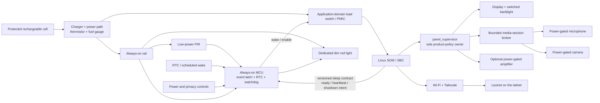
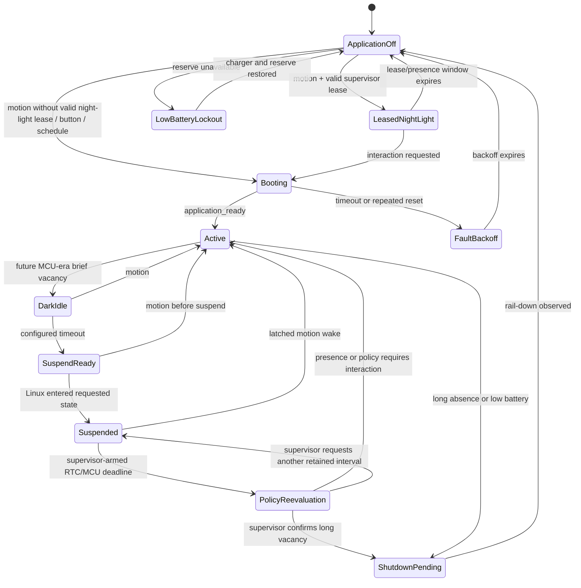

# Proposed Power-Domain Architecture

**Status:** proposed product architecture; not implemented or hardware-proven.

## Promise

The product can wake promptly for human interaction while allowing every
high-draw Linux, display, network, microphone, camera, and speaker rail to be
removed during sufficiently long vacancy. Product policy remains independent
of the chosen application processor and exact low-power mechanism.

This document owns the future two-domain design. The concrete implemented
AM335x topology remains in [system architecture](system-architecture.md), and
the candidate evidence remains in
[compute platform assessment](../research/compute-platform-assessment.md).

## Why two power domains

Always-on presence detection and interactive Linux have different power,
reliability, and security requirements. A faster single-board computer does not
by itself create a good battery appliance.



The controller remains alive when the SOM is completely unpowered. It captures
a brief PIR event, enforces battery/thermal ceilings, recovers from a wedged
Linux boot, and applies wake-rate backoff. It may execute a previously issued,
bounded night-light lease, but it never calculates solar state or invents
product policy. An M4/M7/R5 inside a candidate SoC can help during suspend, but
cannot replace the external controller while the complete SOM rail is off.

The analog charger and cell-protection hardware—not MCU firmware—enforce
battery safety.

## Stable capability seams

These capabilities may vary independently across the Black, a future SOM, and
host tests:

- `PresenceSource`: current state plus monotonically ordered changes.
- `PowerController`: exact named transition request plus accepted/rejected
  result; no silent substitution.
- `Backlight`: validated logical brightness to exact applied hardware result.
- `CommandRecognizer`: bounded audio utterance plus one content-addressed active
  command set/backend projection to a semantic intent with artifact identity,
  abstention, or typed failure. Command transcripts and engine scores remain
  broker-local.
- `TranscriptionProvider`: an explicitly consented birthday-wish artifact to a
  bounded transcript or typed failure. It never consumes the command-listening
  ring buffer.
- `GestureRecognizer`: bounded frame/landmark stream to gesture/confidence or
  typed failure.
- `MediaSessionBroker`: sole owner of raw ALSA/V4L2 device nodes; accepts a
  supervisor-authorized purpose and duration and yields only the bounded stream
  required by a recognizer. The unprivileged UI never opens raw media devices or
  rail-enable controls.
- `FlashCardView`: rendering independent of DRM, LVGL, or display connector.
- `LexinetClient`: authoritative remote vocabulary operations independent of a
  bounded local degraded cache.

These are intended extension points, not a request for a speculative plugin
framework. Use the lightest interface that supports the host fake, current
BeagleBone backend, and at least one future SOM backend.

## Power states

A configured state must fail visibly when unsupported rather than silently
entering a shallower mode.

This table describes the proposed future two-domain, MCU-backed product. In
particular, `dark_idle` is a future MCU-era application-processor state; it is
not the current AM335x presence-grace behavior. The authoritative current grace
contract lives only in [panel policy](../behavior/panel-policy.md).

| State | Application processor | Display and media | Network | Wake | Use |
|---|---|---|---|---|---|
| `active` | Running | Required rails on | Available | Already interactive | Occupied daytime UI or active voice/gesture interaction |
| ~~`dark_idle`~~ | ~~Running and runtime-idle~~ | ~~Backlight off; camera/mic normally off~~ | ~~Available~~ | ~~Immediate~~ | ~~Brief vacancy or debugging control~~ |
| `dark_idle` (future MCU era only) | Running and runtime-idle | Backlight off; camera/mic normally off | Available | Immediate | Future controller-backed brief vacancy or debugging control; never current presence grace |
| `suspend_to_ram` | Platform deep suspend, RAM retained | Display/camera/mic rails off | Unavailable unless a complete WoWLAN chain is proven | PIR resume or supervisor-armed policy deadline | Medium vacancy |
| `application_domain_off` | Clean shutdown, SOM rail off | All Linux-domain rails off | Unavailable | MCU cold boot | Long vacancy, low battery, or repeated fault |
| `leased_night_light` | Off | Only dedicated red LED on under a bounded supervisor-issued lease | Unavailable | Raw PIR/button handled by MCU within lease limits | After-hours light without starting Linux |

The transition between suspend and power-off is a measured break-even:

```text
break_even_absence =
    (cold_boot_to_ready_energy - resume_to_ready_energy)
    / (suspend_power - application_domain_off_power)
```



## Wake and shutdown handshake

### Wake

1. PIR, button, RTC, or charger wakes the MCU.
2. The MCU latches the bounded wake reason, boot epoch, sequence, and timestamp.
3. It checks independent battery/thermal ceilings, fault backoff, and wake-rate
   limits.
4. If a non-expired, versioned lease previously issued by `panel_supervisor`
   authorizes a red-light interval, the MCU may execute that exact bounded
   action without calculating solar state. Missing, stale, or invalid leases
   fail with the red LED off.
5. Otherwise it asserts the board's supported wake or power input, subject to
   the hard safety ceilings.
6. Linux resumes or boots, initializes local UI state, and asserts
   `application_ready`.
7. The supervisor consumes wake reason, current presence, and battery state.
8. A correct local frame is staged before nonzero backlight.
9. Wi-Fi, Tailscale, and Lexinet recover asynchronously.

Before entering suspend-to-RAM, the supervisor also issues the next bounded
policy-reevaluation deadline. At that deadline the RTC/MCU wakes Linux with a
scheduled reason; it never cuts the application rail. The supervisor re-reads
presence and time, then chooses active, another retained interval, or orderly
application-domain-off. This is the route from medium to long vacancy while
preserving the sole-policy-owner and shutdown-handshake invariants.

### Shutdown

1. `panel_supervisor` decides that measured long-absence policy requires
   application-domain-off. Analog/MCU low-battery protection may independently
   require shutdown for safety.
2. The supervisor sends a bounded sleep contract, including any authorized
   night-light interval, and `shutdown_intent`; Linux commits bounded writable
   state.
3. Linux invokes an orderly kernel poweroff.
4. The MCU observes PMIC power-good or rail fall and returns to
   `application_domain_off`.
5. A forced rail cut occurs only after a watchdog timeout and records a reset
   cause.
6. Repeated failed boots enter exponential backoff; low battery enters explicit
   boot lockout until charging restores reserve.

## MCU/Linux trust contract

The MCU treats Linux messages as untrusted hints, even when they arrive over a
private on-board bus. Every message has a bounded version and length, boot
epoch, monotonic sequence, type, value, and acknowledgement. The MCU rejects
stale or replayed state after either side resets and reconciles current rails,
presence, and reset cause before accepting a new lease. A checksum detects bus
corruption; it does not make compromised Linux trustworthy.

The responsibility split is explicit:

- `panel_supervisor` is the only product-policy owner. It decides solar mode,
  presence grace, display behavior, ordinary suspend/off timing, and the exact
  bounded night-light lease. This proposed architecture does not restate current
  grace duration or brightness; [panel policy](../behavior/panel-policy.md) is
  authoritative for those semantics.
- The MCU enforces hard ceilings: minimum battery reserve, thermal cutoff,
  maximum boot duration, an absolute awake time/energy budget per wake and
  rolling time window, maximum wake rate, and fault backoff. Acknowledgements
  and heartbeats cannot renew those ceilings indefinitely; only charger-present
  or a physical service mode may use separately bounded limits.
- Physical buttons may request service/recovery behavior, but ordinary sensor
  input cannot disable safety limits.
- A stuck or chattering PIR cannot retain nonzero display/media power forever.
  The product design needs a bounded degraded display-off state and an explicit
  physical recovery path. That policy is not implemented in the current Black
  scaffold and requires a supervisor change with tests before product use.

Prevent phantom powering through MCU-to-SOM GPIO, UART, I2C, and USB when the
application domain is off. Use open-drain, isolation, level translation, or
high-impedance states as the final schematic requires.

## Kernel-module proof of concept

The requested Linux kernel proof remains useful under this architecture. Two
implementations share one userspace presence contract:

1. **Direct suspend wake:** PIR drives a verified wake-capable application
   processor GPIO. The custom module or stock `gpio-keys` makes it a wake source
   and emits an input event. This is the fast suspend-to-RAM path.
2. **Controller-supervised wake:** PIR drives the MCU. The MCU latches the event
   and asserts a wake/power line. A kernel-side provider exposes the controller
   event and current presence level after Linux resumes.

Both paths re-read sensor state before suspend and after wake. A PIR can remain
asserted, so an edge alone is not occupancy state. `presence_sensor` owns
acquisition and wake mechanics; `panel_supervisor` remains the sole owner of
grace periods, solar policy, display, and transitions.

Linux `freeze`, `standby`, and `mem` are distinct requests. The current Black
experiment must record `/sys/power/state`, `/sys/power/mem_sleep`, every
relevant `power/wakeup`, wake IRQ/reason, kernel/device-tree/firmware versions,
and suspend statistics.
[Linux sleep states](https://docs.kernel.org/admin-guide/pm/sleep-states.html)
and [device wakeup model](https://docs.kernel.org/driver-api/pm/devices.html).

## Motion and night light

A low-power PIR is the preferred always-on wake sensor. Continuous radar may
improve stationary-person detection but can dominate a multi-week budget. If
needed, use PIR for wake and briefly power or duty-cycle radar for occupied
confirmation.

The lowest-latency and lowest-energy night light is a dimmable red LED on the
always-on domain. Before powering off, the supervisor can issue a versioned,
expiring lease with the permitted interval, brightness ceiling, and maximum
duration. The MCU executes but does not derive that policy. The requested red
LCD surface remains a valid comparison because it may give better diffusion and
UX, but it requires display-controller and backlight power and wins only if
measurement justifies it.

## Battery and power path

A USB battery bank is suitable only for early experiments after confirming
low-current always-on behavior and supported charge-through operation. The
product path includes:

- a protected cell or certified protected pack;
- a charger with power-path management;
- correctly placed thermistor and hardware temperature qualification;
- independent pack protection;
- a fuel gauge for state-of-charge and state-of-health reporting;
- efficient conversion at dormant and peak current;
- separate switches for backlight/display, camera, microphone, and speaker
  amplifier;
- shutdown energy reserve;
- low-battery boot refusal and charger-insertion recovery without boot loops.

Measure at the battery boundary so conversion and carrier losses are included:

```text
daily_energy = sum(state_power * state_time)
             + sum(transition_count * transition_energy)

runtime_days = usable_battery_energy / daily_energy
```

For intuition only, a nominal 10,000 mAh, 3.7 V pack contains 37 Wh. If 30 Wh
is usable after conversion, reserve, temperature, and aging:

| Illustrative duty cycle | Daily energy | Approximate runtime |
|---|---:|---:|
| 4 W active for 4 h; 0.15 W suspended for 20 h | 19 Wh | 1.6 days |
| 4 W active for 1 h; 0.02 W controller/AP-off for 23 h | 4.46 Wh | 6.7 days |
| 4 W continuously | 96 Wh | 7.5 hours |

These are not candidate predictions. They show why screen-on time and dormant
power matter more than advertised milliamp-hours.

## STT and gestures

- Use voice-activity detection and short utterances instead of continuous
  Whisper.
- Begin with explicit touch or push-to-talk; evaluate a low-power wake word
  only if hands-free value justifies it.
- Prototype with a USB Audio Class microphone, then use PDM/I2S MEMS hardware
  in the product.
- Train gesture models on a workstation or tailnet server; deploy only small,
  quantized inference models.
- Prefer hand/pose landmarks plus a compact classifier to open-ended image
  recognition.
- Run the camera only while presence and active UI state justify it.
- Benchmark STT, gestures, and the concurrent workload in the real room,
  including noise, lighting, distance, and thermal soak.

## Tailnet and local-first behavior

Linux cannot remain reachable through Tailscale while suspended or off.

- Render a safe local frame before network recovery.
- Keep a bounded, explicitly degraded flash-card working set.
- Queue a bounded set of review mutations with idempotency metadata.
- Recover Wi-Fi, DNS, Tailscale, and Lexinet asynchronously.
- Measure `sensor edge -> first correct frame` separately from
  `sensor edge -> Lexinet ready`.
- Calculate sunrise/sunset locally from coordinates and valid RTC time.
- Permit scheduled maintenance wake only when freshness justifies its energy.

Lexinet remains authoritative after reconciliation. Offline behavior does not
fabricate server success.

## Privacy and security

The canonical controls live in [the threat model](../security/threat-model.md).
The power architecture must make them physically enforceable: microphone and
camera rails default off, physical mute removes microphone power/clock, the
camera indicator is tied to its rail, and an optional shutter blocks the lens.
Raw audio/video is not retained or transmitted by default. The unprivileged UI
does not own ALSA/V4L2 nodes or media load switches; it requests semantic voice
or gesture interactions through bounded sessions.

The controller is an availability root. Production firmware needs
authenticated updates, rollback protection, watchdog recovery, reset-cause
reporting, controlled debug access, and wake-rate limiting. Cold-off reduces
the time remotely exposed Linux code and RAM secrets remain active, but it does
not erase Wi-Fi, Tailscale, or Lexinet credentials from storage. Suspend also
retains credentials and transient media in RAM; media buffers are bounded and
wiped at session end and before suspend, and media/credential processes disable
swap and core dumps in the production design.

Linux and MCU updates need separate production state machines: authenticated
manifests, anti-rollback state, immutable A/B slots, boot confirmation, an
independent recovery path, and charger/reserve gates. The MCU grants a bounded
update lease during which it avoids an ordinary watchdog cut; analog battery
safety still takes precedence. Linux cannot install controller firmware unless
the MCU bootloader independently verifies it. These are production gates, not
claims about the current prototype.

## Display consequence

The 4D cape is the least portable major component. Characterize it on the Black
because it is already owned and may support the first working panel. For the
packaged product, assume a modern DSI or LVDS/OLDI capacitive display unless the
cape wins a measured portability, power, availability, and integration test.

## “What if” checks

| Change | Expected extension |
|---|---|
| Linux board changes | New power/display/media/inference backends; policy and UX remain |
| SoC suspend is unreliable | MCU uses application-domain-off for long absence |
| Cold boot is too slow | Increase suspend residency; stage local frame before network |
| PIR misses a stationary person | Duty-cycle a second sensor without changing `PresenceSource` consumers |
| Local STT is too expensive | Tailnet recognizer implementation with explicit privacy/degraded behavior |
| Camera is removed | Gesture capability reports unavailable; vocabulary and presence remain |
| Product must work offline for days | Increase bounded cache via the existing Lexinet boundary, not a second authority |

## Evidence gate

Do not promote this diagram to an implemented architecture until a named
controller, charger/power-path circuit, SOM/carrier, wake input, isolation path,
and shutdown handshake are prototyped. Record battery-boundary current,
transition energy, wake latency, missed/false wakes, failure recovery, thermal
behavior, and exact software revisions.

**Amended 2026-08-07:** ~~The original `dark_idle` row could be read as the
current presence-grace display behavior.~~ `dark_idle` is now explicitly a
future MCU-era state in this proposed two-domain architecture, while the current
grace contract defers to the authoritative panel-policy document. No product
decision changed status, roadmap Step 1 remains unapproved, and no hardware
observation was promoted into a default.
