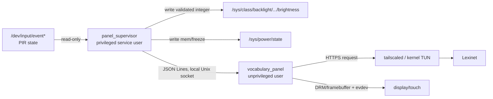

# Process Interconnectivity

## Runtime topology



Only the supervisor receives permissions for backlight and suspend. The UI can connect to the supervisor socket and display/input devices, but it cannot change system power directly.

## Present during daytime

```mermaid
sequenceDiagram
    participant P as Presence provider
    participant S as Panel supervisor
    participant U as Vocabulary panel
    participant T as tailscaled
    participant L as Lexinet

    P->>S: asserted state event
    S->>S: read clock; calculate solar period
    S->>U: mode.v1 {display_mode: vocabulary}
    S->>S: apply calibrated day brightness
    U->>T: HTTPS next-card request
    T->>L: route over tailnet
    L-->>U: validated response envelope
    U-->>U: word screen
```

## Absence and resume

```mermaid
sequenceDiagram
    participant P as Presence provider
    participant S as Panel supervisor
    participant U as Vocabulary panel
    participant K as Kernel PM
    participant T as tailscaled

    P->>S: deasserted state event
    S->>S: enter grace period
    S->>S: grace expires; re-read current state
    S->>S: apply brightness 0
    S->>U: mode.v1 {display_mode: suspended}
    S->>K: request selected suspend experiment
    Note over K,T: network and tailnet become unavailable in DeepSleep0
    P->>K: GPIO0 wake interrupt
    K-->>S: process resumes
    S->>S: re-read GPIO + clock + solar truth
    S->>U: recomputed mode; never blind-toggle
    S->>S: v1 applies brightness after socket delivery
    Note over S,U: render-ready/page-flip acknowledgement is not implemented yet
    T-->>T: re-establish tailnet asynchronously
```

## Local mode protocol

The supervisor is authoritative. The UI cannot command a mode; version 1 only
delivers snapshots/events. With no connected UI, publication is deliberately a
successful no-op so power policy cannot be held hostage by a crashed display
process. A future sequence-bound render-ready acknowledgement may delay
nonzero brightness without granting the UI power authority. See
[panel mode protocol](../interfaces/panel-mode-protocol.md).

## Lexinet boundary

Tailscale supplies routing and node identity. Lexinet must still validate whatever application credential or tailnet identity policy it chooses. API data is untrusted until schema validation succeeds. See [provisional Lexinet contract](../interfaces/lexinet-contract.md) and [threat model](../security/threat-model.md).
