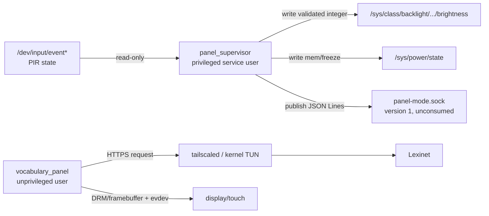

# Process Interconnectivity

**Status:** the first three diagrams document the implemented but disabled
scaffold, including the version 1 publisher ending at an unconsumed socket.
They do not describe the accepted planned production owner or claim that a
production panel study client exists. Lexinet's server-side `study.v1` API and
local native-TLS scoped Tailnet boundary are implemented in its repository; the
planned on-panel successor slice is shown separately. Agenda-to-Mac provider
and message flows remain in the personal-agenda architecture.

## Current scaffold runtime topology



Only the supervisor receives permissions for backlight and suspend. In this
legacy scaffold, ~~the vocabulary process can connect to the supervisor socket
and display/input devices~~ the supervisor publishes version 1 to its local
socket, but `vocabulary_panel` implements no `AF_UNIX` client and does not
consume those snapshots. The vocabulary process remains unprivileged and
cannot change system power directly. The planned neutral `panel_ui` replaces
that device owner before production.

## Current scaffold daytime sequence

```mermaid
sequenceDiagram
    participant P as Presence provider
    participant S as Panel supervisor
    participant M as Panel-mode socket (unconsumed)
    participant U as Vocabulary panel
    participant T as tailscaled
    participant L as Lexinet

    P->>S: asserted state event
    S->>S: read clock; calculate solar period
    S->>M: publish mode.v1 {display_mode: vocabulary}
    Note over M,U: no implemented client carries this snapshot to U
    S->>S: apply calibrated day brightness
    U->>T: study.v1 create/resume or sync over HTTPS (not mode-triggered)
    T->>L: route over tailnet
    L-->>U: validated response envelope
    U-->>U: word screen
```

The exchange above is Lexinet's frozen `study.v1` contract. Production panel
study requests stay disabled until real Tailnet evidence and packaging are
verified; the historical next-card adapter was removed on 2026-09-25.

## Absence and resume

```mermaid
sequenceDiagram
    participant P as Presence provider
    participant S as Panel supervisor
    participant M as Panel-mode socket (unconsumed)
    participant K as Kernel PM
    participant T as tailscaled

    P->>S: deasserted state event
    S->>S: enter grace period
    S->>S: grace expires; re-read current state
    S->>S: apply brightness 0
    S->>M: publish mode.v1 {display_mode: suspended}
    S->>K: request selected suspend experiment
    Note over K,T: network and tailnet become unavailable in DeepSleep0
    P->>K: GPIO0 wake interrupt
    K-->>S: process resumes
    S->>S: re-read GPIO + clock + solar truth
    S->>M: publish recomputed mode; never blind-toggle
    S->>S: v1 applies brightness after retaining the snapshot
    Note over S,M: publication is unconsumed; no render-ready acknowledgement exists
    T-->>T: re-establish tailnet asynchronously
```

## Local mode protocol

The supervisor is authoritative. The UI cannot command a mode. ~~Version 1 only
delivers snapshots/events.~~ Version 1 publishes snapshots/events, but no
implemented process consumes them. With no connected consumer, publication is
deliberately a successful no-op so power policy cannot be held hostage by a
crashed display process. A future sequence-bound render-ready acknowledgement
may delay nonzero brightness without granting the UI power authority. See
[panel mode protocol](../interfaces/panel-mode-protocol.md).

## Proposed production panel/Lexinet convergence slice

```mermaid
flowchart LR
    PIR["PIR / attributed input"] --> SUP["panel_supervisor\npower + lifecycle authority"]
    TOUCH["exact configured touch evdev"] -->|"direct observation"] SUP
    SUP -->|"mode.v2 snapshot / commit deadline"| SHELL["panel_ui\nsole display + application touch router"]
    SUP -->|"separate one-way normalized touch observation + opaque ID"| SHELL
    SHELL --> STUDY["vocabulary reducer\ncache + outbox"]
    SHELL --> AGENDA["agenda reducer"]
    CATALOG["spoken-command catalog"] --> SET["ActiveCommandSet"]
    SET --> PROJ["content-addressed backend projection"]
    POLICY["validated recognition-policy artifact"] --> BROKER
    MIC["microphone"] --> BROKER["media broker\nraw capture owner"]
    SUP -->|"lifecycle window; close on absence / night / suspend preparation"| BROKER
    SHELL -->|"direct purpose-scoped lease request + touch observation ID"| BROKER
    BROKER -->|"exact-peer claim for canonical operation digest"| SUP
    PROJ --> BROKER
    BROKER -->|"artifact-bound semantic intent"| SHELL
    SHELL --> DISPLAY["DRM/fbdev + application touch routing"]
    STUDY -->|"HTTPS study.v1"| TAIL["panel tailscaled / kernel TUN"]
    TAIL -->|"native TLS :443"| LEX["Lexinet create + sync router"]
```

ADR 0006 accepts this local-runtime ownership and product-semantics slice, which
remains disabled pending the resilient study client, shared shell integration,
panel Tailscale packaging, real Tailnet deployment evidence, catalog pipeline,
and cross-repository tests. The server-owned `study.v1` contract, canonical
service, and local native-TLS scoped Tailnet boundary are implemented. The slice
intentionally stops at the agenda reducer; the signed personal-context client,
recording-artifact transfer, Tailnet route, and Mac companion are documented in
[Personal Agenda and Birthday Wishes](personal-agenda-and-birthday-wishes.md).

**Amended 2026-10-19 (issue #22):** the supervisor-to-broker edges now exist
on the supervisor side. `MediaWindowEndpoint`
(`BHP_PANEL_SUPERVISOR_MEDIA_WINDOW_SOCKET`) publishes the lifecycle window and
redeems the broker's touch claims, with the wire format in
`shared/media_window_protocol` (one session ID and a rising sequence per
frame; a new session, a gap or a lost connection closes the window). The
broker that uses it is the
[voice-take capture plan](../../.claude/plans/2026-10-19-voice-take-capture.md)'s
Step 5.

~~The diagram's former `panel_ui`-owned touch edge left the UI able to author
the same touch claim consumed by a capability holder.~~ Under accepted
[ADR 0005](../decisions/0005-validate-touch-provenance-at-capability-holders.md),
the supervisor observes the exact configured touch device and forwards
normalized events on a separate one-way stream. The UI maps those events to
application actions, then requests media leases directly from the broker. Only
the broker or personal-context client can claim an observation from the
supervisor and bind it once to an opaque canonical operation digest. Those
claimants use distinct exact service UIDs verified with `SO_PEERCRED`; group
membership cannot substitute, and each claimant reciprocally verifies the
supervisor UID and root-owned socket identity. Version, supervisor session, and
sequence bind lifecycle, observation, and provenance messages. Disconnect,
restart, stale session, replay, or an unreconciled gap closes the media window
and broker leases, and invalidates unclaimed observations or in-flight claim
exchanges. It does not revoke a confirmation token already created by the
personal-context client, which has no lifecycle subscription and applies its
own expiry/restart/consumption rules. Cutover removes the UI's current raw
`bhp-touch` access, and slow observation/provenance consumers are dropped so
they cannot delay blanking or suspend. This does not add any request, lease,
feature message, or capability negotiation to the UI-to-supervisor lifecycle
socket.

## Lexinet boundary

Tailscale supplies routing and native peer evidence. Lexinet independently
applies narrow study authorization. Its implemented Tailnet handler uses native
TLS on fixed port 443, fresh per-request `WhoIs`, and exposes only
create/resume and sync; GET, operator, health/version, and vocabulary routes
stay loopback-only. Node-capability and scoped-token modes are mutually
exclusive and retain a local operation/profile ceiling. API data remains
untrusted until the server-owned schema and panel validation both succeed.
Real policy, tagged/negative/revocation/certificate evidence and the panel
package choice remain deployment gates. See the [Lexinet consumer transition
contract](../interfaces/lexinet-contract.md) and [threat
model](../security/threat-model.md).

**Amended 2026-08-07:** corrected the current topology and sequences to show
that the supervisor publishes protocol version 1 while the socket remains
unconsumed; the future neutral `panel_ui` remains the first planned consumer.

**Amended 2026-08-07:** added the proposed ADR 0005 touch-provenance path,
direct UI-to-broker lease request, supervisor lifecycle publication, and
capability-holder claim boundary. These are future contracts, not implemented
code, hardware evidence, roadmap approval, or product-decision approval.

**Amended 2026-08-16:** reconciled the planned convergence slice with ADR 0006
acceptance of its product semantics, shared ownership, and atomic protocol-v2
cutover. Every depicted successor component remains disabled or absent pending
its implementation and evidence gate.

**Amended 2026-08-17:** recorded clean Lexinet HEAD
`ce42272df315f357e10998dd48e9ffd1a935c2ff`, where native
`tsnet.ListenTLS`, a separate create/resume-and-sync router, fresh `WhoIs`, and
scoped node-capability/token authorization are implemented locally.
Verification Item 1 is recorded; the synthetic listener-failure proof is not
real certificate evidence. Tagged, untagged, wrong/extra-tag, live-revocation,
destructive/cross-profile, MagicDNS/hostname/handshake/invalid-certificate
evidence and the panel Tailscale packaging choice remain pending. Contract
provenance and roadmap checkboxes are unchanged, and Step 5 stays unchecked.
