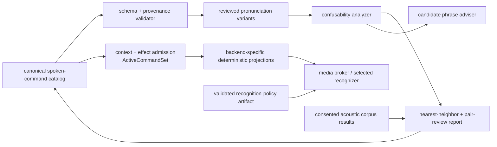

<!-- @canonical spoken-command-distinctiveness -->

# Spoken Command Distinctiveness

**Status:** proposed for roadmap Step 1 human review; no catalog, analyzer,
active-set builder, or backend projector is implemented

**Initial language profile:** proposed `en-US`

## Outcome and terminology

Maintain one panel-wide inventory of spoken forms, their reviewed phoneme
breakdowns, the contexts in which they can be active, and measured recognition
confusions. Use it to find dangerously similar commands before they enter an
application and to rank candidate phrases by their distance from the existing
vocabulary.

“Phonetic orthogonality” is a useful mathematical analogy for the desired
property, but the engineering terms used here are **phonetic distinctiveness**
and **command confusability**. “Phonetic dissonance” usually suggests an
acoustic or aesthetic effect rather than separability in a recognizer.

Static phoneme distance is a design-time screen, not a probability that speech
will be recognized correctly. The selected microphone, speakers, room noise,
pronunciation variants, recognition engine, and thresholds remain decisive.

`Lexi` is an invocation prefix while Linux is already listening. It is not a
low-power wake word and cannot wake suspended Linux.

## One canonical capability

The planned authority consists of:

- `docs/interfaces/spoken-command-catalog.json`: reviewed semantic intents,
  spoken forms, pronunciations, contexts, and evidence references;
- `docs/interfaces/schemas/spoken-command-catalog.schema.json`: the one
  machine-readable catalog schema;
- `docs/interfaces/schemas/recognition-policy.schema.json`: the one schema for
  decision settings that can change whether or when a recognizer emits an
  intent;
- `config/voice/recognition-policies/*.json`: validated canonical policy
  artifacts, each bound to one backend artifact and recognizer build/model and
  content-addressed from its canonical JSON representation;
- `shared/spoken_command_catalog/`: the planned canonical validator,
  comparison engine, candidate adviser, active-set builder, and backend
  projection and recognition-policy artifact capability; and
- `scripts/voice_commands/analyze_spoken_command_catalog.py`: a thin host CLI
  over that capability, producing deterministic reports under ignored `.build/`.

No feature may maintain a second phrase list or handwritten recognizer grammar.
Vocabulary first delivers the shared capability because it reaches voice first;
later applications register namespaced intents in the same catalog.

## Catalog contract

Each stable semantic intent is independent of its spoken aliases. Renaming
`Lexi hard` must not migrate a `study.rate.hard` intent or application protocol.

The catalog records at least:

| Field | Meaning |
|---|---|
| `catalog_schema_version` | Version of the catalog contract |
| `catalog_revision` | Content identity consumed by an active command set and emitted intent |
| `language_tag` | BCP 47 language profile, initially `en-US` |
| `intent_id` | Stable namespaced semantic action such as `study.rate.hard` |
| `owner` | Feature domain that handles the semantic action |
| `effect_class` | Closed enum separating reversible local navigation, bounded learning observation, correctable learning, capture stop, capture start, external submission, and power/illumination |
| `spoken_forms` | Exact accepted phrases and aliases, each with a stable form ID |
| `invocation_form_id` | Required prefix such as `Lexi`, stored separately from the payload |
| `allowed_contexts` | Lifecycle, active surface, workflow state, render state, transition state, and media purpose in which the form may enter an active command set |
| `pronunciations` | One or more reviewed phoneme sequences with notation, stress, dialect, source/version, and review status |
| `pair_reviews` | Explicit disposition for every flagged pair: rename, context-separated, or accepted only for acoustic measurement |
| `acoustic_evidence` | Content-free reference to engine/microphone/corpus results and their expiry |

All IDs and owner names are unique and grep-discoverable. A spoken form cannot
map to two semantic intents in an overlapping context. Catalog parsing is
strict; missing pronunciation provenance, unknown effect classes, or unreviewed
generated pronunciations are errors rather than silent defaults.

### Voice-effect admission

Context and pronunciation review cannot make every effect suitable for speech.
Version 1 derives admission from the effect class; it is not a discretionary
alias flag:

| Effect class | Version 1 voice admission |
|---|---|
| `reversible_local` | Allowed only in an active generated context with visible acknowledgement and touch fallback |
| `bounded_learning_observation` | Allowed only in the active study context; may append idempotent `presented`/`revealed` evidence but cannot imply mastery, select a rating, or create an external effect |
| `correctable_learning` | Allowed only after reveal with durable correction capacity, visible acknowledgement, and touch Undo; it may include subordinate local navigation and a successor's idempotent `presented` observation in the same guarded transition |
| `capture_stop` | Allowed only inside the active `wish_recording` purpose's stop-only command set; it may stop local capture but cannot submit |
| `capture_start` | Forbidden |
| `external_submission` | Forbidden |
| `power_or_illumination` | Forbidden |

Schema/generator validation rejects an active spoken form that violates this
matrix. A pair-review waiver can address linguistic confusability; it cannot
override effect admission.

Study effects have the explicit dominance order
`reversible_local < bounded_learning_observation < correctable_learning`. A
higher class admits the subordinate study effects only while all safeguards for
the higher class remain satisfied; it does not make an observation correctable
or imply mastery. The capture and external/power classes are separate hard
categories, not members of that order. Each stable intent has one class chosen
by its highest possible effect in any allowed state; runtime does not relabel
it. Consequently `study.flip` and `study.next` are always
`bounded_learning_observation`, even when a particular invocation only changes
an already-observed local view, while a rating remains `correctable_learning`
when its guarded advance also presents a successor.

## Pronunciation representation

Version 1 uses stressed ARPABET because the initial command catalog is American English
and the CMU Pronouncing Dictionary supplies a compact machine-readable phone
inventory. The project pins the exact CMUdict revision used by the analyzer.
Every accepted form stores its reviewed pronunciation variants and provenance;
the tool also derives a stress-stripped representation for comparison.

Out-of-vocabulary input fails with
`VOICE_COMMAND.PRONUNCIATION_REVIEW_REQUIRED`. A future
`PronunciationProvider` `@extension-point` may propose variants from a pinned
grapheme-to-phoneme model or eSpeak NG, but generated output never becomes
accepted without review. `Lexi` itself requires a project-reviewed household
pronunciation because it is not guaranteed to exist in the pinned dictionary.

Optional broad IPA in Unicode NFC can support cross-language and
articulatory-feature analysis. IPA does not replace the language-tagged
pronunciation variants or acoustic corpus.

## Confusability analysis

The analyzer reports a vector instead of hiding tradeoffs in one score:

- normalized text identity and containment;
- exact stressed and stress-stripped phone collisions;
- minimum phoneme Levenshtein distance across every pronunciation pair;
- normalized phone similarity, both with and without the invocation prefix;
- longest shared phone-prefix and phone-suffix ratios;
- optional articulatory-feature-weighted distance over reviewed IPA; and
- whether the forms can be simultaneously active.

The metric algorithm and normalization are versioned. For `en-US`, text is
Unicode NFC, case-folded, punctuation-normalized, and whitespace-tokenized by a
pinned rule set. Phone metrics operate on token arrays, once with stress and
once with stress removed. For variants `a` and `b`, Levenshtein distance is the
ordinary unit-cost token edit distance `d(a,b)` and normalized similarity is
`1 - d(a,b) / max(|a|, |b|)`. Both-empty is defined as `1`; exactly-one-empty is
`0`, although the schema rejects an empty command payload. Shared prefix and
suffix ratios divide the common token count by `min(|a|, |b|)`, with the same
empty rules. Containment means a complete normalized text-token or phone-token
sequence occurs contiguously in the other.

Every pair report evaluates the Cartesian product of reviewed pronunciation
variants. It reports minimum raw edit distance and maximum similarity,
prefix/suffix ratio, and containment—the risk-maximizing values—and names the
variant IDs responsible. Invocation-stripped scoring removes the separately
identified invocation form before comparison; it never guesses a prefix from
text. Optional feature distance has its own named algorithm/version and cannot
silently affect the fixed ARPABET thresholds. The report records the metric
version and configuration digest.

The candidate adviser accepts a proposed intent, phrase, effect class, and
contexts, then ranks it by its minimum distance from existing commands. It shows
the global nearest neighbors as well as the more important overlapping-context
neighbors. This supports deliberate vocabulary growth without pretending that
one scalar score can choose product language automatically.

Exact text or phone collisions between different intents in an overlapping
context are hard failures. Edit distance at most one, normalized similarity at
least `0.80`, containment, or a shared prefix/suffix ratio at least `0.60` are
initial review triggers, not scientific safety thresholds. Every triggered pair
must be renamed or receive an explicit review record; acoustic evidence can
tighten or invalidate these provisional triggers.

The current requested pair illustrates the value of the tool: `send birthday
wish` and `end birthday wish` share almost their entire phone sequence and
differ at the beginning of `send`. The proposed safer stop form is `Lexi finish
recording`. Retaining `Lexi end birthday wish` as an alias requires an explicit
context-separated review and cross-command acoustic evidence.

## Initial semantic inventory

Exact spoken forms remain proposed until the first catalog report is reviewed:

| Intent | Candidate spoken payload | Active context | Effect boundary |
|---|---|---|---|
| `study.flip` | `flip` | Stable study card | Bounded learning observation on first reveal; otherwise local navigation |
| `study.next` | `next` | Stable study card | Bounded `presented` observation plus local navigation; never a rating |
| `study.back` | `back` | Study history available | Reversible local navigation |
| `study.rate.again` | `again` | Back revealed and rating affordance active | Correctable learning event, then advance |
| `study.rate.hard` | `hard` | Back revealed and rating affordance active | Correctable learning event, then advance |
| `study.rate.good` | `good` | Back revealed and rating affordance active | Correctable learning event, then advance |
| `study.rate.easy` | `easy` | Back revealed and rating affordance active | Correctable learning event, then advance |
| `agenda.prepare_wish` | `send birthday wish`; `record birthday wish` | One unambiguous birthday selected; not recording | Open a reversible composer only |
| `agenda.stop_wish_recording` | `finish recording` | Wish recording is active | Stop capture; never submit |

The invocation prefix is required but excluded from secondary payload-distance
scoring so the shared word does not dilute differences among commands.

The panel intent registry is broader than the spoken-form projection. It also
contains safety-relevant touch-only intents with no spoken forms:

| Touch-only intent | Capability endpoint | Effect class | Provenance rule |
|---|---|---|---|
| `agenda.start_wish_recording` | Media-broker lease open followed by `capture_start` | `capture_start` | Broker requires one supervisor observation bound to the canonical lease operation |
| `agenda.submit_wish` | Personal-context-client dispatch | `external_submission` | Client requires one supervisor observation, observer-measured qualifying hold, and exact prepared-revision binding |

No active spoken command set may project either ID. Their absence from the
spoken catalog does not remove them from per-`intent_id` call-graph analysis or
runtime provenance enforcement.

## Runtime and safety boundary

The catalog describes language; it does not grant authority. The catalog plus
current lifecycle, surface, workflow state, and purpose produces one canonical
`ActiveCommandSet`. It contains exact form/intent/pronunciation IDs and effect
admissions and has an `active_command_set_digest`. Deterministic
backend-specific projectors then produce JSGF/FSG, keyword/token configuration,
pronunciation lexicon, or fake-recognizer artifacts as appropriate. Every
artifact records a projection format/version, backend family/build/model
identity, source active-set digest, and `backend_artifact_digest`; a keyword
spotter is not described as consuming a grammar it cannot represent.

Decision policy is a separate canonical artifact. Its validated schema covers
every setting that can change whether or when an intent is emitted, including
VAD, utterance endpointing, confidence and runner-up margins, silence,
cooldown/debounce, and backend post-processing. It also binds the exact backend
artifact and recognizer build/model that interpret those settings. The shared
builder serializes it as canonical JSON and derives `recognition_policy_digest`;
the broker recomputes and verifies that digest when loading the artifact rather
than trusting a caller-supplied value. A policy change cannot hide behind an
unchanged model or projection digest.

The media broker loads only the exact projected artifact allowed by its current
purpose. It abstains on ambiguity and emits a semantic intent bound to the
stable catalog `intent_id` and `spoken_form_id`, catalog revision,
active-command-set digest, backend artifact digest, recognizer build/model
identity, recognition-policy digest, active-context nonce, source instance, and
utterance sequence. The form must map to that exact intent inside the identified
active set; there is no second namespace/action translation table. Raw audio,
transcripts, and engine scores remain inside the broker.

~~`panel_ui` independently revalidates the active surface, workflow state,
catalog revision, active-command-set digest, configured backend artifact
identity, recognizer build/model identity, recognition-policy digest, render
generation, lifecycle mode, and transition idleness.~~ `panel_ui` continues to
perform those checks for deterministic routing and visible behavior, but its
result is not security-relevant provenance. The media broker validates its exact
caller, current lifecycle window, touch provenance, and one-shot lease state.
The personal-context client validates its exact caller, prepared revision,
touch/hold provenance, token expiry, process lifetime, and atomic consumption;
it does not subscribe to lifecycle state. Both enforce their narrow boundary
under
[ADR 0005](../decisions/0005-validate-touch-provenance-at-capability-holders.md).
No utterance queues across a surface change, loading/commit boundary, absence,
night mode, suspend, resume, or broker restart.

For `capture_start`, the media broker requires a live `wish_recording` lease
opened from a supervisor-observed touch. The lease binds the single-use touch
provenance envelope to the canonical lease request and `intent_id`; a catalog
classification, voice intent, UI-authored `touch` flag, or lifecycle window
alone cannot open or start capture. The supervisor publishes lifecycle state
directly to the broker, and absence, night, or suspend preparation closes the
window without consulting the UI.

A successful observation claim consumes the observation and creates an `armed`
lease with a unique opaque ID bound to the exact UI connection/peer and request,
intent, purpose, operation digest, provenance, lifecycle, start deadline, and
capture expiry. The UI receives only that ID and never receives or echoes the
stored provenance or lifecycle binding. `capture_start` carries only the ID over
the same still-authenticated connection. The broker verifies the stored binding
against the current peer, purpose, lifecycle, and deadlines before it separately
consumes start authorization and atomically transitions `armed -> active`.
Repeated starts fail structured. Stop transitions `active -> closed`; expiry,
lifecycle closure, UI disconnect, mute, or broker restart transitions
`armed|active -> closed`; `closed` is terminal.

For external submission, the personal-context client requires its confirmation
token to contain a supervisor-authored `touch_provenance` envelope bound to the
exact prepared-dispatch revision and observer-measured contact duration that
meets the reviewed hold threshold. It consumes the token at its atomic dispatch
barrier. `panel_ui` cannot mint, alter, renew, redeem, or supply the duration in
the provenance envelope. The supervisor claim endpoint authenticates the media
broker and personal-context client as two distinct exact service UIDs rather
than trusting a shared group. Once created, this confirmation token is not
retroactively revoked by lifecycle change or supervisor restart. Exact
prepared-revision binding, touch/hold provenance, monotonic expiry, client
restart, and atomic dispatch consumption govern it.

The deterministic acceptance gate has two phases. Phase A analyzes every
registered `intent_id` source-independently, traverses registered handlers to
capability endpoints, and records every endpoint-to-effect pair plus the
deduplicated endpoint-owned effect set. It does not rank the separate capture,
submission, or power/illumination categories; the study-effect dominance order
remains only in the canonical matrix above. Unresolved edges reach every
compatible registered target; unenumerable edges fail. Phase B derives each
voice-emittable ID set from the validated active spoken-form projection and
applies the unchanged matrix to every effect in each ID's Phase-A set under the
projection context and safeguards. Any one forbidden effect fails. Touch-only
IDs remain absent from every voice projection but still receive Phase-A
results.

Learning ratings affect only the configured learner and are append-only and
correctable, so a qualifying recognizer may commit one after visible feedback;
touch Undo emits a correction rather than rewriting history. Voice cannot start
birthday-wish capture, submit a message, control power, or illuminate the
screen, regardless of phrase distinctiveness. Touch remains independently
available for every voice-controlled application action.

## Acoustic evidence

The host analyzer is only the first gate. Before tuning, freeze a development
set, a comparison/selection set, and a final-confirmation set. Sessions are
disjoint for every speaker; speakers are disjoint when the intended-speaker
population permits, and every intended speaker otherwise has held-out sessions.
Thresholds and pronunciations may be tuned only on development data. A manifest
is single-use as unseen decision evidence: once its results are inspected, any
result-informed change requires a fresh predeclared manifest drawn from reserved
uninspected sessions or newly collected data. Candidate comparison uses the
selection set; the selected unchanged build and policy must then pass the
untouched confirmation set. For every selected microphone and recognizer, use
consented positive and negative corpora covering distance,
orientation, representative room noise, clipped/prefix-only speech, commands
inside longer speech, nearest-neighbor phrases, disabled cross-application
commands, and context changes mid-utterance.

Record content-free per-command recall/precision, abstention, directional
substitution matrix, broker-level false accepts per active-listening hour,
UI-applied false actions per active-listening hour, and visible-action latency.
Predeclare denominators and report 95% binomial intervals for utterance metrics
and an exact Poisson exposure interval for false-event rates. A minimum-hour run
is an observed qualification sample, not proof of the underlying household
rate. Keep raw recordings and transcripts outside Git. Evidence names every
catalog, active-set, backend artifact, recognizer/model, recognition policy,
microphone, corpus, split, round, and `recognition_policy_digest`; a change
invalidates that evidence. A catalog phrase without current evidence is labeled
`acoustically_unvalidated`; a
static review waiver never selects a production engine.

## Acceptance gates

- Schema validation rejects duplicate IDs, ambiguous aliases, unknown context
  predicates, invalid language tags, missing pronunciation provenance, and any
  effect-class admission violation.
- Fixed catalog, tool, pronunciation sources, and configuration produce the
  same phoneme and pairwise reports.
- The candidate adviser identifies every exact and near neighbor and reports
  both global and overlapping-context risk.
- A canonical active command set contains every and only the forms/effects
  allowed in the named context; each backend projection is deterministic,
  content-addressed, and traces to that exact set.
- The recognition-policy schema rejects unknown or missing decision settings,
  canonical serialization reproduces the policy artifact and digest, and the
  broker refuses a digest, backend-artifact, or recognizer identity mismatch.
- Changing VAD, endpointing, confidence, runner-up, silence, cooldown, or other
  decision settings changes `recognition_policy_digest` and invalidates prior
  acoustic qualification.
- Repository checks find no second handwritten command list or recognizer
  configuration.
- Phase A reproducibly reports every registered `intent_id`, reachable
  endpoint-to-effect pair, and deduplicated effect set, including touch-only
  IDs; unresolved dispatch fails closed.
- Phase B reproducibly derives voice-emittable IDs from each active spoken-form
  projection, rejects every touch-only ID in a projection, and applies the
  unchanged matrix to every effect in the corresponding Phase-A set. Any one
  forbidden effect rejects the projection. No admitted voice projection reaches
  `capture_start`, external submission, or power/illumination.
- Negative runtime cases prove that the media broker refuses `capture_start`
  unless its only payload is the opaque `lease_id` on the same authenticated UI
  connection and the broker's stored binding still matches the current peer,
  purpose, lifecycle, and deadlines; atomically consumes only one
  `armed -> active` start; returns structured repeat/closed/expiry/binding
  failures; and closes `armed|active` on lifecycle closure or restart. They also
  prove that the
  personal-context client refuses dispatch without the exact single-use
  supervisor-authored touch provenance for the prepared revision, preserves an
  already-issued token across later lifecycle/supervisor changes, and invalidates
  it on client restart, monotonic expiry, or atomic dispatch consumption.
- Every flagged pair has a recorded disposition; exact overlapping collisions
  cannot be waived.
- On-target qualification uses single-use selection and untouched confirmation
  manifests, measures every active form and its nearest neighbors, reports
  broker false accepts separately from applied false actions with
  denominators/intervals, and never reports static scores as empirical
  recognition accuracy.

## Shared decision pending human review

| ID | Proposed decision | Status | Consequence |
|---|---|---|---|
| `VOICE-001` | Create one versioned, language-tagged spoken-command catalog with reviewed phoneme variants, hard effect-admission rules, context metadata, reproducible confusability/candidate analysis, a canonical active-command set with content-addressed backend projections and recognition-policy artifacts, and held-out acoustic confusion evidence | Proposed | All applications share one evolving command vocabulary; phonetic scores guide naming but never authorize an action or replace on-device measurements |

## Primary references

- [CMU Pronouncing Dictionary](https://www.speech.cs.cmu.edu/cgi-bin/cmudict)
- [BCP 47 language tags (RFC 5646)](https://www.rfc-editor.org/info/rfc5646/)
- [PanPhon articulatory-feature resource](https://aclanthology.org/C16-1328/)
- [Phonologically informed edit distance](https://aclanthology.org/W18-0311/)
- [W3C Speech Recognition Grammar Specification](https://www.w3.org/TR/speech-grammar/)
- [Speech Commands dataset and evaluation motivation](https://arxiv.org/abs/1804.03209)

**Amended 2026-08-07:** moved effect-admission enforcement from catalog and UI
claims to the media broker, personal-context client, and a reachable-call-graph
acceptance gate under proposed ADR 0005. The admission matrix and product
decision status are unchanged; this amendment does not approve roadmap Step 1.
