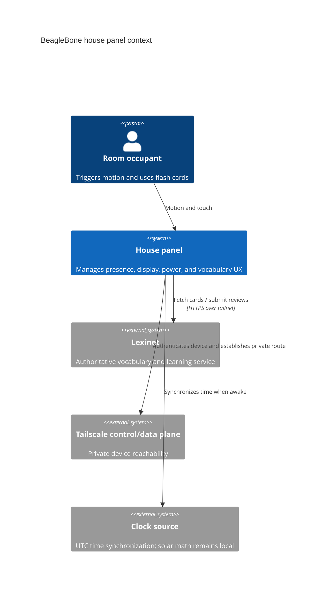
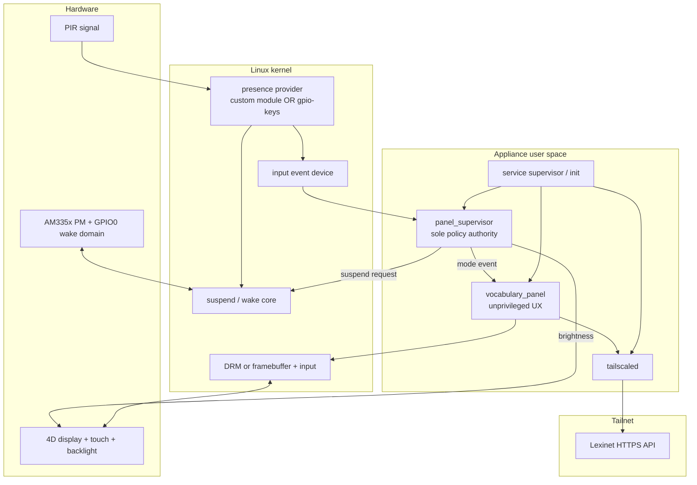

# System Architecture

## Promise

The house panel turns physical presence, local solar time, and recoverable external vocabulary data into one deterministic display/power state. Every hardware or network dependency sits behind a boundary that can be replaced by a host fake or another on-target implementation.

This document describes the implemented BeagleBone/AM335x scaffold. It does
not claim the Black is the final product platform. The cross-platform,
always-on-controller design is separately labeled as proposed in
[power-domain architecture](power-domain-architecture.md).

## System context

## Container architecture

## Component contracts

| Component | Owns | Does not own |
|---|---|---|
| Presence provider | GPIO acquisition, current level, ordered input events, wake-source mechanics | Presence grace, solar time, brightness, UI, networking |
| Panel supervisor | Presence interpretation, solar period, output precedence, backlight, suspend/resume orchestration | Vocabulary data, drawing widgets, Tailscale identity |
| Vocabulary panel | Card interaction, rendering, Lexinet request lifecycle, explicit offline UX | Root privileges, GPIO, backlight, suspend |
| Buildroot image | Kernel/DT/package versions, service lifecycle, filesystem permissions, image provenance | Runtime product policy |
| Lexinet | Authoritative vocabulary and learning state | Device presence or display policy |

## Stable seams

- `PresenceSource`: current asserted/deasserted value plus monotonically ordered changes.
- `SolarCalculator`: UTC instant + latitude/longitude → day/night result or explicit invalid-clock error; timezone is presentation-only.
- `Backlight`: validated logical brightness request → applied device value or exact failure.
- `Suspend`: requested experiment mode → accepted/rejected result; no hidden fallback to another power state.
- `UiModeNotifier`: versioned local event → retained snapshot and a best-effort
  write to the single connected client. Zero clients is a documented success,
  and a send failure closes/isolates that client without faulting panel policy;
  socket setup/accept, encoding, and sequence failures remain explicit. A sequence-bound
  render-ready/page-flip acknowledgement is a required future protocol addition
  before nonzero-brightness ordering can be called presentation-safe.
- `LexinetClient`: `study.v1` create/resume and sync operations (`HttpLexinetClient`), executed only on the study worker.
- `FlashCardView`: presentation model + user action, independent of DRM/LVGL/SDL/terminal implementation.

Search for `@canonical` to find each authoritative implementation and `@extension-point` to add a hardware or display backend.

If a tiered controller is proven, `Suspend` becomes one backend operation
inside the broader proposed `PowerController` contract. That promotion must
preserve exact requested-state reporting and `panel_supervisor` as the sole
policy owner; it must not add a second power-policy implementation.

## “What if” checks

| Change | Expected extension |
|---|---|
| Radar or camera replaces PIR | New `PresenceSource`; policy remains unchanged |
| The cape exposes only legacy framebuffer | New `FlashCardView`; flash-card state and Lexinet client remain unchanged |
| Network must remain available while absent | Configure a non-suspending power action; presence and UI semantics remain unchanged |
| A local read-only vocabulary cache is added | New boundary implementation with explicit degraded metadata; Lexinet stays authoritative |
| Sunrise policy becomes civil twilight plus offsets | Replace/configure `SolarCalculator`; kernel and UI remain unchanged |
| The application processor changes | Replace device-tree, power, display, media, and inference adapters; policy and flash-card domain remain unchanged |

## Evidence gate

No hardware adapter becomes the default until the associated result record names the board, cape, kernel, device tree, wiring, software revision, test count, and failures. See [hardware tests](../../hardware_tests/README.md).
