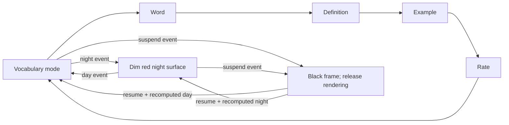

```mermaid
stateDiagram-v2
    [*] --> Loading
    Loading --> Word: valid card
    Loading --> Offline: network unavailable + explicit bounded cache
    Loading --> Empty: successful response has no card
    Loading --> Error: invalid response / permanent failure
    Word --> Definition: tap card
    Definition --> Example: tap card
    Example --> Rating: tap card or choose rate
    Rating --> Submitting: choose Again / Hard / Good / Easy
    Submitting --> Loading: review acknowledged
    Submitting --> Error: review rejected; retain current card
    Offline --> Word: cached card selected with degraded badge
    Example --> OfflineComplete: cached/degraded card; never offer rating
    OfflineComplete --> Loading: retry connection
    Error --> Loading: retry
    Empty --> Loading: refresh
```

# Lexinet Flash-Card UX

## UX goals

- Work at a likely 480×272 resolution with large touch targets.
- Preserve the useful legacy progression: word → definition → example → next.
- Never flash a white surface while entering or leaving after-hours mode.
- Make loading, offline, empty, and failed states visibly different.
- Keep Lexinet authoritative; never imply that an unsubmitted review was saved.

## Primary interaction



## Supervisor-driven mode flow



## Wireframes

```text
┌────────────────────────────────────────┐
│  07:42                    ● tailnet     │
│                                        │
│              perspicacious             │
│                                        │
│         Tap anywhere to reveal         │
│                                        │
│  ◀ previous                 next ▶      │
└────────────────────────────────────────┘

┌────────────────────────────────────────┐
│  Definition                            │
│                                        │
│  Having a ready insight into things;   │
│  shrewd and perceptive.                 │
│                                        │
│           Tap for an example           │
└────────────────────────────────────────┘

┌────────────────────────────────────────┐
│  How well did you know it?             │
│                                        │
│  [ Again ] [ Hard ] [ Good ] [ Easy ]  │
│                                        │
│  Review is saved only after Lexinet ✓  │
└────────────────────────────────────────┘
```

At 480 pixels wide, four rating buttons may be too narrow for reliable touch. The first hardware prototype should compare four buttons against a two-step “missed / knew it” layout; that decision belongs to measured touch accuracy rather than desktop preference.

## Error and offline screens

| State | Copy | Allowed action |
|---|---|---|
| Loading | “Connecting to Lexinet…” | Cancel only after a bounded timeout |
| Offline, cache present | “Offline — cached card; reviews are not being saved” | Study or retry; no silent review queue |
| Offline study complete | “Reconnect to save reviews” | Retry; rating controls remain unavailable |
| Offline, no cache | “Lexinet unavailable” | Retry |
| Empty | “No review card available” | Refresh |
| Response invalid | Machine-readable error code plus short explanation | Retry after contract/config correction |

## Night surface

Night mode is not a dimmed daytime UI. It is a separate solid-red rendering path with no network calls or white intermediate frames. The exact RGB value and brightness are calibrated on the cape in the dark.
