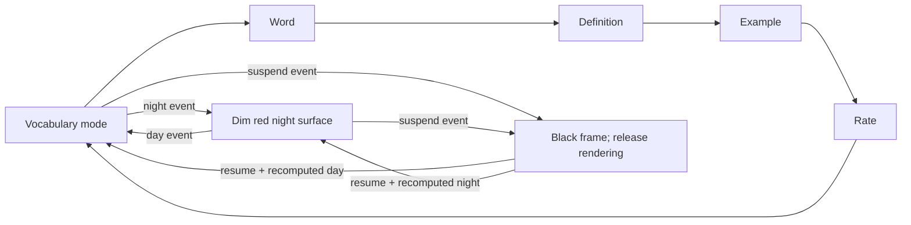

# Lexinet Flash-Card UX

**Status:** implemented scaffold behavior. The pending `LEXI-001` through
`LEXI-007` review in the
[Lexinet study architecture](../architecture/lexinet-study-integration.md)
proposes a two-sided card with explicit flip/next/back semantics. If approved,
that decision supersedes this progression before production controller work;
the project must not implement both interaction models.

~~The implemented cached-card progression ends after the example and never offers a rating.~~
For the intended product UX, that branch is superseded by the bounded outbox
behavior below. This records the intended offline behavior without approving or
changing the pending status of any `LEXI-*` decision. The checked-in scaffold
remains fail-closed until idempotency, bounds, corruption handling, and visible
sync status are implemented together.

## Current scaffold UX goals

- Work at a likely 480×272 resolution with large touch targets.
- Document the implemented legacy progression: word → definition → example
  → rating → next. It is evidence for the rewrite, not the proposed version 1
  product contract.
- Never flash a white surface while entering or leaving after-hours mode.
- Make loading, offline, empty, and failed states visibly different.
- Keep Lexinet authoritative; never imply that a locally queued rating was
  saved.

## Scaffold interaction with intended offline amendment

The online path below remains scaffold evidence. The amended cached-card branch
describes the intended bounded-outbox transition and is not an implementation
claim.

```mermaid
stateDiagram-v2
    [*] --> Loading
    Loading --> Word: valid card
    Loading --> Offline: network unavailable + explicit bounded cache
    Loading --> Empty: successful response has no card
    Loading --> Error: invalid response / permanent failure
    Word --> Definition: tap card
    Definition --> Example: tap card
    Example --> Rating: tap card or choose rate
    Rating --> Submitting: choose Again / Hard / Good / Easy
    Submitting --> Loading: review acknowledged
    Submitting --> Error: review rejected; retain current card
    Offline --> Word: cached card selected with degraded badge
    Example --> OfflineRatingPreflight: cached/degraded card + eligible rating
    OfflineRatingPreflight --> Word: rating and required successor fact durable
    OfflineRatingPreflight --> OfflineComplete: rating durable + completion/refill snapshot
    OfflineRatingPreflight --> Example: preflight or commit rejected; retain card
    OfflineComplete --> Loading: retry connection or refill
    Error --> Loading: retry
    Empty --> Loading: refresh
```



For an eligible cached item, offline rating admission is one all-or-nothing
local transition:

~~1. The item is revealed, its rating affordance is active, and the complete
transition preflight proves that the crash-consistent outbox is writable and
has one slot for `rated` plus one reserved slot for a possible `rating_voided`
Undo. Showing a never-presented successor also requires a third slot for its
`presented` fact.~~

1. The item is revealed, its rating affordance is active, and the complete
   transition preflight proves that the crash-consistent outbox is writable and
   has one slot for `rated` plus one reserved slot for a possible
   `rating_voided` Undo, plus ordinary slots for any provisional current-item
   prerequisites the rating promotes. A touch rating that shows a
   never-presented successor also requires a slot for that successor's
   `presented` fact. A voice rating leaves the newly shown successor provisional
   instead.
~~2. The rating, idempotency data, and any required successor fact become
durable before the UI leaves the current item. The UI then advances through the
same canonical session-ordering primitive as `next`; it never invents or
reorders a cached card. With only the two base slots, it may instead advance to
the explicit tracking-paused completion/refill snapshot and leave a
never-presented cached successor unshown.~~

2. The rating, idempotency data, and any required successor fact become durable
   before the UI leaves the current item. The UI then advances through the same
   canonical session-ordering primitive as `next`; it never invents or reorders
   a cached card. If the rating, Undo reservation, and every current-item
   prerequisite-promotion slot fit but a touch-originated successor's additional
   `presented` slot does not, it instead advances to the explicit
   tracking-paused non-card completion/refill snapshot and leaves that cached
   successor unshown. A voice-originated successor remains provisional and does
   not need that additional durable slot.
3. The successor or completion snapshot remains visibly offline/degraded and
   labels the rating `queued locally`, never `saved`. A live one-tap **Undo**
   appends the exact `rating_voided` correction durably, consumes its reserved
   slot, and leaves that successor snapshot in place.
4. If capacity, durability, or any transition invariant cannot be guaranteed,
   the UI visibly rejects the rating, keeps the current card visible and
   unrated, and reports `study tracking paused`. Only a Lexinet acknowledgement
   may change an event from `queued locally` or `syncing` to `saved`; neither a
   retry nor a successful socket write fabricates synchronization.

Touch and voice retain the same navigation and rating meanings, but not the
same evidence-durability side effect. A voice-only first presentation and any
dependent first reveal display `voice — confirmation required`, use no durable
outbox slot, and cannot sync or satisfy session exhaustion. A study touch bound
to the active session, session item, immutable content revision, and render
generation, or an accepted rating matching that tuple, promotes the current
item's provisional prerequisites atomically. Session termination or restart
drops unpromoted markers and their card render. Restart opens a non-card resume
gate instead of redisplaying an issued item with no canonical `presented` fact;
touch resume records the fact before showing the item, while voice resume
recreates the provisional marker.

A grouped rating transition either makes every current-item promotion, the
rating, and any touch-successor presentation durable locally or changes
nothing. If Lexinet terminally rejects that batch, every constituent is visibly
`rejected`, Undo is released without a void, and the already-shown successor and
face/history state remain because the exposure cannot be undone. Rejected facts
cannot satisfy exhaustion or be silently reissued; a voice-successor marker
outside the batch remains `voice — confirmation required`.

## Current scaffold supervisor-driven flow



## Current scaffold wireframes

```text
┌────────────────────────────────────────┐
│  07:42                    ● tailnet     │
│                                        │
│              perspicacious             │
│                                        │
│         Tap anywhere to reveal         │
│                                        │
│                             next ▶      │
└────────────────────────────────────────┘

┌────────────────────────────────────────┐
│  Definition                            │
│                                        │
│  Having a ready insight into things;   │
│  shrewd and perceptive.                 │
│                                        │
│           Tap for an example           │
└────────────────────────────────────────┘

┌────────────────────────────────────────┐
│  How well did you know it?             │
│                                        │
│  [ Again ] [ Hard ] [ Good ] [ Easy ]  │
│                                        │
│  queued locally — not saved yet        │
└────────────────────────────────────────┘
```

This scaffold's four rating buttons may be too narrow for reliable touch at 480
pixels. The proposed `LEXI-005` contract makes ratings available through
equivalent touch and voice actions after the back is revealed. On-target
measurement still decides the touch geometry and whether a real voice engine
qualifies for production.

## Error and offline screens

| State | Copy | Allowed action |
|---|---|---|
| Loading | “Connecting to Lexinet…” | Cancel only after a bounded timeout |
| Offline, cache present | ~~“Offline — cached card; reviews are not being saved”~~ “Offline — cached session”; show each event as `queued locally`, `syncing`, `saved`, or `rejected` | ~~Study or retry; no silent review queue~~ Study or navigate; rate only after the full durable preflight succeeds; retry sync |
| Offline study complete / refill required | ~~“Reconnect to save reviews”~~ “Offline — refill required”; retain the honest status of the accepted rating | ~~Retry; rating controls remain unavailable~~ Use the live Undo affordance if present, or retry/refill; do not fabricate a successor or saved state |
| Offline tracking paused | “Study tracking paused — rating not queued” | Continue fact-free history navigation or retry; keep the current card unrated |
| Offline, no cache | “Lexinet unavailable” | Retry |
| Empty | “No review card available” | Refresh |
| Response invalid | Machine-readable error code plus short explanation | Retry after contract/config correction |

## Night surface

Night mode is not a dimmed daytime UI. It is a separate solid-red rendering path with no network calls or white intermediate frames. The exact RGB value and brightness are calibrated on the cape in the dark.

**Amended 2026-08-07:** superseded the categorical no-offline-rating branch
with the intended bounded, durable outbox UX without approving any pending
`LEXI-*` decision or claiming the safeguards are implemented.

**Amended 2026-08-08:** documented the provisional UI state for voice-only
first presentation/reveal, the non-card restart gate, the source-qualified
rating preflight, and grouped terminal-rejection state. No pending `LEXI-*`
decision status changed.
