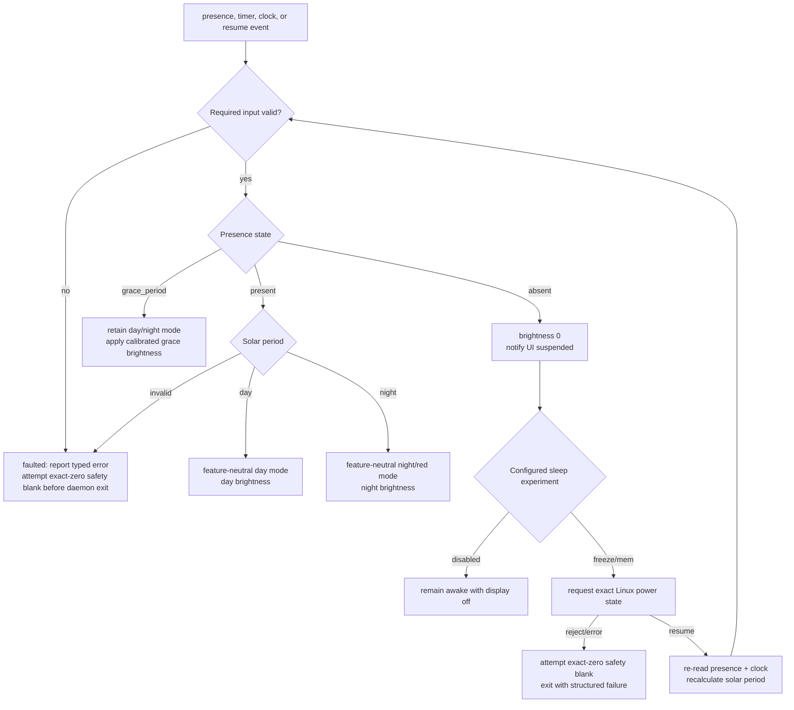

<!-- @canonical panel-presence-grace-policy -->

# Panel Policy

## Scope

~~Earlier drafts assigned daytime vocabulary and night-clock feature selection
to `PanelPolicy`.~~ `PanelPolicy` produces only feature-neutral lifecycle and
display policy: interpreted presence, day/night/suspended display mode,
requested logical brightness, and whether suspend should be requested.
`panel_ui` owns feature routing and chooses the vocabulary, agenda, clock, or
other surface within the lifecycle mode. No feature state belongs in
`PanelPolicy`.

## Inputs and precedence

The policy combines three independent facts:

- presence: `present`, `grace_period`, `absent`;
- solar period: `day` or `night`; an unavailable or unknown result is a typed
  cycle error rather than a guessed policy input;
- system lifecycle: `starting`, `active`, `suspended`, `recomputing_after_resume`, `faulted`.

Safety and lifecycle take precedence over presentation. Presence does not directly toggle the screen; it causes a state transition that is evaluated with clock and hardware health.

## Output table

| Presence | Solar | Display mode | Brightness | Suspend |
|---|---|---|---|---|
| ~~Present~~ | ~~Day~~ | ~~Vocabulary~~ | ~~Calibrated day~~ | ~~No~~ |
| ~~Present~~ | ~~Night~~ | ~~Solid red/night clock~~ | ~~Calibrated dim~~ | ~~No~~ |
| Present | Day | Feature-neutral day-active mode | Calibrated day | No |
| Present | Night | Feature-neutral night/red mode | Calibrated night | No |
| Grace period | Day/night | Matching active mode | Calibrated grace day/night value | No |
| Absent | Either | Suspended/blank | 0 | Exact configured experiment |
| ~~Unknown/fault~~ | ~~Unknown~~ | ~~Existing mode plus structured service fault~~ | ~~Last successfully applied value; no new suspend~~ | ~~No~~ |
| Invalid input (current scaffold) or approved fatal invariant fault | Unknown or last observed | `faulted`; no substitute display policy | No retained-value guarantee; attempt exact zero before daemon exit | Never invent a suspend request or alternate mode |

Requested nonzero brightness is not applied directly from this table. The
presentation gate below must first return an exact committed outcome.

## Presence grace: authoritative current behavior

After previously observed presence, PIR deassertion means only that the
sensor's own hold/retrigger behavior ended; it is not proof of departure. The
supervisor therefore enters presence grace. The current deployment value is
**120 seconds**, supplied explicitly by configuration; the duration remains
configurable and the daemon supplies no runtime default. Throughout grace, the
panel stays active, retains its applicable day or night mode, and uses the
corresponding hardware-calibrated grace brightness. Values of **40% by day and 5% by night
are illustrative only and must never become production defaults**; final grace
brightness values require on-target calibration.

If presence has not reasserted at the 120-second deadline, the supervisor
re-reads the current state, blanks the display, publishes the suspended mode,
and follows the exact configured suspend path. A stuck-asserted sensor consumes
more power but avoids hiding the interface from an occupant. This section is
the single authoritative statement of current presence-grace behavior; other
architecture documents must defer here rather than restating it.

## Presentation degradation and fatal faults

Every output cycle first applies exact logical brightness zero, publishes the
complete display-policy snapshot, and awaits an explicit presentation outcome.
Only an exact `committed` outcome permits a requested nonzero brightness write.
Acknowledgement timeout, disconnect, stale, duplicate, mismatch, or explicit
failure is a structured degraded outcome, not a cycle fault: brightness stays
zero, the supervisor emits `presentation_degraded`, the cycle completes, and
any policy-requested suspend is still attempted. The current explicit outcome
model also treats acknowledgement unavailability, publication failure, and a
caught presentation-adapter contract violation as degraded presentation
failures.

~~A fault retained the last output, stayed awake, and skipped suspend.~~ The
durable daemon-ending internal output/invariant failures identified by ADR 0004
are a backlight write failure, a required structured-log write failure, and a
rejected or failed write of the explicitly configured state to
`/sys/power/state`. ADR 0004 reserves the product invariant-fault policy for
those three categories. Input-acquisition and policy-evaluation errors are
separate typed operational faults; except for the bounded initial
clock-readiness retry, the current scaffold also returns them through its fatal
path rather than inventing presence, solar state, brightness, or a sleep mode.
That fail-closed scaffold behavior is an implementation fact, not an approved
addition to the durable invariant-fault list.

After the backlight adapter exists, a fatal path makes a best-effort exact-zero
safety write before the process exits and preserves the primary failure if that
blank also fails. The Buildroot service applies bounded restart supervision.
Neither mechanism authorizes retaining the last brightness as a fallback.

## Solar semantics

Solar position should be computed locally from configured latitude/longitude and a trusted UTC instant. Network weather and timezone data are not required to decide whether the sun is above the configured horizon; timezone remains a presentation concern. An untrustworthy clock is a first-class error, and the policy will not silently label a guessed time as day. A deliberately configured conservative night fallback may be added later, with explicit degraded metadata.

## Resume invariant and pending presentation gate

The backlight stays off until presence, clock, and solar state have been recomputed. Resume never toggles the prior state, because time and sensor level may have changed while suspended.

~~The version 1 socket write was treated as sufficient ordering before applying
nonzero brightness.~~ Version 1 cannot acknowledge presentation, so its current
adapter returns immediate `acknowledgement_unavailable`; that structured
degraded outcome keeps brightness zero while still allowing cycle completion
and suspend. The frozen version 2 contract requires an exact request-bound
`committed` acknowledgement before nonzero brightness, followed by on-target
page-flip testing before the stronger physical invariant can be claimed. Until
that protocol and hardware evidence exist, services remain disabled by
default.

A successful suspend write normally returns after resume. If the recomputed
state is still absent, the daemon rate-limits the next suspend request before
trying to sleep again. That resume/resuspend backoff is not a retry policy for
a failed `/sys/power/state` write: an adapter rejection or write error leaves
the already-zero backlight in place and terminates the daemon with a structured
failure so service policy or an operator can diagnose it.

**Amended 2026-08-07:** struck the feature-routing and retained-output fault
contracts, made this document the single authority for configurable 120-second
dim presence grace, and aligned presentation degradation and fatal safety exits
with ADR 0004 and the current supervisor implementation. Illustrative
brightness values remain evidence-gated examples, not defaults. This amendment
does not approve roadmap Step 1 or change any pending product-decision status.
