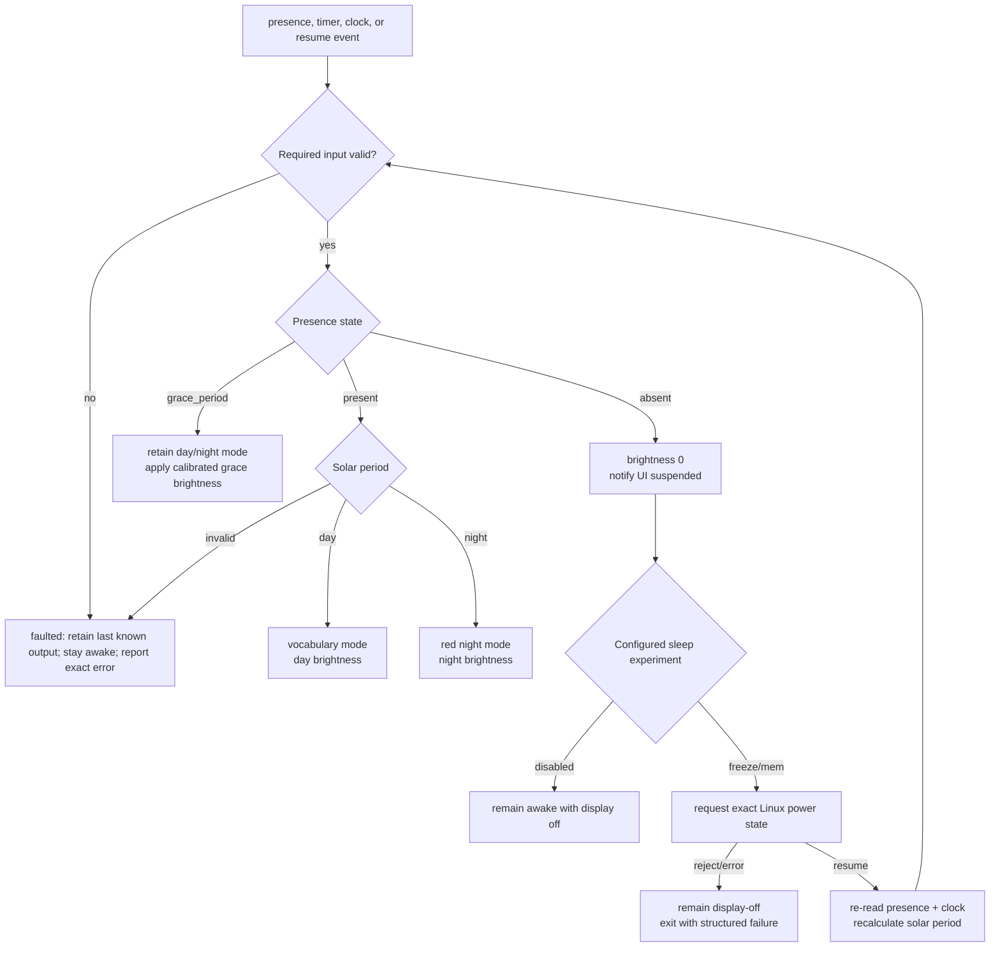

# Panel Policy

## Inputs and precedence

The policy combines three independent facts:

- presence: `present`, `grace_period`, `absent`;
- solar period: `day`, `night`, or explicit calculation failure;
- system lifecycle: `starting`, `active`, `suspended`, `recomputing_after_resume`, `faulted`.

Safety and lifecycle take precedence over presentation. Presence does not directly toggle the screen; it causes a state transition that is evaluated with clock and hardware health.

## Output table

| Presence | Solar | Display mode | Brightness | Suspend |
|---|---|---|---|---|
| Present | Day | Vocabulary | Calibrated day | No |
| Present | Night | Solid red/night clock | Calibrated dim | No |
| Grace period | Day/night | Matching active mode | Calibrated grace day/night value | No |
| Absent | Either | Suspended/blank | 0 | Exact configured experiment |
| Unknown/fault | Unknown | Existing mode plus structured service fault | Last successfully applied value; no new suspend | No |

## Presence semantics

A PIR deassertion means only that its own hold/retrigger behavior ended. It does not prove that a person left. The supervisor therefore starts a configurable grace period and re-reads current state before sleeping. A stuck-asserted sensor consumes more power but avoids hiding the interface from an occupant.

## Solar semantics

Solar position should be computed locally from configured latitude/longitude and a trusted UTC instant. Network weather and timezone data are not required to decide whether the sun is above the configured horizon; timezone remains a presentation concern. An untrustworthy clock is a first-class error, and the policy will not silently label a guessed time as day. A deliberately configured conservative night fallback may be added later, with explicit degraded metadata.

## Resume invariant and pending presentation gate

The backlight stays off until presence, clock, and solar state have been recomputed. Resume never toggles the prior state, because time and sensor level may have changed while suspended.

The version 1 implementation then sends the recomputed UI mode before applying
a nonzero brightness. Its one-way socket write is not proof that the renderer
has displayed the safe frame. A render-ready acknowledgement tied to the mode
event sequence, followed by on-target page-flip testing, is required before we
claim the stronger invariant that the backlight remains off until presentation
is complete. Until that protocol exists, failure or UI disconnection must be
treated conservatively during hardware experiments and the services remain
disabled by default.

A successful suspend write normally returns after resume. If the recomputed
state is still absent, the daemon rate-limits the next suspend request before
trying to sleep again. That resume/resuspend backoff is not a retry policy for
a failed `/sys/power/state` write: an adapter rejection or write error leaves
the already-zero backlight in place and terminates the daemon with a structured
failure so service policy or an operator can diagnose it.
