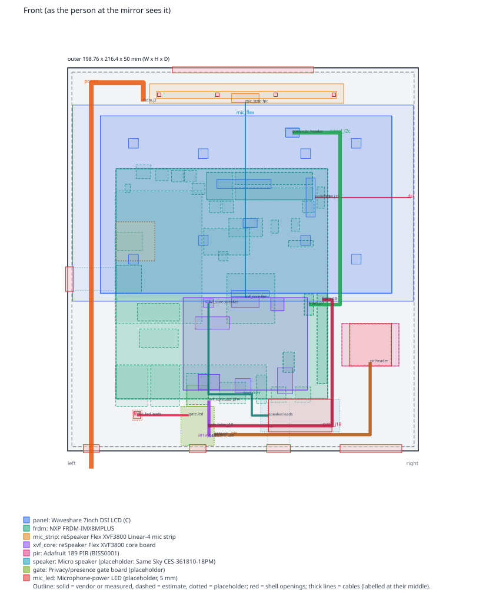
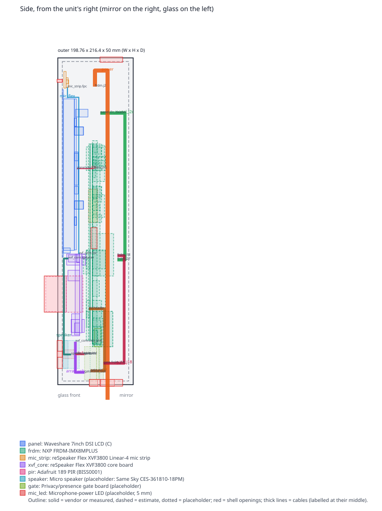
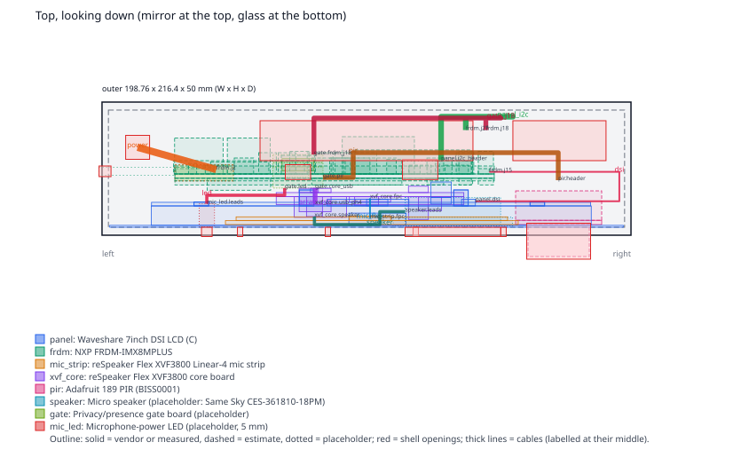

# Mirror Unit: Layout and Harness

<!-- @canonical mirror-unit-layout -->

**Status (2026-10-20):** the fit-check design, from vendor data and estimates;
nothing on this page is measured yet. It is the "schematic" for cables and
fit that the [fit-check enclosure plan](../../.claude/plans/2026-10-20-mirror-unit-fit-check-enclosure.md)
asks for: where every part sits, which connector every cable joins, how each
cable is routed and bent, and which numbers still need calipers.

Everything below comes from [`enclosure/params.toml`](../../enclosure/params.toml).
`python3 enclosure/fit_check.py` checks it:
- parts and plug bodies do not collide;
- every cable leaves its connector straight, bends no tighter than its minimum
  radius, reaches its other end with sensible slack, and passes through the
  shell only at an opening;
- a flex cable never bends across its width (a twist or a fold);
- no metal sits near the Wi-Fi antenna, and the microphones are far from the
  speaker.

The drawings and tables are regenerated with `--write`, and `make verify`
fails when they are stale.

## Frame

The unit's origin is the centre of the panel glass's front face. x runs to the
right of the person at the mirror, y runs up, and z points toward that
person, so everything behind the glass has a negative z. The mirror's front
glass is the plane of the shell's back face.

## How the parts fit

The board's height comes from one constraint: J15 must sit level with the
panel's DSI connector, because a flex cable bends only about its width and
must never twist or fold. The rest follows from that; the
[plan's Decision 7](../../.claude/plans/2026-10-20-mirror-unit-fit-check-enclosure.md#decisions)
gives the reasoning.

- **Outline:** 198.8 × 216.4 × 50 mm (W × H × D), plus the mirror mounting
  plate.
- **The panel** fills the top, with its native orientation (the wider border
  at the bottom). The mic strip sits above the glass, behind four acoustic
  ports.
- **The FRDM board** hangs behind the panel, components facing the rear
  plate, about 55 mm below the glass. Its I/O edge is at the bottom: the
  debug port (J19) takes a plug through the bottom wall, and the USB-A port
  (J4) takes the gate board directly.
- **The chin**, in front of the board's lower half, holds the XVF3800 core
  board (centred), the speaker, the PIR (right, nothing behind it) and the
  microphone-power LED (left). The privacy switch is on the gate board, in
  the bottom wall.
- **Cables:**
  - The DSI flex makes a U-turn at the right wall.
  - The 24-pin mic flex runs straight up behind the panel.
  - The panel's I2C/5 V wires and the J18 harness run behind the board and
    round its right edge.
  - The USB-C power cable leaves J2 upward, loops left and runs down the
    left side to the bottom wall.

## Measure these first

They decide the fit. The full list is below.

1. **The FRDM board's four corner holes.** They are estimated from NXP's
   photo at about ±1 mm, 4.35 mm in from each edge. Also check that they
   are 3.2 mm.
2. **The heatsink's height**, including the screw heads. It is assumed to be
   14 mm, and it may set the unit's depth.
3. **J15's position and the height of its FPC slot.** Then measure the DSI
   flex's real length: 120 mm is assumed, and the U-turn needs
   111 + 6 mm.
4. **The tallest parts on the component side**: the RJ45 jacks (13.5 mm
   assumed), the LVDS headers and the electrolytics.
5. **The pin tails under the board**, assumed 2.5 mm. They and the panel's
   M2.5 standoffs set the gap between the board and the panel.
6. **J2 and J4**: their position, height and how far each sticks past the
   board edge.
7. **The panel's DSI connector**: where the flex leaves it and at what height.
8. **The PIR's lens dome**: its diameter and height.
9. **Weigh** the FRDM board, the panel and the finished unit. The VHB area
   follows from the weight.

## Drawings

Solid outlines are vendor dimensions, dashed outlines are estimates and
dotted outlines are placeholders for parts not chosen yet. Red boxes are the
shell's openings; thick lines are cables. Hovering over a shape in a browser
shows its name and source.

## Harness

"Route" is the cable's centre-line length, with each bend at the cable's
minimum radius. A bought cable's length must cover the route plus its
minimum slack. A made cable is cut to the route plus its service loop.

<!-- generated:harness -->
| Cable | Kind | From | To | Conductors | Section (mm) | Min bend r | Route | Length | Bends | Notes |
|---|---|---|---|---|---|---|---|---|---|---|
| `dsi` DSI flex, 22-pin 0.5 mm to 15-pin 1.0 mm (from the panel kit) | fpc | `panel.dsi` | `frdm.j15` | DSI 2 data lanes + clock (differential), I2C is not on this flex | 16 x 0.3 | 4 | 110.6 | 120 (estimate) | 90°, 90° | U-turn at the right wall: out of the panel toward +x, back into J15 from the right. Contacts toward the springs at both ends. |
| `mic_flex` Mic flex, 24-pin 0.5 mm FFC (buy about 120 mm) | fpc | `xvf_core.fpc` | `mic_strip.fpc` | 24 conductors, pin 1 to pin 1 | 12.5 x 0.15 | 3 | 115.27 | 120 (design) | 90°, 90° | Straight up behind the panel at z = -10.9, between the panel's connectors and the board's underside. |
| `panel_i2c` Panel I2C and 5 V: J27 pins 9/7/6/2 to the panel's SDA1/SCL1/GND/5V | wires | `frdm.j27` | `panel.i2c_header` | J27-9 SDA to SDA1, J27-7 SCL to SCL1, J27-6 GND to GND, J27-2 5V to 5V | Ø3.5 | 3 | 157.95 | cut to 177.95 (20 loop) | 90°, 90°, 90°, 90° | Behind the board, round its right edge, up to the header. |
| `power` USB-C PD power, 45-65 W charger (straight plug) | round | `frdm.j2` | `outside` | VBUS 12-20 V PD, CC, GND | Ø4.5 | 10 | 250.73 | 250.73 inside the unit | 90°, 90° | J2 points up behind the panel; the cable loops left over the board and runs down the left side to a strain-relief clamp. Drip loop outside. |
| `array_usb` Array USB: gate board to the core board's PH-4 (5 V switched, D-, D+, GND) | wires | `xvf_core.usb_ph4` | `gate.core_usb` | 5V switched, D-, D+, GND | Ø3 | 2 | 25.48 | cut to 35.48 (10 loop) | 90° |  |
| `speaker` Speaker leads to the core board's PH 2-pin | wires | `xvf_core.speaker` | `speaker.leads` | SPK+, SPK- | Ø2 | 2 | 101.16 | cut to 111.16 (10 loop) | 90°, 90°, 90°, 90°, 90° |  |
| `pir` PIR: +5V, OUT, GND to the gate board (hub) | wires | `pir.header` | `gate.pir` | +5V, OUT (3.3 V), GND | Ø3 | 2.5 | 144.8 | cut to 159.8 (15 loop) | 90°, 90°, 90°, 90° |  |
| `gate_j18` Gate board to J18: 5 V, GND, PIR OUT to the wake GPIO | wires | `frdm.j18` | `gate.frdm_j18` | 5V, GND, PIR OUT to the wake GPIO (FRDM-GATE-PIR) | Ø3 | 2.5 | 150.82 | cut to 165.82 (15 loop) | 90°, 90°, 90° |  |
| `led` Mic-power LED, from the switched rail | wires | `gate.led` | `mic_led.leads` | LED+ from the switched rail, LED- | Ø2 | 2 | 33.43 | cut to 38.43 (5 loop) | 90°, 90° |  |
<!-- /generated:harness -->

## Caliper list

Every dimension the layout uses that nobody has measured on the real part.
Measure each one with calipers and a photo, then change its status in
`params.toml` to `measured` with the evidence path as its source.

<!-- generated:calipers -->
Estimates and placeholders, which decide the fit:

| Part | Item | What | Value (mm) | Status | Source |
|---|---|---|---|---|---|
| panel | dsi | connector exit | (40.92, 3.09, -9.75) | estimate | Waveshare wiki back photo 7inch-DSI-LCD-C-5.jpg; FPC height in the connector assumed mid-body |
| panel | i2c_header | connector exit | (28.03, 39.83, -25.2) | estimate | 2.54 mm Dupont housing, 14 mm long (typical) |
| frdm | low_parts | solid box | 120 x 130 x 3 at (0, 0, 0) | estimate |  |
| frdm | underside_smd | solid box | 120 x 130 x 1 at (0, 0, -2.6) | estimate |  |
| frdm | tails_j18 | solid box | 5.7 x 51.05 x 2.5 at (0.3, 8.75, -4.1) | estimate |  |
| frdm | tails_j27 | solid box | 5.2 x 12 x 2.5 at (8.1, 47.3, -4.1) | estimate |  |
| frdm | tails_lvds | solid box | 60 x 15.6 x 2.5 at (8.6, 112.4, -4.1) | estimate |  |
| frdm | tails_io_edge | solid box | 85.3 x 19.2 x 2.5 at (34.7, 0, -4.1) | estimate |  |
| frdm | tails_j22 | solid box | 6.3 x 11.5 x 2.5 at (19, 15, -4.1) | estimate |  |
| frdm | j24_m2_key_e | solid box | 23.9 x 9.8 x 4.5 at (84, 44, -6.1) | estimate |  |
| frdm | j2_usbc_power | solid box | 8.3 x 7.8 x 3.3 at (100.3, 124.4, 0) | estimate |  |
| frdm | j1_dc | solid box | 7.3 x 6.7 x 6 at (90.4, 123.3, 0) | estimate |  |
| frdm | power_switch | solid box | 3.1 x 4.7 x 4 at (111.8, 116.6, 0) | estimate |  |
| frdm | lvds0 | solid box | 43.8 x 6.8 x 9 at (8.6, 121.2, 0) | estimate |  |
| frdm | lvds1 | solid box | 43.8 x 6.8 x 9 at (8.6, 112.4, 0) | estimate |  |
| frdm | backlight_jst | solid box | 14.5 x 15.6 x 6 at (54, 112.4, 0) | estimate |  |
| frdm | jumpers | solid box | 7.3 x 6.3 x 8.5 at (69.6, 115.5, 0) | estimate |  |
| frdm | caps_top | solid box | 80.8 x 24.1 x 8 at (7.7, 105.1, 0) | estimate |  |
| frdm | caps_mid | solid box | 26.1 x 15.1 x 8 at (44.2, 81.3, 0) | estimate |  |
| frdm | inductors | solid box | 19.2 x 10.4 x 6 at (36.8, 91.6, 0) | estimate |  |
| frdm | heatsink | solid box | 27.1 x 28.1 x 14 at (30, 42.6, 0) | estimate |  |
| frdm | fan_jst | solid box | 5.2 x 5.2 x 6 at (56.6, 78, 0) | estimate |  |
| frdm | buttons | solid box | 14.1 x 3.7 x 5 at (8.1, 85.8, 0) | estimate |  |
| frdm | jtag | solid box | 4.7 x 7.3 x 6 at (15.9, 94.7, 0) | estimate |  |
| frdm | sw5_boot | solid box | 4.2 x 7.4 x 3 at (27.9, 93.6, 0) | estimate |  |
| frdm | j15_dsi | solid box | 4.1 x 12 x 2 at (1.9, 107.7, 0) | estimate |  |
| frdm | j27 | solid box | 5.2 x 12 x 8.5 at (8.1, 47.3, 0) | estimate |  |
| frdm | j18 | solid box | 5.7 x 51.05 x 8.5 at (0.3, 8.75, 0) | estimate |  |
| frdm | j22_speaker | solid box | 6.3 x 11.5 x 6 at (19, 15, 0) | estimate |  |
| frdm | j3_usbc_otg | solid box | 8.8 x 8.7 x 3.3 at (9.7, -2, 0) | estimate |  |
| frdm | j19_usbc_debug | solid box | 8.3 x 8.7 x 3.3 at (23.7, -2, 0) | estimate |  |
| frdm | j21_audio | solid box | 5.7 x 16.1 x 5.5 at (34.7, -2.7, 0) | estimate |  |
| frdm | j16_hdmi | solid box | 14.6 x 12 x 6 at (46.7, -2.7, 0) | estimate |  |
| frdm | j4_usba | solid box | 12.5 x 17.7 x 7 at (67.5, -3.2, 0) | estimate |  |
| frdm | j7_rj45 | solid box | 16.1 x 23.5 x 13.5 at (84.2, -4.3, 0) | estimate |  |
| frdm | j5_rj45 | solid box | 18.2 x 23.5 x 13.5 at (101.9, -4.3, 0) | estimate |  |
| frdm | microsd | solid box | 14.5 x 15.6 x 2 at (105.5, 59.8, 0) | estimate |  |
| frdm | m2_key_m | solid box | 21.9 x 10.4 x 4.5 at (84.7, 29.1, 0) | estimate |  |
| frdm | wifi_module | solid box | 14.6 x 10.45 x 2.5 at (105, 83.75, 0) | estimate |  |
| frdm | wifi_antenna_zone | rf_keepout box | 22 x 22 x 6 at (98, 78, -2.6) | estimate |  |
| frdm | standoffs_m2 | solid box | 49.2 x 74.8 x 5 at (71.3, 42.7, 0) | estimate |  |
| frdm | microsd_access | access box | 28.5 x 13 x 3 at (120, 61.1, -0.5) | estimate |  |
| frdm | debug_access | access box | 12.35 x 27.4 x 6.5 at (21.68, -29.4, -1.6) | estimate |  |
| frdm | bh3 | hole | Ø3.2 at (4.35, 125.65, -0.8) | estimate |  |
| frdm | bh4 | hole | Ø3.2 at (115.65, 125.65, -0.8) | estimate |  |
| frdm | bh6 | hole | Ø3.2 at (115.65, 24.7, -0.8) | estimate |  |
| frdm | bh5 | hole | Ø3.2 at (4.35, 4.35, -0.8) | estimate |  |
| frdm | j15 | connector exit | (1.9, 113.7, 0.8) | estimate |  |
| frdm | j27 | connector exit | (10.7, 53.3, 16.5) | estimate |  |
| frdm | j18 | connector exit | (3.15, 56, 16.5) | estimate |  |
| frdm | mass | mass (g) | 180 | placeholder | not published; weigh it |
| mic_strip | mass | mass (g) | 3 | estimate | 110 x 11 x 1.5 mm FR4 |
| xvf_core | usb_ph4 | connector exit | (-20.63, -32, 2.84) | estimate | JST PH housing length (typical) |
| xvf_core | mass | mass (g) | 15 | estimate | 70.5 x 52.2 mm board with connectors |
| pir | lens | solid box | 23 x 23 x 12 at (-11.5, -11.5, 0) | estimate | dome 23 mm (generic HC-SR501 datasheet); height = 24.66 - 1.6 - back parts |
| pir | back_parts | solid box | 32.34 x 24.03 x 11.06 at (-16.17, -12.02, -12.66) | estimate | 24.66 total less the lens and PCB |
| pir | header | connector exit | (-0.15, -9.8, -16.66) | estimate | Adafruit back photo, +/-1 mm |
| pir | mass | mass (g) | 7 | estimate | typical HC-SR501-class module |
| speaker | body | solid box | 35.9 x 18.5 x 10.7 at (-17.95, -9.25, -10.7) | placeholder |  |
| speaker | ears | solid box | 44.9 x 18.5 x 3.25 at (-22.45, -9.25, -3.25) | placeholder |  |
| speaker | leads | connector exit | (-17.95, 0, -5.35) | placeholder |  |
| speaker | mass | mass (g) | 4.1 | placeholder | CES-361810-18PM datasheet |
| gate | pcb | solid box | 18.8 x 22 x 1.6 at (-9.4, -11, -1.6) | placeholder |  |
| gate | front_parts | solid box | 18.8 x 22 x 8 at (-9.4, -11, 0) | placeholder |  |
| gate | back_parts | solid box | 18.8 x 22 x 3 at (-9.4, -11, -4.6) | placeholder |  |
| gate | privacy_switch | solid box | 8 x 3 x 4 at (-4, -14, 0) | placeholder |  |
| gate | core_usb | connector exit | (6.44, -6, 8) | placeholder |  |
| gate | pir | connector exit | (9.4, -5, 4) | placeholder |  |
| gate | led | connector exit | (-5, 6, 8) | placeholder |  |
| gate | frdm_j18 | connector exit | (6, 0, -4.6) | placeholder |  |
| gate | mass | mass (g) | 8 | placeholder | small PCB with a USB-A plug |
| mic_led | body | solid box | 5.8 x 5.8 x 8.6 at (-2.9, -2.9, -8.6) | placeholder |  |
| mic_led | leads | connector exit | (0, 0, -8.6) | placeholder |  |
| cable dsi | length | cable length | 120 | estimate | the kit's flex, said to be 12 cm; not measured |

A blank source means the part's own:

- `panel`: Waveshare 7inch-dsi-lcd-c.stp (3D zip sha256 5f138287...a0f9) and Exterior-Size.jpg (sha256 ea79a99e...750b)
- `frdm`: UM12340 Rev 1.0 Figure 2 photo scaled at 9.6 px/mm; heights typical for the part type
- `mic_strip`: Seeed reSpeaker_xvf3800_flex_linear_2d.dxf (sha256 de6eef83...c038) and .step (sha256 3f364668...9ddb)
- `xvf_core`: Seeed reSpeaker_xvf3800_flex_Separate.step (sha256 d1b3f7dc...03ef) and _2d.dxf (sha256 bb17991f...49a1)
- `pir`: Adafruit product 189 page (32.34 x 24.03, 24.66 tall with the lens) and back photo proximity_PIRbackLabeled.jpg
- `speaker`: Same Sky ces-361810-18pm.pdf (sha256 2d29605f...8510); not chosen
- `gate`: packaging plan Step 3; not designed
- `mic_led`: 5 mm through-hole LED; not chosen

Vendor values, to spot-check against the real part:

- `panel`: 22 vendor values (Waveshare 7inch-dsi-lcd-c.stp (3D zip sha256 5f138287...a0f9) and Exterior-Size.jpg (sha256 ea79a99e...750b) where the row does not say otherwise). Spot-check the outline, the holes and each connector's position.
- `frdm`: 2 vendor values (UM12340 Rev 1.0 Figure 2 photo scaled at 9.6 px/mm; heights typical for the part type where the row does not say otherwise). Spot-check the outline, the holes and each connector's position.
- `mic_strip`: 10 vendor values (Seeed reSpeaker_xvf3800_flex_linear_2d.dxf (sha256 de6eef83...c038) and .step (sha256 3f364668...9ddb) where the row does not say otherwise). Spot-check the outline, the holes and each connector's position.
- `xvf_core`: 18 vendor values (Seeed reSpeaker_xvf3800_flex_Separate.step (sha256 d1b3f7dc...03ef) and _2d.dxf (sha256 bb17991f...49a1) where the row does not say otherwise). Spot-check the outline, the holes and each connector's position.
- `pir`: 3 vendor values (Adafruit product 189 page (32.34 x 24.03, 24.66 tall with the lens) and back photo proximity_PIRbackLabeled.jpg where the row does not say otherwise). Spot-check the outline, the holes and each connector's position.
- `gate`: 1 vendor values (packaging plan Step 3; not designed where the row does not say otherwise). Spot-check the outline, the holes and each connector's position.
<!-- /generated:calipers -->
