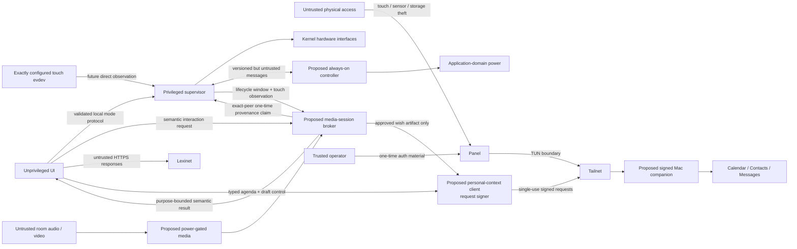

# Security and Trust Map

## One-paragraph model

The panel is a physically accessible, single-purpose tailnet node. The UI runs
without root privileges, and only the supervisor can write the discovered
backlight/suspend interfaces. Every evdev node starts root-only; a fail-closed
`mdev` classifier grants the UI's dedicated `bhp-touch` group access only when
exactly one device matches a root-provisioned nonempty `name` plus `phys` pair.
Both implemented PIR identities are hard-denied, and the UI is never placed in
the generic `input` group. A future presence implementation with another input
identity must extend and test that deny contract before deployment.
Tailscale supplies private routing and device identity, while Lexinet
independently authorizes its API. Provisioning credentials enter through an
operator-controlled action and are never baked into production images or
logged. Physical theft is treated as device compromise and handled by revoking
both identities; this design does not claim tamper resistance.

Microphone and camera support is proposed but not implemented. Their future
default is physically unpowered, with controls that do not depend solely on a
compromiseable UI process.

The current Buildroot scaffold still grants the vocabulary service raw access
to the exactly classified `bhp-touch` device. Proposed
[ADR 0005](../decisions/0005-validate-touch-provenance-at-capability-holders.md)
requires a future atomic cutover: the supervisor becomes the sole direct touch
reader and provenance issuer, forwards normalized input to `panel_ui`, and the
UI's raw node/group access is revoked. Until that packaging change and
on-target evidence exist, capability-holder touch validation is a proposed
contract, not an implemented control.

Personal agenda and birthday-wish support is also proposed, not implemented.
Its additional trust boundary is a signed, logged-in-user Mac companion that
owns Apple/Google authorization, full recipient routes, local transcription,
and Messages automation. See the
[personal-agenda architecture](../architecture/personal-agenda-and-birthday-wishes.md).

## Assets and boundaries

| Asset | Threat | Control | Accepted limitation |
|---|---|---|---|
| Tailscale node state | Image leak or diagnostic collection | Separate writable directory, `0600`, excluded from images/logs | Root or physical storage access can extract it |
| Lexinet credential | Commit, CLI/process-list, URL, or log exposure | Provisioned file, redaction, HTTPS, narrow service permission | No hardware-backed secret storage assumed |
| Lexinet learning state | Unauthorized mutation/replay | Application auth, idempotency keys, server validation | Exact control waits for real API contract |
| System power interfaces | UI compromise causing suspend loops | Privileged supervisor is sole writer; rate limits and state guards | Root compromise bypasses this boundary |
| Presentation readiness | Stale, replayed, cross-release, or forged page-flip acknowledgement exposes an old/bright frame | Planned protocol v2 binds appliance release, unpredictable supervisor session and connection challenge, sequence, snapshot digest, mode, render generation, and exact Unix peer UID; one latest acknowledgement is consumed once and failures stay dark | A compromised authorized `panel_ui` can lie about its own frame; target commit correlation and process isolation bound but cannot eliminate this limitation |
| Household presence inference | Excessive logs, UI compromise, or remote disclosure | Store only current/transition diagnostics locally; exact unique touch grant; both project PIR names stay root-only | Device identity is not cryptographic, physical/root compromise bypasses it, and any new presence-provider name must extend the tested deny list |
| Calendar titles, locations, birthdays, and names | Screen disclosure, excessive synchronization, or storage theft | Planned: content-free capability discovery before consent; local opt-in and grants; selected calendars/provisioned contacts only; daytime display; bounded Today projection/cache; private-event policy; visible freshness | macOS grants remain broad and a compromised companion or logged-in user can read beyond the adapter's logical boundary; intended room occupants can see a lit panel |
| Provider OAuth tokens and full contact/message routes | Theft from the physically accessible panel | Planned: Mac Keychain and companion-only routing; panel receives opaque people and masked destinations | Compromise of the logged-in Mac user bypasses this boundary |
| Raw audio, images, and unrestricted transcripts | Silent collection, accidental logging, or tailnet exfiltration | Planned: media rails default off; purpose-bound broker sessions; command audio is never transmitted; a voice wish command only opens the composer; `bounded_learning_observation` navigation may append idempotent non-mastery `presented`/`revealed` facts, while ratings are visibly acknowledged and append-only correctable by touch Undo; the broker opens capture only from single-use supervisor-observed touch provenance bound to its exact lease request; hardware indicator/mute | No media broker, touch-provenance flow, or rail control is implemented; ~~compromised UI can simulate allowed capture while its lease is active~~ a compromised UI cannot mint provenance but can misuse a genuine touch on a misrepresented frame; root/physical compromise bypasses policy |
| Spoken-command vocabulary and recognizer output | Near-homophones, phrase containment, context leakage, artifact/policy mismatch, or acoustic substitution triggers the wrong semantic action | Planned: one reviewed language-tagged catalog; pronunciation provenance; deterministic pair analysis; hard effect-class admission excluding capture start/submission/power/illumination; content-addressed active command sets and backend projections; schema-validated canonical recognition-policy artifacts bound to backend/model identities and verified by the broker; the complete identity chain in each voice intent; abstention; visible acknowledgement; touch fallback and append-only rating correction; single-use held-out selection plus untouched confirmation evidence before enabling a real engine | Static phonetic distance is not a probability or a safety proof; actual microphones, speakers, noise, accents, and recognizer builds remain unproven until on-device evidence exists |
| Birthday-wish body/audio and Messages authority | False activation, wrong recipient, replay, duplicate submission, or hidden retention | Planned: allowlisted current-birthday route; broker-validated supervisor touch before capture; personal-context-client validation of supervisor-authored provenance and observer-measured qualifying hold before submit; single-use signed request; atomic dispatch barrier; daily attempt bound; local STT; playback-gated audio; 30-minute Mac content ceiling; deterministic terminal deletion; and 30-day non-content attempt-metadata ceiling | Messages semantics are unproven; ~~compromised `panel_ui` can fabricate touch-level allowed requests~~ a compromised UI can misrepresent pixels around a genuine bound touch but cannot author provenance; root can use the device key |
| Microphone/camera activation state | Compromised UI falsifies software indicator or mute | Planned: physical mic mute removes bias/clock/power; camera indicator is tied to its rail; mechanical shutter preferred | Prototype USB devices may not expose a separately switchable rail; controls remain unproven |
| Always-on controller availability and authority | Wake storm drains battery, stale Linux state controls output, or controller fault prevents boot | Planned: bounded sequenced protocol, independent safety ceilings, watchdog, boot backoff, reset reconciliation, authenticated A/B update | No controller, protocol, bootloader, or secure update path is implemented |
| eMMC durability | Corruption or wear | No implemented control yet; read-only root and a bounded writable data partition are planned evidence gates | Current writable-root prototype remains exposed to abrupt-power-loss corruption and wear |

## Future media privacy posture

- Start voice with touch/push-to-talk or explicitly presence-gated capture;
  continuous listening is not a default.
- The unprivileged UI never owns raw ALSA/V4L2 nodes, microphone/camera rail
  GPIOs, or a general media group. A narrow broker grants a purpose, duration,
  and bounded semantic result under supervisor authorization.
- Under proposed ADR 0005, the UI also loses raw touch-evdev access at cutover.
  The supervisor forwards normalized events and observer-measured contact
  duration, while the broker and personal-context client claim one observation
  under two distinct exact service UIDs checked with `SO_PEERCRED`. Each holder
  reciprocally validates the supervisor UID and root-owned socket identity.
  Version/session/sequence mismatch, replay, disconnect, or supervisor restart
  closes broker media windows/leases and invalidates unclaimed observations or
  in-flight claims. It does not revoke an already-issued personal-context
  confirmation token; that client has no lifecycle subscription.
- A physical microphone mute removes the microphone's power, clock, or bias.
- Camera and microphone power indicators are coupled to hardware rails rather
  than controlled only by application software.
- Include a mechanical camera shutter where enclosure geometry permits.
- Keep only the minimum volatile ring buffer needed for voice activity or a
  separately approved future low-power wake-word capability; discard non-trigger
  audio. `Lexi` is only an invocation prefix while Linux is already listening.
- Persist transcripts or gesture events only when the product feature needs
  them, and never log raw audio/video.
- Do not send raw media to the tailnet without an explicit consent, service,
  authorization, and retention decision.
- Treat command recognition and birthday-wish recording as distinct capture
  purposes. Command-listening audio never leaves the broker. A wish artifact
  begins only after the composer is visible and the user affirmatively touches
  Record, has fixed duration/size/destination bounds, and is erased after
  acknowledged upload or cancellation. Mac-side content is separately capped
  at 30 minutes and deleted earlier on cancellation, terminal failure, handoff
  outcome (including `delivery_unknown`), expiry, or crash recovery.
- During `wish_recording`, do not lease the general command-recognition
  projection.
  A purpose-internal, content-addressed stop-only projection may consume the
  same stream solely to halt capture; it cannot activate another intent or
  submit the artifact.

See [proposed power-domain architecture](../architecture/power-domain-architecture.md)
for the rail-level enforcement model.

## Future MCU/Linux boundary

Linux is not trusted to keep itself powered honestly. `ready`, heartbeat,
shutdown, and night-light lease messages are bounded inputs to the MCU rather
than authority to bypass battery, thermal, boot-time, awake-time, or wake-rate
ceilings. Messages carry a protocol version, boot epoch, monotonic sequence,
bounded payload, and acknowledgement; reset reconciliation rejects stale state.

The supervisor remains the sole product-policy owner. The MCU does not compute
solar mode, presence grace, or ordinary display policy. It executes only an
unexpired supervisor-issued lease and otherwise fails with optional outputs
off. The controller independently owns hard liveness and battery-safety
ceilings. A checksum detects corruption but cannot make compromised Linux
trustworthy.

A stuck or chattering sensor can drain the battery after a successful boot, not
only by creating repeated wakes. Product acceptance therefore requires a
maximum awake/energy lease, fault detection, degraded display/media-off state,
and physical recovery path. These controls are not present in the Black
prototype.

## Tailnet policy intention

- Give the panel a dedicated tag, not a reusable human identity.
- Permit only DNS/time dependencies and the exact Lexinet and approved Mac
  companion hosts/ports needed.
- Use a short-lived, ephemeral, or one-time provisioning key as supported by the deployment; never commit it.
- Prefer normal kernel TUN mode. Userspace proxy mode is an experiment only if `/dev/net/tun` cannot be supported.
- Revoke the Tailscale node and Lexinet credential after loss or re-imaging.

| Principal | Permitted egress | Explicitly absent by default |
|---|---|---|
| Vocabulary/Lexinet client | Exact Lexinet identity, host, port, and API scope | Arbitrary tailnet peers, raw media destinations |
| Personal-context client (proposed) | Exact Mac companion identity, root-provisioned device signer, and separate agenda-read, wish-prepare, transcribe, and submit operations | Provider credentials, arbitrary contacts, calendar writes, recipient handles, stale send queue, arbitrary URLs |
| Time/network service | Configured DNS and time endpoints | Lexinet mutation and media access |
| Update agent (future) | Pinned update metadata/artifact origin | General web browsing or Lexinet credentials |
| Model provisioning (future) | Offline signed bundle or separately approved pinned origin | Runtime arbitrary model download |
| Remote STT (disabled) | None | Raw-audio network access; enabling requires a separate decision, capture indication, allowlist, size bound, and retention contract |

Tailscale supplies private transport, not complete application authorization.
The companion must reject forged Serve headers and require a provisioned panel
signature over a single-use server challenge and canonical request. The UI and
broker use a narrow typed local client rather than a general-purpose companion
socket or the private signing key. ~~This blocks ordinary same-user Mac
processes from borrowing the companion's TCC grants, but it does not prove
touch: a compromised authorized UI can still request the allowlisted operations
exposed to it.~~ This blocks ordinary same-user Mac processes from borrowing the
companion's TCC grants. The personal-context client additionally refuses
dispatch unless the confirmation token contains fresh, single-use,
supervisor-authored touch provenance and an observer-measured qualifying hold
bound to the exact prepared revision. A compromised UI can still misrepresent
what it displayed around a genuine touch.

## Power-state data exposure

| State | Sensitive material still exposed | Required posture |
|---|---|---|
| Active / dark idle | Credentials, UI state, bounded agenda cache, and any active media buffer in RAM and storage | Least-privilege processes, minimum personal-data projection, bounded buffers, no raw-media logs |
| Suspend-to-RAM | The same RAM material is retained even though networking/media rails are off | Wipe media buffers before suspend; disable swap/core dumps for credential/media processes |
| Application-domain-off | RAM residency ends, but Wi-Fi, Tailscale, Lexinet, cached cards, bounded agenda snapshot, and queued reviews remain on storage | Narrow revocable credentials; hard agenda expiry; test node revocation; do not describe power-off as erasure |

The prototype accepts physical theft as device compromise. A later requirement
to resist opportunistic storage theft implies verified boot plus encrypted
sensitive storage or hardware-bound credentials.

## Update interruption posture

Production Linux and MCU updates require separate signed manifests, independent
signature verification, anti-rollback state, immutable A/B slots, boot
confirmation, recovery images, and charger-plus-energy-reserve gates. The MCU
honors a bounded update lease against an ordinary watchdog cut, while analog
battery safety retains priority. Power-loss tests interrupt every update phase
on sacrificial media. None of these controls is claimed by the current
prototype.

## Base-image access posture

The checked-in production Buildroot defconfig disables password-based root
login and does not select an SSH server. Its wired `eth0` DHCP client, Chrony
client, and unprovisioned Tailscale daemon are outbound/client-side building
blocks, not an administrative backdoor. A separate, visibly non-production
bring-up defconfig provides root public-key-only Dropbear using exactly one
caller-supplied Ed25519 public key; password authentication remains disabled,
and the production release gate rejects that profile. Signed update/rollback
remains unresolved. Never weaken the canonical production defconfig merely to
make iteration convenient.

## Diagnostics policy

Structured logs include UTC timestamp, level, service, message, trace ID, error
code, and non-secret hardware state. They exclude auth headers, credential
files, URLs containing user info, full vocabulary payloads, names, recipient
handles, calendar titles/locations, message bodies, content hashes, transcripts,
audio, Wi-Fi configuration, and raw shell history. Diagnostic collection
scripts list every included path and redact before archive creation.

## Explicitly out of scope

- Protection from an attacker with sustained physical access and root-capable hardware tools.
- Secure boot, encrypted root filesystem, remote attestation, or a hardware secure element in the first prototype.
- Protecting public application binaries or non-sensitive display configuration.

These are honest prototype boundaries, not permanent prohibitions. The
personal-agenda work must revisit storage protection before it persists more
than the minimized bounded snapshot or enables reboot-surviving drafts.

**Amended 2026-08-07:** replaced the proposed UI-authored touch limitation for
capture and Messages dispatch with ADR 0005's supervisor-observed,
capability-holder-validated provenance boundary. The text explicitly preserves
the current raw-touch scaffold as not yet migrated, makes no hardware claim,
and does not preempt the broader threat-model review planned for Step 14.
