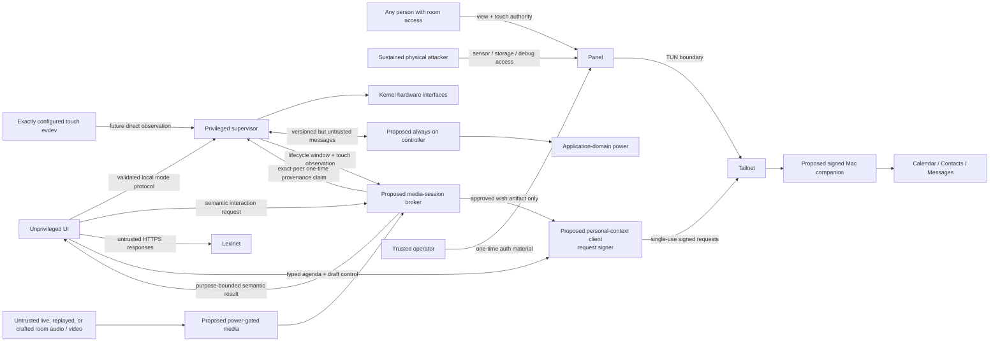

# Security and Trust Map

## One-paragraph model

The panel is a physically accessible, single-purpose tailnet node. The UI runs
without root privileges, and only the supervisor can write the discovered
backlight/suspend interfaces. Every evdev node starts root-only; a fail-closed
`mdev` classifier grants the UI's dedicated `bhp-touch` group access only when
exactly one device matches a root-provisioned nonempty `name` plus `phys` pair.
Both implemented PIR identities are hard-denied, and the UI is never placed in
the generic `input` group. A future presence implementation with another input
identity must extend and test that deny contract before deployment.
Tailscale supplies private routing and device identity, while Lexinet
independently authorizes its API. Lexinet implements that local native-TLS,
fresh-identity, scoped-authorization boundary; real Tailnet policy,
revocation/certificate evidence and panel packaging are still pending.
Provisioning credentials enter through an operator-controlled action and are
never baked into production images or logged. Physical theft is treated as
device compromise and handled by revoking
~~both identities~~ the Tailscale node, Lexinet credential, and companion
signing-key grant; this
design does not claim tamper resistance.

Microphone and camera support is proposed but not implemented. Their future
default is physically unpowered, with controls that do not depend solely on a
compromiseable UI process.

The current Buildroot scaffold still grants the vocabulary service raw access
to the exactly classified `bhp-touch` device. Accepted
[ADR 0005](../decisions/0005-validate-touch-provenance-at-capability-holders.md)
requires a future atomic cutover: the supervisor becomes the sole direct touch
reader and provenance issuer, forwards normalized input to `panel_ui`, and the
UI's raw node/group access is revoked. Until that packaging change and
on-target evidence exist, capability-holder touch validation is an accepted
target contract, not an implemented control.

ADR 0006 accepts the personal-agenda, spoken-command, and Lexinet product/safety
semantics described below, but those capabilities remain unimplemented.
Its additional trust boundary is a signed, logged-in-user Mac companion that
owns Apple/Google authorization, full recipient routes, local transcription,
and Messages automation. See the
[personal-agenda architecture](../architecture/personal-agenda-and-birthday-wishes.md).
The agenda feasibility plan's experiment-contract review and every live
Messages approval remain separate pending gates.

## Assets and boundaries

~~`PHYSICAL["Untrusted physical access"] -->|"touch / sensor / storage theft"|
DEVICE["Panel"]`~~

~~`ROOM["Untrusted room audio / video"] --> MEDIA["Proposed power-gated
media"]`~~

### Local and physical principals

| Principal | Capability at the boundary | Control or accepted limitation |
|---|---|---|
| Any person with room access | Can read the visible panel and supply physical touch, including Record and hold-to-submit for an already prepared, allowlisted birthday wish | **Accepted limitation:** room access plus a fresh operation-bound touch is sufficient human authorization. The panel does not identify the person and adds no second factor or extra touch friction. Recipient allowlisting, exact prepared-content preview, bounded attempts, and single-use touch provenance limit scope but do not distinguish a household member from a visitor or bystander. |
| Acoustic source able to reach the microphone | Can supply live speech, playback, crafted audible signals, or out-of-band injection that the microphone/front end may demodulate into an in-context command | Treat all acoustic input as unauthenticated. Voice cannot start capture, submit externally, control power, or illuminate the display; a voice-only first presentation stays provisional until a touch or rating bound to its active session, session item, immutable content revision, and render generation promotes it. A false rating remains append-only correctable. Real microphone/front-end resistance remains unproven until adversarial on-device qualification. |
| Attacker with sustained physical access and root-capable tools | Can read storage, replace software, use debug interfaces, or extract/exercise the panel-to-companion signing key | **Accepted prototype limitation:** no tamper resistance is claimed. Recovery revokes the Tailscale node, Lexinet credential, and companion public-key capability mapping. The companion still limits a stolen key to its provisioned typed capabilities; it does not make the key non-extractable. |

| Asset | Threat | Control | Accepted limitation |
|---|---|---|---|
| Tailscale node state | Image leak or diagnostic collection | Panel daemon state stays in a root-owned persistent location; Lexinet embedded-node state is pre-enrolled outside Git in a real effective-user-owned mode-`0700` directory; both are excluded from images/logs | Root or physical storage access can extract either identity |
| Lexinet authorization identity/credential | Tag/app-grant overreach or scoped-token exposure through a commit, CLI/process list, URL, or log | Preferred exact-singleton tagged-node identity plus connection-scoped app capability and Lexinet's local operation/profile ceiling; mutually exclusive scoped token uses an owner-only file and independent nonsecret subject UUID; native HTTPS, redaction, and per-request `WhoIs` | No hardware-backed identity or secret storage is assumed; real policy, revocation, and certificate evidence is pending |
| ~~Lexinet learning state~~ | ~~Unauthorized mutation/replay~~ | ~~Application auth, idempotency keys, server validation~~ | ~~Exact control waits for real API contract~~ |
| Lexinet learning state | Unauthorized mutation/replay | Implemented server application authorization, idempotency keys, strict validation, and a Tailnet route table limited to create/resume and sync; a voice-only first `presented` observation is session-local and provisional until a touch or accepted rating bound to the active session, session item, immutable content revision, and render generation promotes it into the durable outbox | Real Tailnet deployment evidence and the resilient panel outbox are pending; a voice rating accepts bounded false-recognition risk because the rating is visibly acknowledged and append-only correctable |
| ~~System power interfaces~~ | ~~UI compromise causing suspend loops~~ | ~~Privileged supervisor is sole writer; rate limits and state guards~~ | ~~Root compromise bypasses this boundary~~ |
| System power interfaces | UI compromise, PIR chatter, or repeated wake/suspend loops | Privileged supervisor is sole policy writer; it owns evidence-configured monotonic PIR debounce, attributed wake-rate ceilings/backoff, and suspend state guards while the presence provider reports only raw state/events and wake capability | Root compromise bypasses this boundary; the current Black driver calls `pm_wakeup_event` on every edge, and userspace cannot recover energy already spent on the edge that woke Linux; no production debounce/rate value exists before target evidence |
| Presentation readiness | Stale, replayed, cross-release, or forged page-flip acknowledgement exposes an old/bright frame | Implemented host protocol v2 and ADR 0007 bind appliance release, unpredictable supervisor session and connection challenge, sequence, snapshot digest, mode, render generation, and exact Unix peer UID; the privileged canonical socket adapter freezes one publish-time expectation, consumes one latest acknowledgement, and the final power owner revalidates the immutable tuple and generation continuity | The canonical adapter is inside the power-path TCB. A display-commit backend and target correlation evidence do not yet exist, so services remain disabled; a future compromised authorized `panel_ui` could lie about its own frame, which process isolation can bound but not eliminate |
| Household presence inference | Excessive logs, UI compromise, or remote disclosure | Store only current/transition diagnostics locally; exact unique touch grant; both project PIR names stay root-only | Device identity is not cryptographic, physical/root compromise bypasses it, and any new presence-provider name must extend the tested deny list |
| Calendar titles, locations, birthdays, and names | Screen disclosure, excessive synchronization, or storage theft | Planned: content-free capability discovery before consent; local opt-in and grants; selected calendars/provisioned contacts only; daytime display; bounded Today projection/cache; private-event policy; visible freshness | macOS grants remain broad and a compromised companion or logged-in user can read beyond the adapter's logical boundary; intended room occupants can see a lit panel |
| Provider OAuth tokens and full contact/message routes | Theft from the physically accessible panel | Planned: Mac Keychain and companion-only routing; panel receives opaque people and masked destinations | Compromise of the logged-in Mac user bypasses this boundary |
| Panel-to-companion signing key | Sustained physical/root access extracts or exercises the key and impersonates the panel to the Mac companion | Planned: root-provisioned owner-only key readable only by `personal_context_client`; fixed typed local operations; companion-issued single-use challenges; capability-mapped public key; explicit revocation | No encrypted or hardware-bound key storage is assumed. Physical loss requires revoking the companion key grant as well as the Tailscale and Lexinet identities |
| ~~Raw audio, images, and unrestricted transcripts~~ | ~~Silent collection, accidental logging, or tailnet exfiltration~~ | ~~Planned: media rails default off; purpose-bound broker sessions; command audio is never transmitted; a voice wish command only opens the composer; `bounded_learning_observation` navigation may append idempotent non-mastery `presented`/`revealed` facts, while ratings are visibly acknowledged and append-only correctable by touch Undo; the broker opens capture only from single-use supervisor-observed touch provenance bound to its exact lease request; hardware indicator/mute~~ | ~~No media broker, touch-provenance flow, or rail control is implemented;~~ ~~compromised UI can simulate allowed capture while its lease is active~~ ~~a compromised UI cannot mint provenance but can misuse a genuine touch on a misrepresented frame; root/physical compromise bypasses policy~~ |
| Raw audio, images, and unrestricted transcripts | Silent collection, accidental logging, crash-dump retention, or tailnet exfiltration | Planned: media rails default off; purpose-bound broker sessions and memory arenas; command audio is never transmitted; a voice wish command only opens the composer; `bounded_learning_observation` voice-only first presentation/reveal state remains local and provisional, while ratings are visibly acknowledged and append-only correctable by touch Undo; the broker opens capture only from single-use supervisor-observed touch provenance bound to its exact lease request; hardware indicator/mute; swap and core dumps disabled | No media broker, touch-provenance flow, or rail control is implemented; ~~compromised UI can simulate allowed capture while its lease is active~~ a compromised UI cannot mint provenance but can misuse a genuine touch on a misrepresented frame; root/physical compromise bypasses policy |
| Spoken-command vocabulary and recognizer output | Near-homophones, phrase containment, context leakage, artifact/policy mismatch, or acoustic substitution triggers the wrong semantic action | Planned: one reviewed language-tagged catalog; pronunciation provenance; deterministic pair analysis; hard effect-class admission excluding capture start/submission/power/illumination; content-addressed active command sets and backend projections; schema-validated canonical recognition-policy artifacts bound to backend/model identities and verified by the broker; the complete identity chain in each voice intent; abstention; visible acknowledgement; touch fallback and append-only rating correction; single-use held-out selection plus untouched confirmation evidence before enabling a real engine | Static phonetic distance is not a probability or a safety proof; actual microphones, speakers, noise, accents, and recognizer builds remain unproven until on-device evidence exists |
| Adversarial acoustic command integrity | Replay or loudspeaker injection, crafted/psychoacoustic audible audio, ultrasonic or near-ultrasonic carrier injection, or structure-borne out-of-band energy induces a valid-looking command | Treat microphone input as unauthenticated; enforce effect-class limits after recognition; keep voice-originated first `presented`/dependent `revealed` state provisional; qualify the exact microphone, analog front end, ADC, enclosure, recognizer, and policy against each class; use input filtering only after measured evidence | No speaker identity or liveness proof is claimed. Inaudibility to a nearby person is not rejection evidence, and the current prototype has no adversarial-acoustic qualification |
| Birthday-wish body/audio and Messages authority | False activation, wrong recipient, replay, duplicate submission, or hidden retention | Planned: allowlisted current-birthday route; broker-validated supervisor touch before capture; personal-context-client validation of supervisor-authored provenance and observer-measured qualifying hold before submit; single-use signed request; atomic dispatch barrier; daily attempt bound; local STT; playback-gated audio; 30-minute Mac content ceiling; deterministic terminal deletion; and 30-day non-content attempt-metadata ceiling | Messages semantics are unproven; ~~compromised `panel_ui` can fabricate touch-level allowed requests~~ a compromised UI can misrepresent pixels around a genuine bound touch but cannot author provenance; root can use the device key |
| Microphone/camera activation state | Compromised UI falsifies software indicator or mute | Planned: physical mic mute removes bias/clock/power; camera indicator is tied to its rail; mechanical shutter preferred | Prototype USB devices may not expose a separately switchable rail; controls remain unproven |
| Always-on controller availability and authority | Wake storm drains battery, stale Linux state controls output, or controller fault prevents boot | Planned: bounded sequenced protocol, independent safety ceilings, watchdog, boot backoff, reset reconciliation, authenticated A/B update | No controller, protocol, bootloader, or secure update path is implemented |
| eMMC durability | Corruption or wear | No implemented control yet; read-only root and a bounded writable data partition are planned evidence gates | Current writable-root prototype remains exposed to abrupt-power-loss corruption and wear |

## Future media privacy posture

- Start voice with touch/push-to-talk or explicitly presence-gated capture;
  continuous listening is not a default.
- The unprivileged UI never owns raw ALSA/V4L2 nodes, microphone/camera rail
  GPIOs, or a general media group. A narrow broker grants a purpose, duration,
  and bounded semantic result under supervisor authorization.
- Under accepted ADR 0005, the UI also loses raw touch-evdev access at cutover.
  The supervisor forwards normalized events and observer-measured contact
  duration, while the broker and personal-context client claim one observation
  under two distinct exact service UIDs checked with `SO_PEERCRED`. Each holder
  reciprocally validates the supervisor UID and root-owned socket identity.
  Version/session/sequence mismatch, replay, disconnect, or supervisor restart
  closes broker media windows/leases and invalidates unclaimed observations or
  in-flight claims. It does not revoke an already-issued personal-context
  confirmation token; that client has no lifecycle subscription.
- A physical microphone mute removes the microphone's power, clock, or bias.
- Camera and microphone power indicators are coupled to hardware rails rather
  than controlled only by application software.
- Include a mechanical camera shutter where enclosure geometry permits.
- Keep only the minimum volatile ring buffer needed for voice activity or a
  separately approved future low-power wake-word capability; discard non-trigger
  audio. `Lexi` is only an invocation prefix while Linux is already listening.
- Persist transcripts or gesture events only when the product feature needs
  them, and never log raw audio/video.
- Do not send raw media to the tailnet without an explicit consent, service,
  authorization, and retention decision.
- Treat command recognition and birthday-wish recording as distinct capture
  purposes. Command-listening audio never leaves the broker. A wish artifact
  begins only after the composer is visible and the user affirmatively touches
  Record, has fixed duration/size/destination bounds, and is erased after
  acknowledged upload or cancellation. Mac-side content is separately capped
  at 30 minutes and deleted earlier on cancellation, terminal failure, handoff
  outcome (including `delivery_unknown`), expiry, or crash recovery.
- During `wish_recording`, do not lease the general command-recognition
  projection.
  ~~A purpose-internal, content-addressed stop-only projection may consume the
  same stream solely to halt capture; it cannot activate another intent or
  submit the artifact.~~
  A purpose-internal, content-addressed stop-only projection may consume the
  same stream solely to halt capture. Its detector emits only a boolean plus
  monotonic observation timestamp to broker-local logic—no transcript, token,
  score, embedding, or audio excerpt—and the broker alone maps `true` to
  `agenda.stop_wish_recording`. Recording and detector scratch share one
  `wish_recording`-scoped arena that is never shared with command recognition
  and is explicitly wiped on every quiesce path. A valid stop trims and copies
  only the bounded finalized artifact into a distinct purpose-bound draft buffer
  before that wipe; cancellation, failure, lifecycle closure, expiry, or
  quiesce wipes both buffers and promotes nothing. The broker and any capture
  worker run with swap and core dumps disabled.
- A broker quiesce acknowledgement is telemetry, not proof. The supervisor
  blanks immediately when lifecycle policy requires it; blanking never waits
  for media. Before writing the suspend state, the supervisor independently
  verifies a kernel-observable capture owner/device closure and, where present,
  microphone-rail-off state. If the selected platform exposes no independent
  observation, media enablement fails its evidence gate. A runtime mismatch or
  deadline expiry takes the bounded broker-termination/media-off path; the
  supervisor never accepts broker self-report as quiescence or lets media delay
  the suspend request indefinitely.

See [proposed power-domain architecture](../architecture/power-domain-architecture.md)
for the rail-level enforcement model.

## Future MCU/Linux boundary

Linux is not trusted to keep itself powered honestly. `ready`, heartbeat,
shutdown, and night-light lease messages are bounded inputs to the MCU rather
than authority to bypass battery, thermal, boot-time, awake-time, or wake-rate
ceilings. Messages carry a protocol version, boot epoch, monotonic sequence,
bounded payload, and acknowledgement; reset reconciliation rejects stale state.

The supervisor remains the sole product-policy owner. The MCU does not compute
solar mode, presence grace, or ordinary display policy. It executes only an
unexpired supervisor-issued lease and otherwise fails with optional outputs
off. The controller independently owns hard liveness and battery-safety
ceilings. A checksum detects corruption but cannot make compromised Linux
trustworthy.

A stuck or chattering sensor can drain the battery after a successful boot, not
only by creating repeated wakes. Product acceptance therefore requires a
maximum awake/energy lease, fault detection, degraded display/media-off state,
and physical recovery path. These controls are not present in the Black
prototype.

On the current Black path, `panel_supervisor` owns the configured monotonic
debounce interval, attributed wake-rate ceiling, and backoff response. The
presence source reports ordered evidence and wake capability only; it neither
chooses nor applies product-policy parameters. The current custom driver has no
ceiling and calls `pm_wakeup_event` on every edge. Supervisor
filtering after resume can prevent repeated product actions and resuspend churn,
but it cannot undo the energy cost of the kernel edge that already woke Linux.
Production values and any pre-suspend kernel/hardware gate require on-target
evidence and have no default here.

## Tailnet policy intention

- Give the panel one deployment-selected dedicated singleton tag, not a reusable
  human identity or a guessed repository default.
- For Lexinet, grant that exact source only TCP 443 to the exact Lexinet node and
  attach the controlled-domain study app capability for only
  `create_or_resume`/`sync` and configured profile references. Lexinet enforces
  the same operation/profile ceiling locally and exposes no Tailnet GET,
  operator, health/version, or vocabulary route.
- Permit only DNS/time dependencies and the exact Lexinet and approved Mac
  companion hosts/ports needed.
- Use a short-lived, ephemeral, or one-time provisioning key as supported by the deployment; never commit it.
- Prefer normal kernel TUN mode. Userspace proxy mode is an experiment only if `/dev/net/tun` cannot be supported.
- ~~Revoke the Tailscale node and Lexinet credential after loss or re-imaging.~~
  Revoke the Tailscale node, Lexinet tag/app grant or scoped-token authority,
  and companion public-key capability mapping after loss or re-imaging.

| Principal | Permitted egress | Explicitly absent by default |
|---|---|---|
| Vocabulary/Lexinet client | Exact Lexinet identity, host, port, and API scope | Arbitrary tailnet peers, raw media destinations |
| Personal-context client (proposed) | Exact Mac companion identity, root-provisioned device signer, and separate agenda-read, wish-prepare, transcribe, and submit operations | Provider credentials, arbitrary contacts, calendar writes, recipient handles, stale send queue, arbitrary URLs |
| Time/network service | Configured DNS and time endpoints | Lexinet mutation and media access |
| Update agent (future) | Pinned update metadata/artifact origin | General web browsing or Lexinet credentials |
| Model provisioning (future) | Offline signed bundle or separately approved pinned origin | Runtime arbitrary model download |
| Remote STT (disabled) | None | Raw-audio network access; enabling requires a separate decision, capture indication, allowlist, size bound, and retention contract |

Tailscale supplies private transport, not complete application authorization.
At Lexinet HEAD `ce42272df315f357e10998dd48e9ffd1a935c2ff`, the server-side
local boundary uses native `ListenTLS` on fixed port 443, fresh per-request
`WhoIs`, a separate create/resume-and-sync router, exact node-capability or
mutually exclusive scoped-token mode, and structured fail-closed errors. The
passing synthetic `ListenTLS` failure proves wrapper cleanup, not real
certificate issuance or validation. Real tagged/untagged/wrong-extra-tag,
live-revocation, destructive/cross-profile, MagicDNS/hostname/handshake and
invalid-certificate evidence remain pending, along with the panel choice of a
SHA-256-pinned official ARM Tailscale package or approved pinned source-build
toolchain.

The companion must reject forged Serve headers and require a provisioned panel
signature over a single-use server challenge and canonical request. The UI and
broker use a narrow typed local client rather than a general-purpose companion
socket or the private signing key. ~~This blocks ordinary same-user Mac
processes from borrowing the companion's TCC grants, but it does not prove
touch: a compromised authorized UI can still request the allowlisted operations
exposed to it.~~ This blocks ordinary same-user Mac processes from borrowing the
companion's TCC grants. The personal-context client additionally refuses
dispatch unless the confirmation token contains fresh, single-use,
supervisor-authored touch provenance and an observer-measured qualifying hold
bound to the exact prepared revision. A compromised UI can still misrepresent
what it displayed around a genuine touch.

## Power-state data exposure

| State | Sensitive material still exposed | Required posture |
|---|---|---|
| ~~Active / dark idle~~ | ~~Credentials, UI state, bounded agenda cache, and any active media buffer in RAM and storage~~ | ~~Least-privilege processes, minimum personal-data projection, bounded buffers, no raw-media logs~~ |
| Active / dark idle | Credentials including the companion signing key, UI state, bounded agenda cache, and any active media buffer in RAM and storage | Least-privilege processes, minimum personal-data projection, bounded purpose arenas, no raw-media logs or core dumps |
| ~~Suspend-to-RAM~~ | ~~The same RAM material is retained even though networking/media rails are off~~ | ~~Wipe media buffers before suspend; disable swap/core dumps for credential/media processes~~ |
| Suspend-to-RAM | The same RAM material is retained even though networking/media rails are off | Supervisor-verifiable capture closure; wipe purpose-scoped media arenas before suspend; disable swap/core dumps for credential/media processes |
| ~~Application-domain-off~~ | ~~RAM residency ends, but Wi-Fi, Tailscale, Lexinet, cached cards, bounded agenda snapshot, and queued reviews remain on storage~~ | ~~Narrow revocable credentials; hard agenda expiry; test node revocation; do not describe power-off as erasure~~ |
| Application-domain-off | RAM residency ends, but Wi-Fi, Tailscale, Lexinet, companion signing key, cached cards, bounded agenda snapshot, and queued reviews remain on storage | Narrow revocable credentials; hard agenda expiry; test all three identity-revocation paths; do not describe power-off as erasure |

~~The prototype accepts physical theft as device compromise. A later requirement
to resist opportunistic storage theft implies verified boot plus encrypted
sensitive storage or hardware-bound credentials.~~

The prototype accepts physical theft as compromise of the node, Lexinet client,
and companion-signing principal. Loss response must revoke all three; revoking
only the vocabulary-panel identities leaves the stolen companion key useful. A
later requirement to resist opportunistic storage theft implies verified boot
plus encrypted sensitive storage or hardware-bound credentials.

## Update interruption posture

Production Linux and MCU updates require separate signed manifests, independent
signature verification, anti-rollback state, immutable A/B slots, boot
confirmation, recovery images, and charger-plus-energy-reserve gates. The MCU
honors a bounded update lease against an ordinary watchdog cut, while analog
battery safety retains priority. Power-loss tests interrupt every update phase
on sacrificial media. None of these controls is claimed by the current
prototype.

## Base-image access posture

The checked-in production Buildroot defconfig disables password-based root
login and does not select an SSH server. Its wired `eth0` DHCP client, Chrony
client, and unprovisioned Tailscale daemon are outbound/client-side building
blocks, not an administrative backdoor. A separate, visibly non-production
bring-up defconfig provides root public-key-only Dropbear using exactly one
caller-supplied Ed25519 public key; password authentication remains disabled,
and the production release gate rejects that profile. Signed update/rollback
remains unresolved. Never weaken the canonical production defconfig merely to
make iteration convenient.

## Diagnostics policy

Structured logs include UTC timestamp, level, service, message, trace ID, error
code, and non-secret hardware state. They exclude auth headers, credential
files, URLs containing user info, full vocabulary payloads, names, recipient
handles, calendar titles/locations, message bodies, content hashes, transcripts,
audio, Wi-Fi configuration, and raw shell history. Diagnostic collection
scripts list every included path and redact before archive creation.

## Explicitly out of scope

- ~~Protection from an attacker with sustained physical access and root-capable
  hardware tools.~~ Resistance to an attacker with sustained physical access and root-capable
  hardware tools. This attacker can extract or exercise the companion signing
  key as well as the Tailscale and Lexinet credentials; explicit revocation and
  companion capability bounds are recovery controls, not tamper resistance.
- Secure boot, encrypted root filesystem, remote attestation, or a hardware secure element in the first prototype.
- Protecting public application binaries or non-sensitive display configuration.

These are honest prototype boundaries, not permanent prohibitions. The
personal-agenda work must revisit storage protection before it persists more
than the minimized bounded snapshot or enables reboot-surviving drafts.

**Amended 2026-08-07:** replaced the proposed UI-authored touch limitation for
capture and Messages dispatch with ADR 0005's supervisor-observed,
capability-holder-validated provenance boundary. The text explicitly preserves
the current raw-touch scaffold as not yet migrated, makes no hardware claim,
and does not preempt the broader threat-model review planned for Step 14.

**Amended 2026-08-08:** added room occupants, adversarial acoustic sources, and
sustained physical attackers as principals; recorded room access plus touch and
the absence of a second factor as an accepted limitation; made voice-only first
presentation provisional; included the companion signing key in physical-loss
scope; tightened the `wish_recording` arena-to-draft handoff and quiescence
requirements; and assigned unmeasured PIR debounce and wake-rate policy to the
supervisor. No pending product-decision status or roadmap step changed.

**Amended 2026-08-16:** reconciled the trust map with ADR 0006 acceptance of the
Lexinet, voice, and agenda product/safety semantics. Every listed planned
control, agenda-feasibility stop, live external-effect approval, and hardware
evidence gate remains unimplemented or pending as stated.

**Amended 2026-08-17:** recorded clean Lexinet HEAD
`ce42272df315f357e10998dd48e9ffd1a935c2ff`. Its local native-TLS,
fresh-`WhoIs`, separate create/resume-and-sync route boundary and scoped
node-capability/token authorization are implemented, and Verification Item 1 is
recorded. Synthetic listener-failure cleanup is not real Item 4 certificate
proof. Tagged, untagged, wrong/extra-tag, live-revocation,
destructive/cross-profile, certificate issuance, MagicDNS/hostname/handshake,
invalid-certificate behavior, and panel Tailscale packaging remain pending.
The `study.v1` contract provenance and roadmap checkboxes are unchanged; Step 5
stays unchecked.

**Amended 2026-09-26:** ADR 0010 selects node-capability panel authentication,
so no study credential is stored on the physically accessible panel, and pins
the official Tailscale `1.102.2` arm64 archive by SHA-256. Tailnet node state
remains an identity-bearing secret outside the image. Real Tailnet evidence
remains pending.
