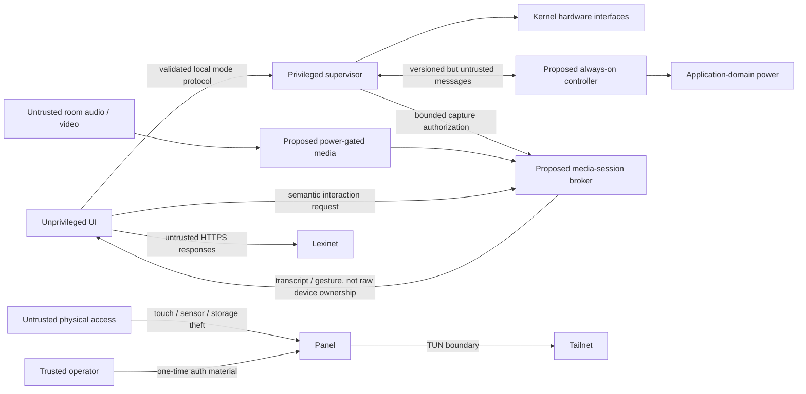

# Security and Trust Map

## One-paragraph model

The panel is a physically accessible, single-purpose tailnet node. The UI runs
without root privileges, and only the supervisor can write the discovered
backlight/suspend interfaces. Every evdev node starts root-only; a fail-closed
`mdev` classifier grants the UI's dedicated `bhp-touch` group access only when
exactly one device matches a root-provisioned nonempty `name` plus `phys` pair.
Both implemented PIR identities are hard-denied, and the UI is never placed in
the generic `input` group. A future presence implementation with another input
identity must extend and test that deny contract before deployment.
Tailscale supplies private routing and device identity, while Lexinet
independently authorizes its API. Provisioning credentials enter through an
operator-controlled action and are never baked into production images or
logged. Physical theft is treated as device compromise and handled by revoking
both identities; this design does not claim tamper resistance.

Microphone and camera support is proposed but not implemented. Their future
default is physically unpowered, with controls that do not depend solely on a
compromiseable UI process.

## Assets and boundaries

| Asset | Threat | Control | Accepted limitation |
|---|---|---|---|
| Tailscale node state | Image leak or diagnostic collection | Separate writable directory, `0600`, excluded from images/logs | Root or physical storage access can extract it |
| Lexinet credential | Commit, CLI/process-list, URL, or log exposure | Provisioned file, redaction, HTTPS, narrow service permission | No hardware-backed secret storage assumed |
| Lexinet learning state | Unauthorized mutation/replay | Application auth, idempotency keys, server validation | Exact control waits for real API contract |
| System power interfaces | UI compromise causing suspend loops | Privileged supervisor is sole writer; rate limits and state guards | Root compromise bypasses this boundary |
| Household presence inference | Excessive logs, UI compromise, or remote disclosure | Store only current/transition diagnostics locally; exact unique touch grant; both project PIR names stay root-only | Device identity is not cryptographic, physical/root compromise bypasses it, and any new presence-provider name must extend the tested deny list |
| Raw audio, images, and unrestricted transcripts | Silent collection, accidental logging, or tailnet exfiltration | Planned: media rails default off; bounded broker sessions; no raw-media persistence/transmission by default; explicit feature and retention decision required | No media broker or rail control is implemented; root/physical compromise bypasses software policy |
| Microphone/camera activation state | Compromised UI falsifies software indicator or mute | Planned: physical mic mute removes bias/clock/power; camera indicator is tied to its rail; mechanical shutter preferred | Prototype USB devices may not expose a separately switchable rail; controls remain unproven |
| Always-on controller availability and authority | Wake storm drains battery, stale Linux state controls output, or controller fault prevents boot | Planned: bounded sequenced protocol, independent safety ceilings, watchdog, boot backoff, reset reconciliation, authenticated A/B update | No controller, protocol, bootloader, or secure update path is implemented |
| eMMC durability | Corruption or wear | No implemented control yet; read-only root and a bounded writable data partition are planned evidence gates | Current writable-root prototype remains exposed to abrupt-power-loss corruption and wear |

## Future media privacy posture

- Start voice with touch/push-to-talk or explicitly presence-gated capture;
  continuous listening is not a default.
- The unprivileged UI never owns raw ALSA/V4L2 nodes, microphone/camera rail
  GPIOs, or a general media group. A narrow broker grants a purpose, duration,
  and bounded semantic result under supervisor authorization.
- A physical microphone mute removes the microphone's power, clock, or bias.
- Camera and microphone power indicators are coupled to hardware rails rather
  than controlled only by application software.
- Include a mechanical camera shutter where enclosure geometry permits.
- Keep only the minimum volatile ring buffer needed for voice activity or an
  approved wake word; discard non-trigger audio.
- Persist transcripts or gesture events only when the product feature needs
  them, and never log raw audio/video.
- Do not send raw media to the tailnet without an explicit consent, service,
  authorization, and retention decision.

See [proposed power-domain architecture](../architecture/power-domain-architecture.md)
for the rail-level enforcement model.

## Future MCU/Linux boundary

Linux is not trusted to keep itself powered honestly. `ready`, heartbeat,
shutdown, and night-light lease messages are bounded inputs to the MCU rather
than authority to bypass battery, thermal, boot-time, awake-time, or wake-rate
ceilings. Messages carry a protocol version, boot epoch, monotonic sequence,
bounded payload, and acknowledgement; reset reconciliation rejects stale state.

The supervisor remains the sole product-policy owner. The MCU does not compute
solar mode, presence grace, or ordinary display policy. It executes only an
unexpired supervisor-issued lease and otherwise fails with optional outputs
off. The controller independently owns hard liveness and battery-safety
ceilings. A checksum detects corruption but cannot make compromised Linux
trustworthy.

A stuck or chattering sensor can drain the battery after a successful boot, not
only by creating repeated wakes. Product acceptance therefore requires a
maximum awake/energy lease, fault detection, degraded display/media-off state,
and physical recovery path. These controls are not present in the Black
prototype.

## Tailnet policy intention

- Give the panel a dedicated tag, not a reusable human identity.
- Permit only DNS/time dependencies and the exact Lexinet host/port needed.
- Use a short-lived, ephemeral, or one-time provisioning key as supported by the deployment; never commit it.
- Prefer normal kernel TUN mode. Userspace proxy mode is an experiment only if `/dev/net/tun` cannot be supported.
- Revoke the Tailscale node and Lexinet credential after loss or re-imaging.

| Principal | Permitted egress | Explicitly absent by default |
|---|---|---|
| Vocabulary/Lexinet client | Exact Lexinet identity, host, port, and API scope | Arbitrary tailnet peers, raw media destinations |
| Time/network service | Configured DNS and time endpoints | Lexinet mutation and media access |
| Update agent (future) | Pinned update metadata/artifact origin | General web browsing or Lexinet credentials |
| Model provisioning (future) | Offline signed bundle or separately approved pinned origin | Runtime arbitrary model download |
| Remote STT (disabled) | None | Raw-audio network access; enabling requires a separate decision, capture indication, allowlist, size bound, and retention contract |

Tailscale supplies private transport, not application authorization. The UI
must not receive a general-purpose tailnet socket capability merely because it
needs one Lexinet client.

## Power-state data exposure

| State | Sensitive material still exposed | Required posture |
|---|---|---|
| Active / dark idle | Credentials, UI state, and any active media buffer in RAM and storage | Least-privilege processes, bounded buffers, no raw-media logs |
| Suspend-to-RAM | The same RAM material is retained even though networking/media rails are off | Wipe media buffers before suspend; disable swap/core dumps for credential/media processes |
| Application-domain-off | RAM residency ends, but Wi-Fi, Tailscale, Lexinet, cached cards, and queued reviews remain on storage | Narrow revocable credentials; test node revocation; do not describe power-off as erasure |

The prototype accepts physical theft as device compromise. A later requirement
to resist opportunistic storage theft implies verified boot plus encrypted
sensitive storage or hardware-bound credentials.

## Update interruption posture

Production Linux and MCU updates require separate signed manifests, independent
signature verification, anti-rollback state, immutable A/B slots, boot
confirmation, recovery images, and charger-plus-energy-reserve gates. The MCU
honors a bounded update lease against an ordinary watchdog cut, while analog
battery safety retains priority. Power-loss tests interrupt every update phase
on sacrificial media. None of these controls is claimed by the current
prototype.

## Base-image access posture

The checked-in production Buildroot defconfig disables password-based root
login and does not select an SSH server. Its wired `eth0` DHCP client, Chrony
client, and unprovisioned Tailscale daemon are outbound/client-side building
blocks, not an administrative backdoor. A separate, visibly non-production
bring-up defconfig provides root public-key-only Dropbear using exactly one
caller-supplied Ed25519 public key; password authentication remains disabled,
and the production release gate rejects that profile. Signed update/rollback
remains unresolved. Never weaken the canonical production defconfig merely to
make iteration convenient.

## Diagnostics policy

Structured logs include UTC timestamp, level, service, message, trace ID, error code, and non-secret hardware state. They exclude auth headers, credential files, URLs containing user info, full vocabulary payloads, Wi-Fi configuration, and raw shell history. Diagnostic collection scripts list every included path and redact before archive creation.

## Explicitly out of scope

- Protection from an attacker with sustained physical access and root-capable hardware tools.
- Secure boot, encrypted root filesystem, remote attestation, or a hardware secure element in the first prototype.
- Protecting public application binaries or non-sensitive display configuration.

These are honest prototype boundaries, not permanent prohibitions. Revisit them if the panel stores sensitive household data or becomes remotely managed at scale.
