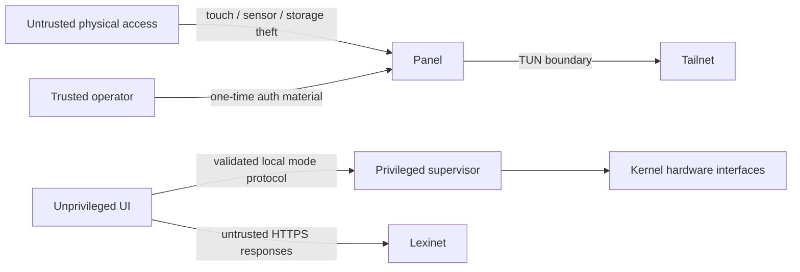

# Security and Trust Map

## One-paragraph model

The panel is a physically accessible, single-purpose tailnet node. The UI runs
without root privileges, and only the supervisor can write the discovered
backlight/suspend interfaces. Every evdev node starts root-only; a fail-closed
`mdev` classifier grants the UI's dedicated `bhp-touch` group access only when
exactly one device matches a root-provisioned nonempty `name` plus `phys` pair.
Both implemented PIR identities are hard-denied, and the UI is never placed in
the generic `input` group. A future presence implementation with another input
identity must extend and test that deny contract before deployment.
Tailscale supplies private routing and device identity, while Lexinet
independently authorizes its API. Provisioning credentials enter through an
operator-controlled action and are never baked into production images or
logged. Physical theft is treated as device compromise and handled by revoking
both identities; this design does not claim tamper resistance.

## Assets and boundaries

| Asset | Threat | Control | Accepted limitation |
|---|---|---|---|
| Tailscale node state | Image leak or diagnostic collection | Separate writable directory, `0600`, excluded from images/logs | Root or physical storage access can extract it |
| Lexinet credential | Commit, CLI/process-list, URL, or log exposure | Provisioned file, redaction, HTTPS, narrow service permission | No hardware-backed secret storage assumed |
| Lexinet learning state | Unauthorized mutation/replay | Application auth, idempotency keys, server validation | Exact control waits for real API contract |
| System power interfaces | UI compromise causing suspend loops | Privileged supervisor is sole writer; rate limits and state guards | Root compromise bypasses this boundary |
| Household presence inference | Excessive logs, UI compromise, or remote disclosure | Store only current/transition diagnostics locally; exact unique touch grant; both project PIR names stay root-only | Device identity is not cryptographic, physical/root compromise bypasses it, and any new presence-provider name must extend the tested deny list |
| eMMC durability | Corruption or wear | No implemented control yet; read-only root and a bounded writable data partition are planned evidence gates | Current writable-root prototype remains exposed to abrupt-power-loss corruption and wear |

## Tailnet policy intention

- Give the panel a dedicated tag, not a reusable human identity.
- Permit only DNS/time dependencies and the exact Lexinet host/port needed.
- Use a short-lived, ephemeral, or one-time provisioning key as supported by the deployment; never commit it.
- Prefer normal kernel TUN mode. Userspace proxy mode is an experiment only if `/dev/net/tun` cannot be supported.
- Revoke the Tailscale node and Lexinet credential after loss or re-imaging.

## Base-image access posture

The checked-in production Buildroot defconfig disables password-based root
login and does not select an SSH server. Its wired `eth0` DHCP client, Chrony
client, and unprovisioned Tailscale daemon are outbound/client-side building
blocks, not an administrative backdoor. A separate, visibly non-production
bring-up defconfig provides root public-key-only Dropbear using exactly one
caller-supplied Ed25519 public key; password authentication remains disabled,
and the production release gate rejects that profile. Signed update/rollback
remains unresolved. Never weaken the canonical production defconfig merely to
make iteration convenient.

## Diagnostics policy

Structured logs include UTC timestamp, level, service, message, trace ID, error code, and non-secret hardware state. They exclude auth headers, credential files, URLs containing user info, full vocabulary payloads, Wi-Fi configuration, and raw shell history. Diagnostic collection scripts list every included path and redact before archive creation.

## Explicitly out of scope

- Protection from an attacker with sustained physical access and root-capable hardware tools.
- Secure boot, encrypted root filesystem, remote attestation, or a hardware secure element in the first prototype.
- Protecting public application binaries or non-sensitive display configuration.

These are honest prototype boundaries, not permanent prohibitions. Revisit them if the panel stores sensitive household data or becomes remotely managed at scale.
