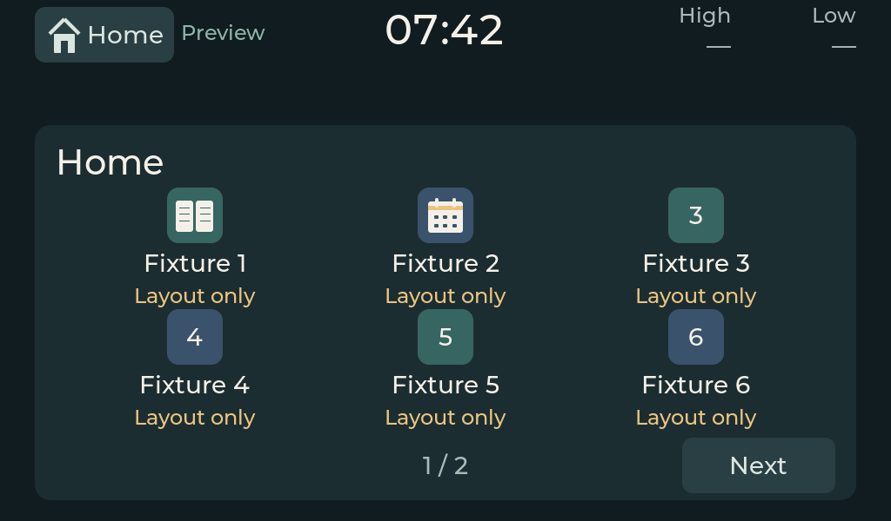
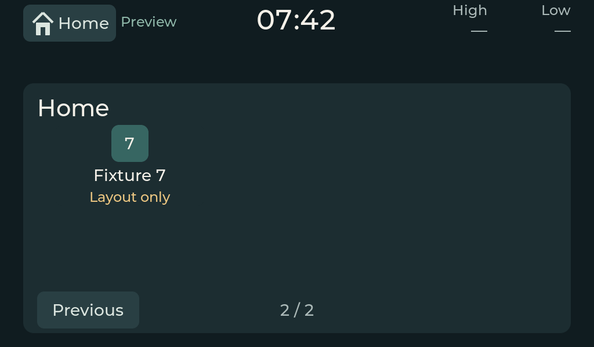

# Configurable Home grid validation

This follow-up preserves the approved Home presentation and makes its app tiles
configuration-driven. See the [plan](../../.claude/plans/2026-09-26-configurable-app-grid.md)
and [extension guide](../../panel_ui/README.md#configuring-and-extending-home).
The startup catalog controls order, visibility, labels, icon style/color and
1–4 columns by 1–2 rows. Overflow creates pages; returning Home retains the page.
New implemented features register canonical navigation destinations and add
catalog metadata without changing the Home renderer.

## Review examples

The [seven-entry fixture](../../simulator/tests/fixtures/application_grid/seven_apps.json)
contains layout-only aliases of the existing study and Agenda surfaces. These
are not seven implemented applications. Its first two entries exercise scalable
book/calendar icons; the others use monograms. The default catalog remains
Lexinet and the Agenda preview.

## Verification

The accompanying [status record](configurable-app-grid-validation.json) records
completed checks. Unit coverage includes every supported grid shape, counts up
to the 64-entry limit, hidden/reordered/empty catalogs, invalid metadata/routes,
real rendered font/icon fit, pagination, study preservation, voice exclusion
and lifecycle gating. Existing screen baselines were not changed.

The native gate compares all 43 baseline screens and two alternate-catalog pages.
The Linux guest gate temporarily installs that catalog, exercises Next, app
launch, Home and Previous through actual supervisor-observed touch and requires
fresh DRM commits. It restores the exact prior catalog in a `finally` block.
Guest default-screen comparisons retain the existing semantic checks for grace
and untrusted time; all other comparisons remain pixel-exact.

The Mac window was visually inspected after relaunch. No fresh native coordinate
click proof is claimed because that automation remains unavailable. Host/guest
results are simulation evidence only. Household civil time, live weather and
physical FRDM bring-up remain outside this change. Optional cross-toolchain,
Buildroot and kernel-source checks retain their explicit unavailable/skipped
status; the provisioned Linux ARM64 guest was compiled and tested natively.
