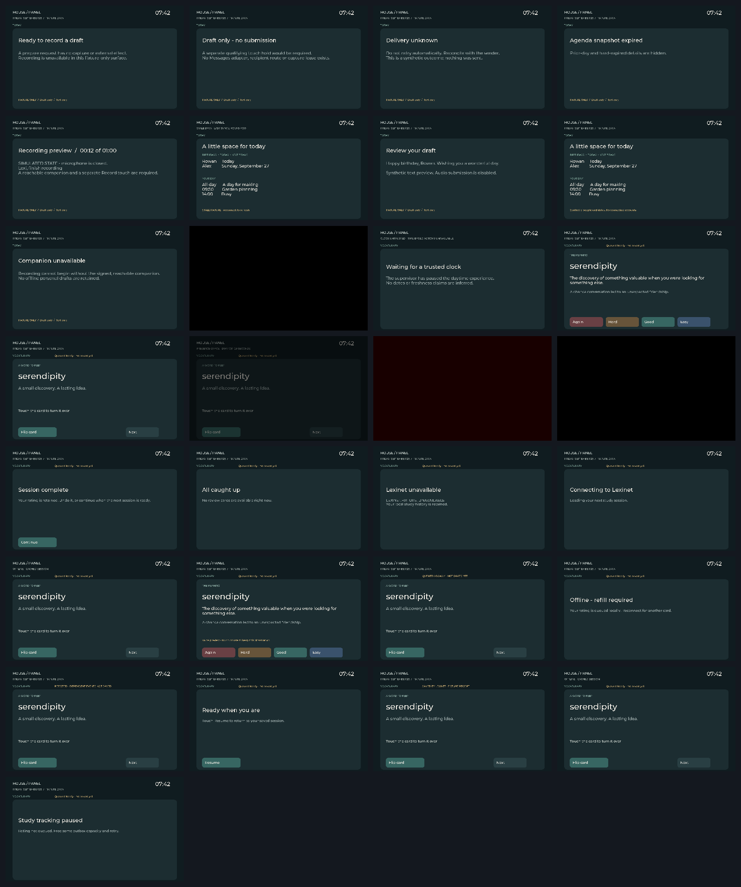
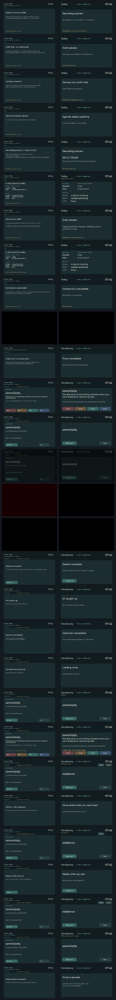

# Golden display baselines

Initial baseline: **2026-09-25**. Before: no shared LVGL golden image suite existed.
After: the same 29 scenarios render through `panel_ui::LvglPanelDisplay` and its
subordinate vocabulary renderer at 1024×600. These are synthetic fixtures.

`manifest.json` fixes the scenario inventory, dimensions and exact pixel budget
(channel tolerance 0; changed pixels 0). `make verify` rerenders and compares it.
On mismatch, `.build/screenshots/` receives the actual, pink-highlighted diff,
and structured report. No display, animation timing or platform fonts are used.

To change a baseline intentionally, run `make update-panel-goldens`, inspect the
before/after files under `.build/screenshots/review/`, and commit review images
with the changed goldens and a reason. Updates are staged only after every
scenario renders successfully. Never relax tolerance to conceal a layout change.

**Amended 2026-09-25:** established the initial reviewed baseline. No image is
physical display or FRDM evidence.

**Amended 2026-09-25 (approved UI review):** the user approved all seven visual
changes before implementation. The project font, larger type, aligned grid,
quiet truthful status, product copy and dim red night clock now replace the
initial layout. Delivery fixtures exercise actual memory-only reducer receipts;
their displayed successor and Undo state are intentional. Durable stores cannot
receive synthetic delivery receipts.

The [review manifest](review/pre-board-before-after.json) gives the row order;
the left images are from `effffd4`, and the right images correspond to these
baselines. Both blank and display-failure screens remain completely black.
All 29 scenarios retain exact pixel comparison with zero tolerance.
